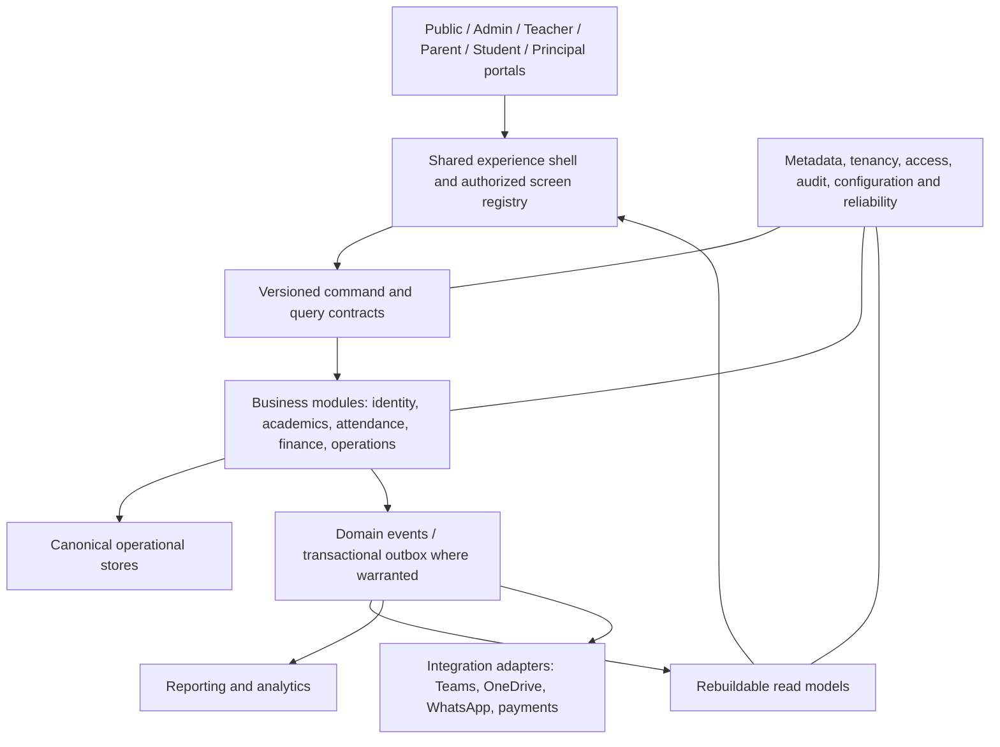

# Tiny Steps School OS v2 — Enterprise Architecture & Progressive Implementation Programme

**Version:** 2.0 programme baseline, revision 18 (proposed evidence update)  
**Date:** 26 November 2026 (IST)  
**Status:** Proposed for owner review; implementation roadmap, not production cutover approval  
**Audited source:** `main` at [701c7ec832dbe9c531964496fa09cd4a4948ddd2](https://github.com/tinystepselearning-surya/tinysteps-react-v1/commit/701c7ec832dbe9c531964496fa09cd4a4948ddd2)  
**Production project configured in source:** `tinysteps-react-v1`  
**Programme owners:** Tiny Steps leadership; assign a named accountable engineering owner and school-operations reviewer for each brick.

## 0. Executive decision and document governance

Build one durable education operating platform for Tiny Steps online education, its acquired preschool, future physical schools/campuses, hybrid delivery and eventually independently operated SaaS customers. Protect the current online business throughout. New functionality must converge on shared enterprise foundations; never create an unrelated preschool identity, attendance or billing system merely to deliver quickly.

Retain the existing React/TypeScript, Firebase Auth, Firestore and Cloud Functions investments. Organize new business logic as a modular monolith with explicit ownership and typed contracts. Choose additional physical stores, deployment stamps or separate services only against measured or contractual requirements. Adopt Epic-inspired metadata, historical records, contextual access, integrated workspaces and operational/reporting separation, not proprietary Epic implementation or licensing.

This document is the proposed cross-wave execution programme, extending rather than silently replacing:

- [Master Blueprint v1](TINY_STEPS_SCHOOL_OS_MASTER_BLUEPRINT_V1.md): authoritative canonical domain boundaries.
- [Enterprise Architecture Standard v1](SCHOOL_OS_ENTERPRISE_ARCHITECTURE_STANDARD_V1.md): adopted engineering rules.
- [Migration Roadmap v1](SCHOOL_OS_MIGRATION_ROADMAP_V1.md): existing seven-wave sequencing.
- [Wave 0 ownership map](wave-0/CURRENT_TO_CANONICAL_MAP.md) and [exit review](wave-0/WAVE_0_EXIT_REVIEW.md).
- [Wave 1 migration ledger](wave-1/migrations/identity-foundation-v1.json): implementation evidence and authorization holds.

Until a reviewed architecture decision record (ADR) explicitly amends a v1 contract, the existing contract and more restrictive safety gate prevail. Adoption of this document does not authorize production data changes, rule cutovers, deployment, deletion, or external tenant onboarding. If a future discovery conflicts with this plan, update the relevant ADR, dependencies, acceptance criteria and tracker before implementation. No retrospective reinterpretation of pass criteria.

**Next executable brick: P01.1–P01.3 read-only discovery; resume the held Wave 1 M3 gate in P04 only with the prescribed approvals.** The immediate preschool operational track is P09-A; it can proceed after its scoped data/security prerequisites, not after the whole programme.

## 1. Evidence-based baseline

### 1.1 What was actually reviewed

The recursive repository tree at the audited commit contained 3,729 entries, including 3,382 blobs (files/assets/tests/docs; not 3,382 individually reviewed source files). Selected architecture documents, migration ledger, identity, school authorization, school programme, enrollment, Firestore and Storage Rules, CI workflow definitions and recent Actions job results were reviewed. No private production documents were queried, no live user accounts impersonated, no live callable executed, and no production mutation was made. Live Firebase operations are not exposed to this audit session; the installed Firebase capability may be used in an appropriately authorized Codex/local environment for P01. Source configuration is not proof of deployed state.

| Evidence | Finding | Disposition |
|---|---|---|
| Wave 0 exit review and v1 blueprint | 18 principal business domains, six layers, canonical vocabulary and ownership already documented | Preserve; do not start a parallel architecture |
| Wave 1 ledger | Original 1,253 canonical records reconciled; catch-up recorded 1,265/1,265 on 4 Oct 2026; household backfill excluded | Historical checkpoint, not today's population |
| Wave 1 ledger | `switchReads.status=r5_milestone3_final_system_verification_in_progress`; next brick is live-role canary and read-model freshness; canonical primary writes exist for selected paths, legacy writes not globally frozen, destructive deletion false | HOLD broad reader/Rules/retirement cutovers |
| [M3 controlled verification](wave-1/IDENTITY_R5_M3_CONTROLLED_VERIFICATION_STATUS.md) | Historical preflight blocked by missing approved actors/fixtures/read budgets; production canary not certified | Complete approval packet; never infer pass from CI |
| [Identity contracts](../../functions/src/schoolOS/identity/contracts.ts) | Typed Person, AuthIdentity, RoleAssignment, LearnerProfile, GuardianRelationship, Household, Organisation and Membership collections | Reuse and extend |
| [School authorization](../../functions/src/helpers/schoolAuthorization.ts) | Canonical principal and school-scoped reader checks; global admin/assigned LP manager; schoolAdmin reader | Useful for partner portal; principal/staff write capabilities and tenant boundary need separate design |
| [School programme contracts](../../src/types/SchoolProgramme.ts) | Academic year, grade, section with aggregate studentCount and teacher IDs; lightweight school teachers; aggregate reading checkpoints | Preserve B2B phonics partnership semantics; build individual SIS and observations separately |
| [School portal integration audit](../SCHOOL_PORTAL_INTEGRATION_AUDIT.md) | Server snapshot boundary, principal read-only, aggregate programme assessment not individual longitudinal evidence | Validate current behavior; do not grant principal writes by broadening old role |
| [Enrollment interface](../../src/types/Enrollment.ts) | Student/course/parent/teacher plus rate, billing cycle, credits in one interface | Extract independent ownership incrementally; preserve existing contract during cutover |
| [Firestore Rules](../../firestore.rules), [Storage Rules](../../storage.rules) | Existing legacy and scoped rules; Firestore rules file 1,954 lines at snapshot | Audit overlap and deployed parity, test both server and client paths |
| Source tree | `functions/src/schoolOS/identity/`, scheduling, attendanceValidation, finance-related functions, parent projections, school services, iOS/Android and public web | Reuse current modules and contracts |
| Source tree search | No obvious comprehensive master-record/item/screen registry by candidate filename; partial registries and typed schemas exist | P01 verify contents before proposing any duplicate registry |
| [CI run 45602427036](https://github.com/tinystepselearning-surya/tinysteps-react-v1/actions/runs/45602427036) | 25 Nov scheduled M3 system verification on audited SHA: three jobs succeeded (canonical authorization/full Functions, operational contracts, Firestore/Storage emulator); PR-specific impact check skipped | Strong code/emulator baseline; not live authorization proof |
| [CI run 45050782571](https://github.com/tinystepselearning-surya/tinysteps-react-v1/actions/runs/45050782571) | 22 Nov main deployment workflow succeeded | Workflow conclusion only, not current deployed resource digest |
| [Deploy workflow](../../.github/workflows/deploy.yml) | Main push initiates impact analysis; production markers can force broader deployment if missing/invalid | Docs-only PR review; before merge confirm actual impact and marker lineage |
| [Historical M3 production report](wave-1/IDENTITY_R5_M3_PRODUCTION_VERIFICATION_REPORT.md) | 10 Oct metadata recorded one Standard Native Firestore database in asia-south1 and 198 active Node.js 22 functions | Re-inventory, not current infrastructure count |

### 1.2 Gap register (initial, not a vulnerability claim)

| ID | Priority | Gap | Resolution |
|---|---|---|---|
| G01 | Critical | Live authorization canaries, role freshness and held Rules exit unverified | P01/P04; no bypass |
| G02 | Critical | External tenant isolation not certified end-to-end, global platform roles exist | P05/P12; deny by default |
| G03 | High | Legacy/canonical ownership and active readers/writers not fully reconciled | P01/P04/P06–08/P12 |
| G04 | High | Preschool requires individual records, attendance, safety and authorized staff operations beyond B2B partner portal | P09-A |
| G05 | High | Enrollment shape spans academic, staffing and financial responsibilities | P06–08 |
| G06 | High | Current data integrity, billed reads, backup/PITR, recovery and deploy parity unverified in this session | P01/P11/P12 |
| G07 | High | Household boundary deliberately deferred | P04 |
| G08 | Medium | Comprehensive stable item dictionary, schema lineage and screen dependency registry not established | P03/P10 |
| G09 | High | Child privacy, consent, restricted health/safeguarding and tenant import/export retention need explicit operational review | P02/P05/P09/P12 |
| G10 | Medium | Shared experience and reporting semantics need convergence, not UI/metric forks | P10/P11 |

## 2. Architecture decisions to adopt through reviewed ADRs

| ADR | Proposed default | Revisit trigger / rejected alternative |
|---|---|---|
| A01 | Existing monorepo and modular monolith; domain APIs and explicit dependency graph | Split services only if independent scaling, isolation, reliability or ownership materially benefits; no big-bang rewrite |
| A02 | Keep existing Firestore operational storage and separate domains logically; use typed adapters, named indexes and server commands | Dedicated database/project/stamp when tenant isolation, residency, recovery, cost or contention warrants; relational store when demonstrated invariant/query needs justify it |
| A03 | Stable opaque record IDs, readable typed fields and registry IDs as semantic identifiers | Do not convert all values to generic EAV/item-number blobs or encode PII in IDs |
| A04 | Single canonical owner/writer per fact, explicit read models, versioned interfaces | No permanent competing dual writers; historical snapshots allowed where their meaning is explicit |
| A05 | Tenant is security/customer boundary, Organisation legal/operating unit, Campus physical site; contextual roles and membership | No automatic cross-customer person merge or global school admin role |
| A06 | Commands enforce business invariants; events/outbox and projections support integrations | Do not demand distributed transactions or full event sourcing for every update |
| A07 | Git-reviewed metadata and configuration schemas first; runtime UI inspector read-only initially | No arbitrary executable configuration, formula injection or tenant-defined authorization |
| A08 | Tenant-aware data minimization, consent, retention, support access and export/deletion | No unrestricted global child chart, media URL or raw sensitive logging |
| A09 | Education interoperability via adapters (OneRoster 1.2 where relevant), provider-independent domain model | No vendor schema as canonical model; no conformance claim without validation/certification |
| A10 | Separate operational dashboards from analytical reporting; warehouse introduced on evidence | No unbounded historical browser queries or duplicate authority |
| A11 | Compatibility with existing web and mobile clients, public URLs and SEO/AEO/GEO | No mandatory app upgrades or removal of old contracts before compatibility gate |
| A12 | Progressive releases with feature flags, measurable parity, rollback and repair rehearsals | No automatic destructive cleanup or broad production deploy from architecture work |

### 2.1 Target logical layers



Domain boundaries are not physical database requirements. Every module declares its public commands/queries, owning schema, allowed dependencies, privacy classification, invariants, integration events and tests. No new module imports another module's private persistence internals without a documented temporary exception. Existing files do not need moving solely to match the target directory structure.

### 2.2 Master records and item dictionary

Use globally unique stable **schema codes**, distinct from record instance IDs, and qualified item IDs that are never reused. Illustrative codes PER (Person), ORG (Organisation), CAM (Campus), LRN (LearnerProfile), GUA (GuardianRelationship), ENR (Enrollment), CRS (Course), SES (ClassSession), ATT (AttendanceRecord), CHG (Charge), PAY (Payment), CNS (ConsentRecord). These are not actual collection renames or allocated IDs until registry adoption. Use LearnerProfile terminology consistently with v1, not a new Student authority.

Proposed registry entry (illustrative, not asserting existing date-of-birth storage path):

```json
{
  "recordType": "PER",
  "itemId": "PER-1004",
  "semanticName": "dateOfBirth",
  "definition": "Person's calendar date of birth",
  "ownerDomain": "identity",
  "dataType": "date-only",
  "cardinality": "0..1",
  "classification": "restricted-personal",
  "schemaVersion": 1,
  "storageBinding": "pending-verified-inventory",
  "validationContract": "identity.dateOfBirth.v1",
  "readPolicy": "authorized-context",
  "writeCommand": "identity.correctPerson",
  "historyPolicy": "audited-correction",
  "lifecycle": "proposed"
}
```

Registry also records null/unknown distinction, units, effective time, category/value-set versions, constraints, relationship cardinality, deletion policy, index/query needs, provenance, consumers (screens, reports, API versions), migration mappings and retirement date. Deprecate instead of reusing IDs. Define typed runtime validation and CI checks for duplicate codes, unresolved dependencies, illegal ownership, schema breaking changes and unused/retired fields. Start with a small domain slice, not an expensive universal framework. UI metadata must select approved components and commands; rendering metadata never grants access or bypasses code invariants. Keep controlled enum/reference codes stable while labels may be localized. Do not embed confidential production values in the registry.

### 2.3 Identity, tenancy and operational semantics

- Person identity is separate from authentication provider account, profile and role. Preserve existing IDs when verified semantically correct. Use deterministic mapping/provenance for migrations; never match children by name or phone alone. Support multiple guardians, independent permissions, siblings, custody restrictions and effective-dated relationships. Household/payer/guardian are distinct.
- In the proposed initial topology, Tiny Steps is one tenant with online and physical operating organisations/campuses subject to documented sharing policy. Independent customer schools are separate tenants, not campuses of Tiny Steps. Establish tenant-scoped learner memberships and access; even if platform identity is shared, do not disclose cross-tenant data or link customer records without a permitted purpose and consent/authority. Avoid global searchable child directory.
- Resolve tenant from authenticated memberships and trusted routing, not solely request payload. Resource ownership and tenant must agree, including nested references, cache keys, exports, search indexes, files, event consumers, jobs and restore destinations. Membership revocation must invalidate stale access predictably. Global operations are tightly controlled, least-privilege, audited and time-bound where appropriate.
- Firestore Rules are not filters, and Admin SDK/server access bypasses those rules. Validate every command/query and background job server-side; IAM/service accounts, storage paths, field minimization and role-denial tests are mandatory. Do not rely on a tenantId field or UI hiding alone. New tenant paths default deny, including collection-group queries and guessed IDs.
- Keep provider-specific IDs (Teams meetings, OneDrive recording locations, payment references) as aliases/evidence. Maintain explicit routing ownership and duplicate protection; changing a provider must not change student/session identity.
- Academic year, term, grade, section, programme, course, curriculum version, delivery offering, enrollment, group placement and teaching assignment have distinct meanings. Closing a year preserves historical placement and observations. Promotions create the appropriate next-year record, not an overwrite of history.
- Sessions have independent learner participation and staff assignment. Daily physical attendance, period attendance and online session attendance have different grains and evidence/policies; never feed preschool attendance into online present-only billing or teacher-pay calculations by default. Store event instants in UTC, local school dates and IANA time zones where relevant; preserve time-zone and calendar rules for historical interpretation.
- Separate academic enrollment from commerce and accounting. Billing account, responsible payer, beneficiary, fee plan/offer, charge, receipt/payment, allocation, credit/refund, earning and payout are separate concepts. Use exact currency/minor-unit handling, effective-dated terms and append-safe corrections; no destructive financial-history rewrite.
- New preschool individual observation/assessment records preserve rubric/curriculum version and evidence; B2B aggregate reading assessments remain aggregate. No false individual progress reconstruction. Restrict health, consent and safeguarding in separate access surfaces. A principal's unified workspace is authorized composition, not a duplicated all-fields student document.

### 2.4 External interoperability, analytics and configuration

Version contracts; distinguish commands, evidence and decisions. For new event-driven workflows use durable idempotency key, actor/context, schema version, aggregate version, correlation ID and privacy-minimized payload; consumers tolerate retries/out-of-order delivery and reconcile missed events. For critical cross-domain changes use an atomic state/outbox write within supported transaction boundaries; separate stores require explicit failure/compensation handling. Avoid introducing a universal event bus before a genuine consumer exists.

Projection contracts specify sources, grain, freshness, authorization, replay, reconciliation and rebuild strategy. Operational reads are bounded and indexed; analytical metrics have defined numerator, denominator, date/cohort and coverage. Evaluate BigQuery or another warehouse on measured report load, retention and cost. No analytics-driven mutation of core truth. AI may assist with summaries or recommendations, never silently make attendance, money, safeguarding or access decisions.

Configuration precedence proposed: platform defaults → tenant → organisation/campus → allowed role/user preferences; explicit schema, validation, version, effective period and authorized override. Security and accounting invariants cannot be overridden by a theme or feature flag. Tenant-specific features use common code, not customer forks.

## 3. Twelve-phase implementation roadmap

IDs below are stable programme work-package IDs. Each may be decomposed into smaller PRs with suffixes. Status denotes evidence, not estimated percentage. Dependencies are gate-based, not merely a calendar. Existing v1 waves remain applicable: P01–03 extend W0; P04 completes W1; P05 extends W1/5; P06 maps W2; P07 W3; P08 W4; P09/10 W5; P11/12 W6 plus SaaS certification.

| Phase | Current status | Dependencies / release rule | Outcome |
|---|---|---|---|
| P01 Discovery & baseline | PARTIAL: source/CI review | None; read-only | Verified inventory and risk map |
| P02 Blueprint & governance | PROPOSED; v1 adopted | P01 scoped evidence; owner approval | Reviewed architecture decisions |
| P03 Metadata registry | PROPOSED | P02; P01 inventory | Stable record/item/schema governance |
| P04 Identity & access | IN PROGRESS (v1 W1 held) | P01, existing M3 gates; P02 for new semantics | Reconciled identity and scoped roles |
| P05 Organisation & tenancy | PARTIAL | P02, P04 scoped identity/access | Tenant/campus foundations |
| P06 Academic & enrollment | PARTIAL | P02, P04–05 for new scope | Common academic model |
| P07 Scheduling & attendance | EXISTING strong implementation; convergence pending | P06 relevant contracts | Preserve online engine; extend physical modes |
| P08 Finance & commerce | EXISTING strong implementation; convergence pending | P04–06 relevant contracts; P07 if session charging | Institutional finance without online drift |
| P09 Preschool operations | PROPOSED expansion | Scoped P04–06 and P07/08 as needed | Safe internal school pilot |
| P10 Shared workspaces | PARTIAL portals | P03, relevant domain gates | Composed user experiences |
| P11 System admin & intelligence | PARTIAL | P03, relevant domain evidence | Governed reporting/inspection |
| P12 SaaS certification & retirement | NOT CERTIFIED | P05–11 as applicable | Independently tested customer product |

### P01 — Current architecture discovery and production baseline (read-only)

- P01.1 Pin main, PR/CI/deployment-marker lineage and existing architecture ledger; generate source map of routes, roles, module/service boundaries, Functions exports, triggers, scheduled jobs, scripts, integrations, app versions.
- P01.2 Verify Firebase project, database IDs, regions, security/IAM, indexes, backups/PITR, provider routing and deployment digests with restricted metadata permissions; document inaccessible surfaces.
- P01.3 Enumerate collection/subcollection paths from source and authorized bounded production metadata/samples; field presence/types, keys, data sensitivity, cardinality and unknowns; reconcile source vs live. No raw child/guardian data in reports.
- P01.4 Map all significant readers/writers, direct SDK paths, triggers, rules, functions, media, caches, projection rebuilds, scheduled tasks and external integrations; classify canonical/legacy/mirror/evidence/projection.
- P01.5 Verify references and duplicates using bounded approved aggregates/samples, with explicit scope and coverage. No auto-merge or repair.
- P01.6 Inventory identity/role policies and read-only canary candidates; separate operator IAM from end-user authorization; classify any callable with possible bootstrap or mutation as excluded.
- P01.7 Establish measured cost/read/write/latency/error/freshness baseline, current deployment impact, backup/restore capability, RPO/RTO proposals and data lifecycle.
- P01.8 Reconcile Wave 0/1 and other existing migrations; update gap register with evidence, owner, severity, dependencies and remediation disposition.
- P01.9 Deliver system inventory, collection/field catalogue, ownership map, reader/writer dependency map, migration status, baseline/risks and ordered backlog as repository docs; explicit UNKNOWN/HOLD for missing evidence.
- Gate: owner approves baseline and affected-scope completeness; unresolved access remains blocked, not a pass. No production writes, deploys, tests that create records, auth changes or migrations.

### P02 — Enterprise blueprint and engineering governance

- P02.1 Confirm business requirements for online, preschool, K–12, hybrid, campuses, B2B partnership and SaaS; include non-goals, staffing roles and required business workflows.
- P02.2 Review 18 v1 domains; place operations/facilities/health/transport/workforce/compliance in existing owners or explicitly approved new boundaries.
- P02.3 Approve ADRs A01–A12 and canonical vocabulary; define dependency direction, command/query/event contracts, versioning and configuration.
- P02.4 Approve privacy/consent/retention policies, incident handling and India-specific compliance review; check applicable law/commencement, contracts and school obligations with qualified counsel, no blanket exemption or compliance claim.
- P02.5 Establish PR templates, architecture fitness rules, exceptions with owner/expiry, release and evidence standards. Amend v1 only with reviewed versioned documents.
- Gate: owner-reviewed decisions, explicit authority and acceptance criteria; documentation/synthetic tests only.

### P03 — Master-record, item and configuration registry

- P03.1 Inventory existing field registries/schemas; adopt namespace and IDs; seed one representative low-risk identity/academic record from verified source.
- P03.2 Define record/field schema, category values, relationships, data classifications, schema version, alias/provenance and consumer bindings.
- P03.3 Add typed validation and CI registry checks, compatibility/version policy, schema lineage and deprecation rules.
- P03.4 Implement approved config inheritance and flags with defaults, safe unknown handling, audit and schema version.
- P03.5 Register new and migrated domain contracts incrementally; read-only catalogue UI deferred to P11.
- Gate: registry unique and validated, zero behavior change to existing application, no runtime dependency on incomplete registry.

### P04 — Identity, household, access and existing Wave 1 completion

- P04.1 Resume actual Wave 1 R5 M3 next brick; refresh source/production marker lineage and canonical coverage. Reuse existing scripts; honor held flags.
- P04.2 Complete owner approval packet for exact actors, fixtures, read budgets and authorized methods; bounded live role canaries, freshness, parity and revocation. No impersonation or auth changes without specific authority.
- P04.3 Define household, guardians, memberships, IDs and lifecycle; resolve collisions manually, no guessing; additive schemas/commands and tests.
- P04.4 Verify maintenance/idempotency, role scope and legacy read/write consumers; switch one approved path at a time. Rules and Storage changes are separate review gates.
- P04.5 Complete observation, compatibility retirement criteria and ledger updates. Retain legacy paths if any unresolved dependency.
- Gate: existing login and approved allow/deny outcomes unchanged; zero unexplained identity mismatch, stale unauthorized access or orphan critical references. Live canaries explicitly verified; broad cutover only under existing M3 exit and separate approval.

### P05 — Organisations, campuses and tenant isolation

- P05.1 Model tenant, organisation hierarchy, campus, academic context and membership boundaries; document Tiny Steps online/physical sharing and external tenant defaults.
- P05.2 Scoped role/capability matrix for founder, platform operator, principal, admissions, teachers, helpers, finance, parents and learners. Preserve existing partner principal read-only contract.
- P05.3 Design tenant-aware data paths, commands/queries, indexes, media/storage and configuration; deny missing or mismatched context. Evaluate dedicated project/database/stamp for external pilots.
- P05.4 Synthetic two-tenant tests across UI/API, direct SDK, collection-group, storage, links, cache, search, exports and jobs; test guessed IDs, suspended roles and cross-campus sharing.
- P05.5 Tenant provisioning, lifecycle, support access, offboarding and scoped backup/export/restore design.
- Gate: zero unauthorized cross-tenant allow outcomes; no unrestricted tenant switching; owner-approved deployment boundary. No actual external onboarding yet.

### P06 — Academic catalogue, SIS and enrollment

- P06.1 Academic year/terms, grade/section, programme, subject/course, curriculum version and delivery offering; preserve existing course identifiers and content.
- P06.2 Individual learner institutional enrollment/placement lifecycle and promotion/transfer history; separate guardian, payer and teaching assignment.
- P06.3 Group placement and teacher assignment records; canonical enrollment migration tools reuse; reconcile existing online enrollment and group/session dependencies.
- P06.4 Versioned learning/assessment evidence and legacy mappings; support multiple offerings per learner without duplicating person.
- P06.5 Approved backfill, compatibility adapters and phased switching for affected existing flows; no invented historical fields.
- Gate: no lost enrollment, schedule, course transition, progress, pricing snapshot or teacher assignment. New physical-school student records scoped and validated.

### P07 — Scheduling and attendance

- P07.1 Verify rolling scheduling, recurrence, overrides, ad-hoc classes, pending attendance recovery, timezone boundaries and Teams evidence contracts.
- P07.2 School calendar, local dates/holidays, physical timetable, session participants and staff; avoid generating online meetings for offline school.
- P07.3 Daily/period attendance with scoped staff actions, corrections and evidence; explicit separate policy from online attendance.
- P07.4 Read models for calendar and attendance; bounded queries, idempotent materialization, missing-event repair, versioned projections.
- Gate: online schedules, join links, attendance decisions, billing and earnings parity; no duplicate session generation, timezone drift or unintended Teams side effect. Preschool attendance pilot tested separately.

### P08 — Finance, commerce and entitlements

- P08.1 Audit existing charges, payments, allocations, wallet, earnings/payouts, invoices and month close; define authoritative owner and exact currency/date semantics.
- P08.2 Billing account/payer and commercial offer/agreement separate from academic enrollment; preserve historical rates/terms and online present-only charge policy.
- P08.3 Introduce physical-school fee plans, admission charges, receipts/allocations, discounts and reversal/refund workflows. Add school expenses/staff remuneration only through explicit finance contracts.
- P08.4 SaaS product subscription and entitlement contracts, separate from parent fee records.
- P08.5 Reconcile per student/payer/period/currency, with amount totals, IDs, allocation and payout parity; test retries and duplicate events.
- Gate: zero unexplained monetary difference (minor units), duplicate/missing charges/receipts/payouts or balance drift; historical ledger append-safe; explicit finance-owner signoff before production switch.

### P09 — Physical school operations (accelerated internal pilot)

P09-A is a vertical slice, not a second application or a bypass of security. Immediate school operations must have a safe manual fallback while software is built. Use restricted, reviewed existing school processes for the interim, not production test submissions or spreadsheets with uncontrolled child data.

- P09.1 **A / priority 0:** Scoped campus, school staff, academic year/grade/section and verified student import with dry-run, duplicate review and minimum data. Requires scoped P04–06 gates; no forced migration of online children.
- P09.2 **A / priority 0:** Guardian relationships, emergency contacts, authorized pickup/release, restricted allergies/health alerts, incident/safeguarding reporting and consent/access history. No public health information or broad staff access.
- P09.3 **A / priority 0:** Daily attendance, daily routines, classroom allocation, supervision and hygiene/safety checks. Requires relevant P07 physical attendance gate. Offline/outage fallback and subsequent authorized reconciliation.
- P09.4 **A / priority 1:** Admissions, communication and operational principal workspace, staff responsibilities; preserve partner-portal principal read-only behavior. New school operating role distinct and explicitly scoped.
- P09.5 **A / priority 1:** Fee plans/receipts and arrears once scoped P08 financial gates pass; until then retain approved existing billing process, no duplicate ledger.
- P09.6 **B:** Play/activity-based lesson planning, developmental observations, evidence portfolios, curriculum/rubric versions, parent progress and staff training/audits.
- P09.7 **B:** Leave, inventory, facilities, maintenance, compliance records, transport/daycare only when needed; data retention, permission and service-level requirements.
- Gate: authorized staff can safely perform defined daily workflows; offline fallback tested; no online portal/billing/schedule impact; leadership, pedagogy and school safety reviewers approve. Pilot limited to Tiny Steps acquired school until P12.

### P10 — Shared application and screen system

- P10.1 Inventory portal shells and reusable components; preserve public URLs, SEO metadata, existing login/navigation and native compatibility.
- P10.2 Versioned screen/workspace registry binding approved UI components to scoped query/command contracts; typed form validation, localization, accessibility and design tokens.
- P10.3 Student, staff, parent, principal and founder workspaces compose authorized domain read models; lazy bounded sections, no all-data mega document.
- P10.4 Pilot new screens behind tenant/role flags, compare old workflows, retire UI variants only after parity.
- Gate: role scope, accessibility, responsive/mobile, app compatibility, latency/read budgets and critical workflow parity; no authorization derived from UI visibility.

### P11 — System administration, reporting and intelligence

- P11.1 Read-only master-record/item catalogue, schema/dependency viewer; restricted record/relationship inspector with redaction, audit and pagination.
- P11.2 Migration integrity and audit viewer, integration/job health, retry/reconciliation and operational alerts.
- P11.3 Semantic metrics catalogue and reproducible read models (admissions, enrollment, attendance, progress, finance, staffing); explicitly distinguish unique learner vs enrollment, unknown/partial evidence.
- P11.4 Reporting export/warehouse decision based on query cost, freshness, scale and privacy; tenant-scoped export; no customer analytics leakage.
- P11.5 Governed AI advisory, provenance and deterministic validation; no unauthorized sensitive prompt context.
- Gate: records reconcile to certified authority, access logged and scoped, no unbounded production scans, projections rebuildable and observed.

### P12 — SaaS product certification and legacy retirement

- P12.1 Customer provisioning, branding, configuration, module entitlements, admin workflows and onboarding.
- P12.2 Tenant-specific import/export, retention, data portability and deletion; backup/restore tests in isolated environment and operational recovery drills.
- P12.3 Load, cost, noisy-neighbor, security/privacy and penetration testing; verify residency, service contracts, incident response and support escalation. Choose shared or isolated deployment based on evidence.
- P12.4 Approved external pilot with a separately scoped test/customer tenant after security gates; documented support access and customer acceptance. No sale as certified until readiness is proven.
- P12.5 Retire obsolete code/collections only after active dependency inventory, no required legacy readers/writers, verified history/export, tested recovery and specific deletion approval. Retention/legal holds override cleanup.
- P12.6 Final readiness certificate: operational online stability, preschool pilot accepted, external isolation verified, sustainable service operations, measurable performance and documented outstanding exceptions.
- Gate: independent security and business approval, no open critical blockers; retirement may be deferred without blocking safe product features if documented.

## 4. Migration protocol: mandatory for every affected business fact

1. **Inventory / plan:** pin baseline SHA, deployment markers, data owner, current invariants, source and target shape, all clients/readers/writers, query bounds, trigger side effects, migration IDs, batch/checkpoint strategy and rollback.
2. **Expand:** additive schema, backward-compatible reader/contract, new path disabled. Keep existing default behavior; synthetic/emulator tests first.
3. **Backfill (separate approval):** dry-run with scope/counts/read-write budgets, deterministic ID/provenance and conflict report. Approve specific batches, idempotent resumption and rollback/repair. Handle concurrent source changes with checkpoint/watermark, catch-up and reconciliation. Never copy unknown/invalid facts into authoritative state silently.
4. **Verify and shadow:** compare semantically equivalent records and results; keep existing path authoritative. Measure missing/drift/conflict counts, lag, query cost and failure behavior.
5. **Canary:** explicit owner-approved actors/resources/tenant, safe windows, stop conditions, exact allowed commands. No live synthetic billing/attendance/enrollment unless independently authorized in an isolated environment.
6. **Switch:** move bounded cohorts/path-specific readers and writers after gates. One authoritative writer per fact, versioned compatibility mirror where necessary. Never allow independent dual truth. Preserve API versions for older clients.
7. **Observe / reconcile:** proposed minimum observation seven days including a complete relevant workflow cycle; for billing, cover affected month-close/payout/reconciliation cycle or an explicitly accepted alternative. Expand duration for high-risk flows. Do not retire on elapsed time alone.
8. **Freeze and retire:** verify zero required legacy consumers, approved retention, restore rehearsal, explicit owner approval. Prefer forward repair; code rollback does not undo historical writes.

At any failed gate, stop expansion and disable the new path if safe; do not delete new or old data as an automatic rollback. Quarantine unresolved operations, restore the prior *compatible* routing/authority where possible, drain/reconcile in-flight jobs, preserve financial/evidence history, and escalate. Backup restore to isolated destination for validation before production recovery. A rollback after canonical writes may require a forward-compatible repair or synchronized legacy mirror, not simply git revert. Record actual recovery impact.

## 5. Release protection and measurable gates

### 5.1 Permanent regression matrix

| Surface | Required evidence for affected releases |
|---|---|
| Public site | URL/canonical, structured data, SEO/AEO/GEO, inquiry form and attribution behavior |
| CRM/admissions | Deduplication, returning leads, demo scheduling/assignment, admissions history |
| Identity | Parent/teacher/admin/founder/kid/LP/school sign-in, roles, revocation, access parity, guardian scope |
| Academic | Multiple courses, transitions, student/teacher/section assignment, historic curriculum/progress |
| Scheduling | IST and other IANA time zones, date boundaries/DST, rolling schedules, reschedule and exceptions, no double materialization |
| Attendance | Teams validation, pending recovery, decisions/corrections, evidence, parent/teacher/admin calendar |
| Finance | Present-only online billing, invoices/wallets/month close, earnings/payouts, financial reconciliation, duplicate replay |
| Recording/media | Teams/OneDrive routing, student-folder/links permissions, authorized media sharing, no duplicate routing |
| Learning | Lesson libraries, worksheets, games, progress and parent projections |
| Communication | WhatsApp, notifications, messaging, opt-in and delivery idempotency |
| School | B2B partner portal contract, principal read-only, new operating roles separately scoped |
| Security | Firestore/Storage emulator deny/allow, callable/admin SDK checks, tenant isolation, least privilege and role freshness |
| Clients | Web responsive, accessibility, iOS/Android and old API contract compatibility |
| Operations | Read/write/index costs, latency/errors, replay, restore, CI deployment impact, alerting |

Use existing CI suites and targeted tests plus broad regressions proportionate to blast radius. CI green does not prove production state. If a test is skipped, record why and whether it blocks release. Do not perform live testing via a callable merely because it is named read/dry-run; inspect its entire dependency chain.

### 5.2 Proposed measurable release acceptance (owner ratifies budgets in P01/P02)

| Metric | Initial gate |
|---|---|
| Security | Zero unauthorized allow outcomes in approved negative matrix; zero unresolved critical security issues |
| Identity / reference parity | Zero unexplained mismatches for migrated in-scope required relationships; separately report unresolved historical exceptions |
| Money | Exact reconciliation to minor unit by currency, payer, period and ledger grain; zero unexplained duplicates/loss |
| Scheduling | Zero unexplained session/participant duplication, lost scheduled occurrence or wrong local-day classification |
| Compatibility | All required existing business acceptance tests pass; no unapproved contract break |
| Operational performance | No material regression versus P01 baseline; proposed review trigger >10% increase in comparable p95 latency or reads per workflow, not a measured current threshold; approve per-path absolute caps and sample size |
| Projection/event safety | Idempotent retries, version ordering and rebuild/reconcile tested; owner-approved freshness and lag thresholds |
| Recovery | Measured RPO/RTO versus approved workload targets; isolated restore tested before high-risk migration |
| Monitoring | Error, lag, cost, unauthorized-access and data-integrity alerts assigned to an owner; no automatic data repair without approved policy |

Collect baselines over comparable load and time windows. Report denominators and data coverage, not a fabricated global percentage. No high-risk switch without approved measured budgets and tested rollback. Release owner, domain owner, security reviewer and finance/pedagogy reviewer as relevant record signoff.

### 5.3 PR, deployment and environment discipline

Use short-lived branches, reviewable PRs, pinned source commit, synthetic fixtures, emulator/staging separation and explicit migration execution scripts. Separate documentation, code changes, production write modes, security rules/indexes and destructive operations whenever feasible. For this docs-only programme PR, main deployment workflow is push-triggered: before merge validate production marker lineage and actual impact so no unexpected production deployment occurs. Do not bypass required checks or disable existing automation. Do not run broad deploys to fix a narrow issue. No service account secrets, production PII, raw logs, signed URLs or children media in Git. Establish environment-specific credentials and fail closed on project mismatch.

## 6. Data protection, recovery and operating model

Maintain a child-data inventory with purpose, access, jurisdiction, retention, consent/withdrawal, processors and deletion/export handling; restrict safeguarding and health notes, staff background checks and media. Review applicable Indian DPDP Act/Rules commencement, child consent and any education-specific exemptions/conditions with counsel; architect for protection rather than depend on exemptions. Do not equate consent for classes with consent for marketing, recording or cross-tenant transfer. Log privileged reads of sensitive records with privacy-minimized metadata; ensure audit logs themselves have restricted access and retention.

Document backups for Firestore, Storage, identity/config and provider-owned documents/media separately; Firestore backups do not recover all of these. Verify PITR/backup settings, retention and cost; backup is not a recovery test. Define RPO/RTO per domain, isolated restoration, tenant-scoped export/restore constraints, consistency across systems, credential recovery and incident response. On-premise preschool connectivity failures require manual attendance and safe child-release procedures independent of internet availability.

## 7. Execution sequence and live tracker

- **Track A — immediate:** P01 baseline and P02 owner decisions; P04 held-M3 closeout work only as authorized. P03 small metadata slice in parallel; no dependence on a fully dynamic screen engine.
- **Track B — preschool MVP:** scoped P04/P05/P06 foundations, then P09-A with P07 physical attendance and P08 fee-plan slices as relevant; school safety/manual fallback from day one. Continue legacy online flows unchanged until explicitly migrated.
- **Track C — convergence:** expand P06–08, P09-B and P10 module by module; complete each business-domain cutover independently.
- **Track D — enterprise:** P11 and P12 after applicable sources/tenant isolation are certified; external customers only after acceptance. Indicative ordering, not a promise of elapsed months.

Maintain this table as the authoritative programme status index. Each brick has a linked issue/PR or evidence file once started. Do not mark a phase complete from a merged PR alone.

| ID | Status at this baseline | Next action |
|---|---|---|
| P01 | IN PROGRESS / source export classification complete | [P01.1-A baseline](discovery/P01_SOURCE_BASELINE_2026-11-26.md); [P01.1-B role/automation](discovery/P01_AUTH_AUTOMATION_TOPOLOGY_2026-11-26.md); [P01.1-C topology and ownership seed](discovery/P01_FUNCTION_EXPORT_TOPOLOGY_2026-11-26.md); [198/198 root manifest](discovery/P01_FUNCTION_ROOT_MANIFEST_2026-11-26.md); [P01.1-D1 scheduling/attendance/finance](discovery/P01_SCHEDULING_ATTENDANCE_FINANCE_DEPENDENCIES_2026-11-26.md); [P01.1-D2 frontend/admin/repair](discovery/P01_FRONTEND_ADMIN_REPAIR_DEPENDENCIES_2026-11-26.md); [P01.1-D3 admissions/enrollment/identity](discovery/P01_ADMISSIONS_ENROLLMENT_IDENTITY_DEPENDENCIES_2026-11-26.md); [P01.1-D4 school/resources/shared services](discovery/P01_SCHOOL_RESOURCES_SHARED_SERVICES_DEPENDENCIES_2026-11-26.md); [P01.1-D5 remaining writers/gaps](discovery/P01_REMAINING_WRITERS_EVIDENCE_GAPS_2026-11-26.md); [P01.1-D6 root dependency ledger](discovery/P01_ROOT_DEPENDENCY_LEDGER_2026-11-26.md) (D7: 198 represented and scoped, 0 unresolved root rows; indirect closure pending); [P01.1-D8 source record catalogue](discovery/P01_SOURCE_RECORD_CATALOGUE_2026-11-26.md) (D9: 159 structural paths, 151 scoped, 8 unresolved; additional paths identified for delta); [P01.1-D10 verification matrix](discovery/P01_INTEGRITY_AUTHORIZATION_VERIFICATION_MATRIX_2026-11-26.md) (19/19 reproduced static predicates; P01.5/P01.6 prepared only); [P01.1-D11 acceptance handoff](discovery/P01_DISCOVERY_ACCEPTANCE_HANDOFF_2026-11-26.md) (168 paths, 160 scoped, 8 unresolved; historical migration reconciliation; offline execution and approvals pending); [P01.1-D12 bounded reconciliation design](discovery/P01_BOUNDED_RECONCILIATION_DESIGN_2026-11-26.md) (20/20 synthetic count-only tests; 175 source paths, 160 scoped, 15 unresolved incl seven inventory probes; no live adapter); [P01.1-D13 offline verification and acceptance](discovery/P01_OFFLINE_VERIFICATION_AND_ACCEPTANCE_2026-11-26.md) (223 operational and 107 critical application tests, 1,408 Functions tests, 29 Node checks passed; exact-history resolver and fresh security emulator blocked); next finish D13 execution gates and review the offline collector scope; [P01.2 metadata packet](discovery/P01_METADATA_ONLY_APPROVAL_PACKET_2026-11-26.md) PREPARED NOT APPROVED; P01.2/live P01.3 HOLD |
| P02 | PROPOSED / authorization pending | Complete P01 acceptance and obtain owner approval before reviewing ADRs and v1 alignment |
| P03 | PROPOSED | Confirm existing schemas, seed registry |
| P04 | HOLD / IN PROGRESS | M3 approved role-canary/freshness gate, no broad switch |
| P05 | PARTIAL | Tenant/organisation/campus and access design |
| P06 | PARTIAL | Individual SIS and academic ownership map |
| P07 | EXISTING / CONVERGENCE PENDING | Baseline online behavior; scoped school attendance |
| P08 | EXISTING / CONVERGENCE PENDING | Baseline finance; school fee contracts |
| P09 | PROPOSED | Safety-first scoped preschool pilot |
| P10 | PARTIAL | Shared shell and screen contract inventory |
| P11 | PARTIAL | Metric and metadata evidence design |
| P12 | NOT CERTIFIED | No external rollout or destructive retirement |

For each brick record: ID/title, status (PROPOSED, READY, IN PROGRESS, HOLD, SOURCE VERIFIED, CANARY VERIFIED, COMPLETE), owner/reviewer, baseline SHA, dependencies, scope/non-goals, data ownership, authorization, files/resources affected, production impact, test evidence and skipped tests, migration counts/reconciliation, monitoring, rollback, decision and next action. Use append-safe evidence and link the existing wave ledger rather than create conflicting migration status. Reopen if new evidence invalidates a gate.

### Programme completion definition

The desired implementation is achieved when online-school behavior and historic data are preserved, Tiny Steps preschool operates on shared foundations, selected K–12/hybrid workflows fit the approved model, every active business fact has a documented canonical owner and versioned contract, registry and architectural checks are enforced, operations/restore/security evidence is verified, and an independent customer pilot is certified. Remaining legacy paths have a named owner, reason and exit gate. Future modules such as transport or full payroll are added only when the approved requirements demand them; architectural accommodation is not a commitment to build all possible features.

## 8. Next Codex execution brief (P01 only)

Read this programme and v1 documents plus Wave 1 ledger before work. Fetch latest main and pin SHA. Verify environment/project identity. Perform READ-ONLY inventory using repository analysis and explicitly approved bounded Firebase metadata/queries; no writes, deployment, migrations, role changes, token impersonation, production test records or potentially mutating callable calls. Use existing audit scripts only after inspecting their full behavior and read budgets. Record actual code references, date/time, counts with scope, unknowns and blockers. Generate the P01 evidence files under `docs/architecture/discovery/` in a dedicated documentation PR; propose the ordered next bricks. Do not mark M3 complete or change its hold flags. No other phase implementation until the relevant P01/P02 approvals. If credentials or safe exact targets are unavailable, complete source-side discovery and list the precise approval/access required; do not bypass controls.

## 9. Research register (reviewed 26 November 2026)

The research supports principles, not a claim of exact proprietary Epic schemas or complete compliance.

| Source | Applicable decision |
|---|---|
| [Epic open technical specifications](https://open.epic.com/TechnicalSpecifications) and [developer resources](https://open.epic.com/DeveloperResources) | Explicit interoperability and independent customer environments; inspiration for stable concepts and isolation, not a mandated Epic deployment model |
| [Martin Fowler: Strangler Fig](https://martinfowler.com/bliki/StranglerFigApplication.html) and [Evolutionary Database Design](https://martinfowler.com/articles/evodb.html) | Incremental replacement and version-controlled compatible schema evolution |
| [Firebase Firestore best practices](https://firebase.google.com/docs/firestore/best-practices) | Bounded/index-aware operations, avoid hotspots and sensitive identifiers |
| [Firestore Rules structure](https://firebase.google.com/docs/firestore/security/rules-structure) and [secure queries](https://firebase.google.com/docs/firestore/security/rules-query) | Independent server/IAM controls; per-database Rules; queries must satisfy authorization |
| [Firestore transactions](https://firebase.google.com/docs/firestore/manage-data/transactions) and [manage databases](https://firebase.google.com/docs/firestore/manage-databases) | Explicit transaction boundaries and optional physical decomposition |
| [Firebase event retries](https://firebase.google.com/docs/functions/retries) and [Firestore triggers](https://firebase.google.com/docs/functions/firestore-events) | Idempotent asynchronous work, avoid exactly-once assumptions |
| [Microsoft multitenancy models](https://learn.microsoft.com/azure/architecture/guide/multitenant/considerations/tenancy-models) and [deployment stamps](https://learn.microsoft.com/azure/architecture/patterns/deployment-stamp) | Shared vs dedicated isolation and deployment tradeoffs |
| [1EdTech OneRoster 1.2](https://standards.1edtech.org/oneroster/specifications/standards/v1p2) | K–12 roster, courses, enrollment and grade exchange adapter; no certification claim |
| [Google Cloud reliability framework](https://docs.cloud.google.com/architecture/framework/reliability) and [recovery testing](https://docs.cloud.google.com/architecture/framework/reliability/perform-testing-for-recovery-from-data-loss) | RPO/RTO, data integrity and measured recovery |
| [Firestore backups](https://firebase.google.com/docs/firestore/backups) and [PITR](https://firebase.google.com/docs/firestore/pitr) | Evaluate recovery configuration and isolated restore; not proof these are enabled |
| [MeitY DPDP Rules 2025 and corrigendum](https://www.meity.gov.in/documents/act-and-policies/digital-personal-data-protection-rules-2025-gDOxUjMtQWa?pageTitle=Digital-Personal-Data-Protection-Rules-2025%3B) | Privacy-by-design and legal review of applicable requirements and commencement before school/customer launch |

## 10. Change record

- Revision 1 (26 Nov 2026): consolidated v1 evidence, research, 12-phase programme, preschool accelerated track, hold gates, acceptance metrics, next read-only brick. Decisions proposed pending review. No live database audit or production change claimed.

- Revision 2 (26 Nov 2026): linked scoped P01.1 source evidence and P01.3 source path seed; P01 remains IN PROGRESS, live metadata and samples HOLD. M3 gates unchanged. No production release or completed-phase claim.

- Revision 3 (26 Nov 2026): P01.1-B adds scoped role/authorization, seven scheduled definitions, 28 trigger roots, integrations, PR overlap and proposed metadata approval plan. P01.1 incomplete, live and merge gates remain HOLD; M3 ledger unchanged.

- Revision 4 (26 Nov 2026): P01.1-C identifies 198 unique named Function exports, adds 13 trigger roots (41 cumulatively mapped), verifies 50 scoped callable constructors and seeds eight identity field contracts. Connector batch limit prevented complete root classification; P01.1 remains IN PROGRESS; live and merge holds unchanged.

- Revision 5 (26 Nov 2026): completed P01.1-C source export constructor classification, 198/198 unique roots, zero missing/duplicate; 149 callable, 41 Firestore, seven scheduled, one HTTP. P01.1 overall remains IN PROGRESS; no production certification; next P01.1-D resource and write dependency closure; M3 and release gates unchanged.

- Revision 6 (26 Nov 2026): P01.1-D1 maps selected scheduling, attendance and finance transaction/batch boundaries, downstream triggers, field ownership and direct SDK permissions; P01.1-D/P01.4 remain in progress and source P01.3 partial. Next D2 UI/admin/repair dependencies. No production access or runtime modifications; M3/release gates unchanged.

- Revision 7 (26 Nov 2026): P01.1-D2 verifies selected actual UI callable sequences, direct request approval writes, admin historical/manual/repair paths and teacher settlement dependencies. Four risk candidates require further verification; no confirmed production incident. D1 completion-call narrative refined by actual UI source. P01.1-D/P01.4 remain in progress; P01.2/live P01.3 and M3/release gates unchanged. Next D3 admissions/identity and remaining writer closure.

- Revision 8 (26 Nov 2026): P01.1-D3 verifies returning enquiry semantics on pinned main, scoped lead/demo/enrollment and canonical-primary identity writers, compatibility markers and organisation links. Four risk candidates remain for follow-up; no production incident established. P01.1-D/P01.4 in progress; P01.3 source partial; P01.2/live P01.3 and M3/release gates unchanged. Next D4 school/resources/shared services, then outstanding writer closure.

- Revision 9 (26 Nov 2026): P01.1-D4 verifies scoped school academic/progress/evidence, learning resource access, messaging/notification and Storage/Rules boundaries; worksheet optimization pending separately. Four risk candidates require review; M3 ledger rechecked, no production incident established. P01.1-D/P01.4 in progress, P01.3 source partial; P01.2/live P01.3 HOLD. Next D5 remaining writer closure and evidence-gap matrix. No runtime, data or release changes.

- Revision 10 (26 Nov 2026): P01.1-D5 adds scoped game/insights/AI and direct client write evidence, request Rules/producer search, critical script mode inspection, consolidated P01 obligation and risk matrices. 282 script-source paths inventoried, not fully classified; no complete writer closure claimed. Next D6 explicit root dependency ledger and targeted closure. P01.1-D/P01.4 in progress, source P01.3 partial, P01.2/live P01.3 and M3/release gates unchanged. No runtime/data changes.

- Revision 11 (26 Nov 2026): P01.1-D6 establishes explicit root ledger: 198/198 represented, 140 scoped effect/resource assignments (9 read-oriented, 121 write/external, 10 conditional), 58 unresolved; new finance/AVS source evidence. Metadata-only P01.2 approval packet prepared, not approved/executed. Next D7 unresolved roots and indirect helper closure. P01.1-D/P01.4 remain in progress; source P01.3 partial; P01.2/live P01.3 and M3/release gates unchanged. No runtime or data changes.

- Revision 12 (26 Nov 2026): D7 classifies all 58 former unresolved root rows; ledger now 198/198 scoped (23 read-oriented/retired, 161 write/external, 14 conditional). Scoped root classification is not complete reader/writer or runtime certification. Next D8 transitive dependencies and source catalogue. P01.1-D/P01.4 in progress, P01.3 partial, P01.2/live P01.3 and M3/release gates unchanged. No production access or runtime changes.

- Revision 13 (26 Nov 2026): D8 consolidates 159 structural document paths (133 source-classified, 26 Rules-only unresolved), 47 recursive Rules scopes separately, and critical lifecycle/finance/AVS/identity helper evidence. Source catalogue is partial, not a final registry or live inventory. Next D9 operational field and path-edge closure and P01.5/P01.6 readiness. P01.2/live P01.3 and M3 gates unchanged; no runtime or data changes.

- Revision 14 (26 Nov 2026): D9 reviews all 26 previous Rules-only rows, adds scoped classification for 18 and preserves 8 explicitly unresolved; 151/159 scoped paths. Adds operational field seeds and reader/writer edges, including direct client writes and historical compatibility paths. Next D10 targeted P01.5/P01.6 integrity/authorization verification matrix and source-only preflight where feasible. P01.1-D/P01.4 in progress; P01.3 partial; P01.2/live P01.3 and M3 HOLD. No runtime/data changes.

- Revision 15 (26 Nov 2026): D10 establishes I01–I13 integrity scenarios and role-specific verification matrix; independently reproduced 19/19 source safety predicates on pinned main, reverified historical CI. Local Node CLI/emulator/runtime tests not run (no checkout, toolchain mismatch). Live verification and M3 remain held; P01.5/P01.6 readiness only. Next D11 acceptance/gap handoff, targeted closure and executable test plan. No runtime/data changes.

- Revision 16 (26 Nov 2026): D11 reconciles Wave1 historical core/profile evidence, retains M3/retirement holds, updates source catalogue to 168 unique paths (160 scoped, 8 unresolved), prepares nine-gate acceptance/owner handoff and offline test/marker execution sequence. Local checkout/toolchain unavailable, connector has no workflow dispatch; no fresh runtime tests or production access. Next D12 bounded reconciliation adapter design, targeted script/caller closure and approved verification evidence if available. P01 remains IN PROGRESS; P02 not authorized. No runtime/data changes.

- Revision 17 (26 Nov 2026): D12 verifies audit limits/destructive script effects, designs bounded collector contract and executes 20/20 synthetic budget-accounting cases using a pure documentation reference function. Seven additional academic schema inventory probes added, existence/writers unresolved; 175 unique paths, 160 scoped, 15 unresolved. No real adapter implementation, live approval, data access or runtime changes. Next D13 offline regression/actual marker resolver and metadata approval handoff; targeted dependency closure as necessary. P01 IN PROGRESS; P02 and M3/live gates unchanged.
- Revision 18 (26 Nov 2026): D13 adds [P01.1-D13 offline verification and acceptance](discovery/P01_OFFLINE_VERIFICATION_AND_ACCEPTANCE_2026-11-26.md), with fresh local application/Functions regressions, TypeScript build and Node source/fixture verification on reconstructed pinned source. Independently reproduced 20/20 D12 prototype scenarios, mapped historical recruitment/session-request producers and scoped invoice/payment, skill-stats and database dependencies. Four real deployment marker refs verified and the resolver library classified their comparisons. The actual Git resolver CLI stopped on absent local commit objects, and the fresh security emulator was blocked by the sandbox loopback restriction. P01 remains IN PROGRESS. P01.2/live P01.3, M3, retirement and P02 remain held. No production access, runtime changes or release.
