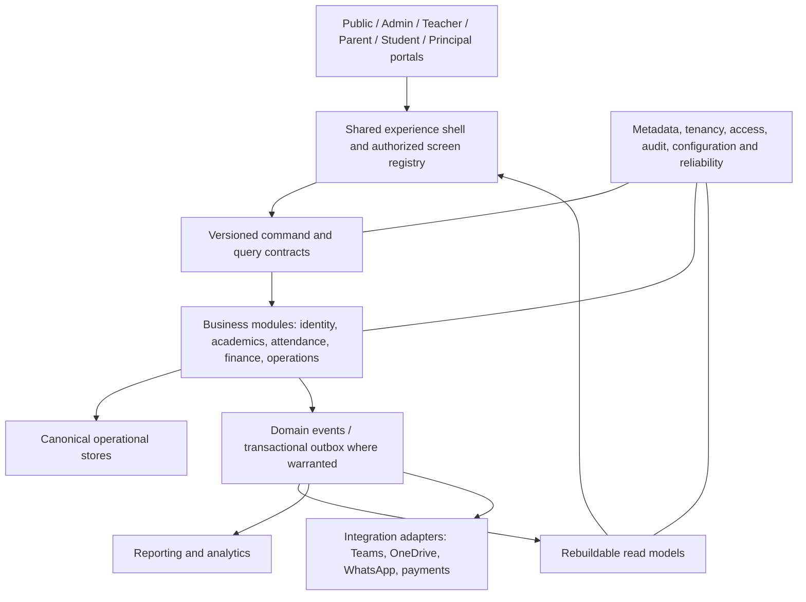

# Tiny Steps School OS v2 — Enterprise Architecture & Progressive Implementation Programme

**Version:** 2.0 programme baseline, revision 62 (P01.2 consolidated residual metadata assessment prepared; R61 offline utility and R59 engineering acceptance retained; effective on isolated merge)  
**Date:** 26 November 2026 (IST)  
**Status:** Proposed for owner review; implementation roadmap, not production cutover approval  
**Audited source:** `main` at [701c7ec832dbe9c531964496fa09cd4a4948ddd2](https://github.com/tinystepselearning-surya/tinysteps-react-v1/commit/701c7ec832dbe9c531964496fa09cd4a4948ddd2)  
**Production project configured in source:** `tinysteps-react-v1`  
**Programme owners:** Tiny Steps leadership; assign a named accountable engineering owner and school-operations reviewer for each brick.

## 0. Executive decision and document governance

Build one durable education operating platform for Tiny Steps online education, its acquired preschool, future physical schools/campuses, hybrid delivery and eventually independently operated SaaS customers. Protect the current online business throughout. New functionality must converge on shared enterprise foundations; never create an unrelated preschool identity, attendance or billing system merely to deliver quickly.

Retain the existing React/TypeScript, Firebase Auth, Firestore and Cloud Functions investments. Organize new business logic as a modular monolith with explicit ownership and typed contracts. Choose additional physical stores, deployment stamps or separate services only against measured or contractual requirements. Adopt Epic-inspired metadata, historical records, contextual access, integrated workspaces and operational/reporting separation, not proprietary Epic implementation or licensing.

This document is the proposed cross-wave execution programme, extending rather than silently replacing:

- [Master Blueprint v1](TINY_STEPS_SCHOOL_OS_MASTER_BLUEPRINT_V1.md): authoritative canonical domain boundaries.
- [Enterprise Architecture Standard v1](SCHOOL_OS_ENTERPRISE_ARCHITECTURE_STANDARD_V1.md): adopted engineering rules.
- [Migration Roadmap v1](SCHOOL_OS_MIGRATION_ROADMAP_V1.md): existing seven-wave sequencing.
- [Wave 0 ownership map](wave-0/CURRENT_TO_CANONICAL_MAP.md) and [exit review](wave-0/WAVE_0_EXIT_REVIEW.md).
- [Wave 1 migration ledger](wave-1/migrations/identity-foundation-v1.json): implementation evidence and authorization holds.

Until a reviewed architecture decision record (ADR) explicitly amends a v1 contract, the existing contract and more restrictive safety gate prevail. Adoption of this document does not authorize production data changes, rule cutovers, deployment, deletion, or external tenant onboarding. If a future discovery conflicts with this plan, update the relevant ADR, dependencies, acceptance criteria and tracker before implementation. No retrospective reinterpretation of pass criteria.

**Next gate: independent R2.2D trust and secure execution acceptance; live execution remains HOLD. Scoped offline engineering through supervised canonical composition accepted at R59 (570/570). R60 records owner-reported infrastructure readiness; R61 accepts the offline index reconciliation utility only, not P01.2 or live parity; R62 consolidates the residual metadata approval decision without executing it; all broader gates unchanged.** See [acceptance and R2 readiness handoff](design/B02_R1C_ACCEPTANCE_AND_R2_READINESS_HANDOFF.md). The immediate preschool operational track is P09-A; it can proceed after its scoped data/security prerequisites, not after the whole programme.

## 1. Evidence-based baseline

### 1.1 What was actually reviewed

The recursive repository tree at the audited commit contained 3,729 entries, including 3,382 blobs (files/assets/tests/docs; not 3,382 individually reviewed source files). Selected architecture documents, migration ledger, identity, school authorization, school programme, enrollment, Firestore and Storage Rules, CI workflow definitions and recent Actions job results were reviewed. No private production documents were queried, no live user accounts impersonated, no live callable executed, and no production mutation was made. Live Firebase operations are not exposed to this audit session; the installed Firebase capability may be used in an appropriately authorized Codex/local environment for P01. Source configuration is not proof of deployed state.

| Evidence | Finding | Disposition |
|---|---|---|
| Wave 0 exit review and v1 blueprint | 18 principal business domains, six layers, canonical vocabulary and ownership already documented | Preserve; do not start a parallel architecture |
| Wave 1 ledger | Original 1,253 canonical records reconciled; catch-up recorded 1,265/1,265 on 4 Oct 2026; household backfill excluded | Historical checkpoint, not today's population |
| Wave 1 ledger | `switchReads.status=r5_milestone3_final_system_verification_in_progress`; next brick is live-role canary and read-model freshness; canonical primary writes exist for selected paths, legacy writes not globally frozen, destructive deletion false | HOLD broad reader/Rules/retirement cutovers |
| [M3 controlled verification](wave-1/IDENTITY_R5_M3_CONTROLLED_VERIFICATION_STATUS.md) | Historical preflight blocked by missing approved actors/fixtures/read budgets; production canary not certified | Complete approval packet; never infer pass from CI |
| [Identity contracts](../../functions/src/schoolOS/identity/contracts.ts) | Typed Person, AuthIdentity, RoleAssignment, LearnerProfile, GuardianRelationship, Household, Organisation and Membership collections | Reuse and extend |
| [School authorization](../../functions/src/helpers/schoolAuthorization.ts) | Canonical principal and school-scoped reader checks; global admin/assigned LP manager; schoolAdmin reader | Useful for partner portal; principal/staff write capabilities and tenant boundary need separate design |
| [School programme contracts](../../src/types/SchoolProgramme.ts) | Academic year, grade, section with aggregate studentCount and teacher IDs; lightweight school teachers; aggregate reading checkpoints | Preserve B2B phonics partnership semantics; build individual SIS and observations separately |
| [School portal integration audit](../SCHOOL_PORTAL_INTEGRATION_AUDIT.md) | Server snapshot boundary, principal read-only, aggregate programme assessment not individual longitudinal evidence | Validate current behavior; do not grant principal writes by broadening old role |
| [Enrollment interface](../../src/types/Enrollment.ts) | Student/course/parent/teacher plus rate, billing cycle, credits in one interface | Extract independent ownership incrementally; preserve existing contract during cutover |
| [Firestore Rules](../../firestore.rules), [Storage Rules](../../storage.rules) | Existing legacy and scoped rules; Firestore rules file 1,954 lines at snapshot | Audit overlap and deployed parity, test both server and client paths |
| Source tree | `functions/src/schoolOS/identity/`, scheduling, attendanceValidation, finance-related functions, parent projections, school services, iOS/Android and public web | Reuse current modules and contracts |
| Source tree search | No obvious comprehensive master-record/item/screen registry by candidate filename; partial registries and typed schemas exist | P01 verify contents before proposing any duplicate registry |
| [CI run 45602427036](https://github.com/tinystepselearning-surya/tinysteps-react-v1/actions/runs/45602427036) | 25 Nov scheduled M3 system verification on audited SHA: three jobs succeeded (canonical authorization/full Functions, operational contracts, Firestore/Storage emulator); PR-specific impact check skipped | Strong code/emulator baseline; not live authorization proof |
| [CI run 45050782571](https://github.com/tinystepselearning-surya/tinysteps-react-v1/actions/runs/45050782571) | 22 Nov main deployment workflow succeeded | Workflow conclusion only, not current deployed resource digest |
| [Deploy workflow](../../.github/workflows/deploy.yml) | Main push initiates impact analysis; production markers can force broader deployment if missing/invalid | Docs-only PR review; before merge confirm actual impact and marker lineage |
| [Historical M3 production report](wave-1/IDENTITY_R5_M3_PRODUCTION_VERIFICATION_REPORT.md) | 10 Oct metadata recorded one Standard Native Firestore database in asia-south1 and 198 active Node.js 22 functions | Re-inventory, not current infrastructure count |

### 1.2 Gap register (initial, not a vulnerability claim)

| ID | Priority | Gap | Resolution |
|---|---|---|---|
| G01 | Critical | Live authorization canaries, role freshness and held Rules exit unverified | P01/P04; no bypass |
| G02 | Critical | External tenant isolation not certified end-to-end, global platform roles exist | P05/P12; deny by default |
| G03 | High | Legacy/canonical ownership and active readers/writers not fully reconciled | P01/P04/P06–08/P12 |
| G04 | High | Preschool requires individual records, attendance, safety and authorized staff operations beyond B2B partner portal | P09-A |
| G05 | High | Enrollment shape spans academic, staffing and financial responsibilities | P06–08 |
| G06 | High | Current data integrity, billed reads, backup/PITR, recovery and deploy parity unverified in this session | P01/P11/P12 |
| G07 | High | Household boundary deliberately deferred | P04 |
| G08 | Medium | Comprehensive stable item dictionary, schema lineage and screen dependency registry not established | P03/P10 |
| G09 | High | Child privacy, consent, restricted health/safeguarding and tenant import/export retention need explicit operational review | P02/P05/P09/P12 |
| G10 | Medium | Shared experience and reporting semantics need convergence, not UI/metric forks | P10/P11 |

## 2. Architecture decisions to adopt through reviewed ADRs

| ADR | Proposed default | Revisit trigger / rejected alternative |
|---|---|---|
| A01 | Existing monorepo and modular monolith; domain APIs and explicit dependency graph | Split services only if independent scaling, isolation, reliability or ownership materially benefits; no big-bang rewrite |
| A02 | Keep existing Firestore operational storage and separate domains logically; use typed adapters, named indexes and server commands | Dedicated database/project/stamp when tenant isolation, residency, recovery, cost or contention warrants; relational store when demonstrated invariant/query needs justify it |
| A03 | Stable opaque record IDs, readable typed fields and registry IDs as semantic identifiers | Do not convert all values to generic EAV/item-number blobs or encode PII in IDs |
| A04 | Single canonical owner/writer per fact, explicit read models, versioned interfaces | No permanent competing dual writers; historical snapshots allowed where their meaning is explicit |
| A05 | Tenant is security/customer boundary, Organisation legal/operating unit, Campus physical site; contextual roles and membership | No automatic cross-customer person merge or global school admin role |
| A06 | Commands enforce business invariants; events/outbox and projections support integrations | Do not demand distributed transactions or full event sourcing for every update |
| A07 | Git-reviewed metadata and configuration schemas first; runtime UI inspector read-only initially | No arbitrary executable configuration, formula injection or tenant-defined authorization |
| A08 | Tenant-aware data minimization, consent, retention, support access and export/deletion | No unrestricted global child chart, media URL or raw sensitive logging |
| A09 | Education interoperability via adapters (OneRoster 1.2 where relevant), provider-independent domain model | No vendor schema as canonical model; no conformance claim without validation/certification |
| A10 | Separate operational dashboards from analytical reporting; warehouse introduced on evidence | No unbounded historical browser queries or duplicate authority |
| A11 | Compatibility with existing web and mobile clients, public URLs and SEO/AEO/GEO | No mandatory app upgrades or removal of old contracts before compatibility gate |
| A12 | Progressive releases with feature flags, measurable parity, rollback and repair rehearsals | No automatic destructive cleanup or broad production deploy from architecture work |

### 2.1 Target logical layers



Domain boundaries are not physical database requirements. Every module declares its public commands/queries, owning schema, allowed dependencies, privacy classification, invariants, integration events and tests. No new module imports another module's private persistence internals without a documented temporary exception. Existing files do not need moving solely to match the target directory structure.

### 2.2 Master records and item dictionary

Use globally unique stable **schema codes**, distinct from record instance IDs, and qualified item IDs that are never reused. Illustrative codes PER (Person), ORG (Organisation), CAM (Campus), LRN (LearnerProfile), GUA (GuardianRelationship), ENR (Enrollment), CRS (Course), SES (ClassSession), ATT (AttendanceRecord), CHG (Charge), PAY (Payment), CNS (ConsentRecord). These are not actual collection renames or allocated IDs until registry adoption. Use LearnerProfile terminology consistently with v1, not a new Student authority.

Proposed registry entry (illustrative, not asserting existing date-of-birth storage path):

```json
{
  "recordType": "PER",
  "itemId": "PER-1004",
  "semanticName": "dateOfBirth",
  "definition": "Person's calendar date of birth",
  "ownerDomain": "identity",
  "dataType": "date-only",
  "cardinality": "0..1",
  "classification": "restricted-personal",
  "schemaVersion": 1,
  "storageBinding": "pending-verified-inventory",
  "validationContract": "identity.dateOfBirth.v1",
  "readPolicy": "authorized-context",
  "writeCommand": "identity.correctPerson",
  "historyPolicy": "audited-correction",
  "lifecycle": "proposed"
}
```

Registry also records null/unknown distinction, units, effective time, category/value-set versions, constraints, relationship cardinality, deletion policy, index/query needs, provenance, consumers (screens, reports, API versions), migration mappings and retirement date. Deprecate instead of reusing IDs. Define typed runtime validation and CI checks for duplicate codes, unresolved dependencies, illegal ownership, schema breaking changes and unused/retired fields. Start with a small domain slice, not an expensive universal framework. UI metadata must select approved components and commands; rendering metadata never grants access or bypasses code invariants. Keep controlled enum/reference codes stable while labels may be localized. Do not embed confidential production values in the registry.

### 2.3 Identity, tenancy and operational semantics

- Person identity is separate from authentication provider account, profile and role. Preserve existing IDs when verified semantically correct. Use deterministic mapping/provenance for migrations; never match children by name or phone alone. Support multiple guardians, independent permissions, siblings, custody restrictions and effective-dated relationships. Household/payer/guardian are distinct.
- In the proposed initial topology, Tiny Steps is one tenant with online and physical operating organisations/campuses subject to documented sharing policy. Independent customer schools are separate tenants, not campuses of Tiny Steps. Establish tenant-scoped learner memberships and access; even if platform identity is shared, do not disclose cross-tenant data or link customer records without a permitted purpose and consent/authority. Avoid global searchable child directory.
- Resolve tenant from authenticated memberships and trusted routing, not solely request payload. Resource ownership and tenant must agree, including nested references, cache keys, exports, search indexes, files, event consumers, jobs and restore destinations. Membership revocation must invalidate stale access predictably. Global operations are tightly controlled, least-privilege, audited and time-bound where appropriate.
- Firestore Rules are not filters, and Admin SDK/server access bypasses those rules. Validate every command/query and background job server-side; IAM/service accounts, storage paths, field minimization and role-denial tests are mandatory. Do not rely on a tenantId field or UI hiding alone. New tenant paths default deny, including collection-group queries and guessed IDs.
- Keep provider-specific IDs (Teams meetings, OneDrive recording locations, payment references) as aliases/evidence. Maintain explicit routing ownership and duplicate protection; changing a provider must not change student/session identity.
- Academic year, term, grade, section, programme, course, curriculum version, delivery offering, enrollment, group placement and teaching assignment have distinct meanings. Closing a year preserves historical placement and observations. Promotions create the appropriate next-year record, not an overwrite of history.
- Sessions have independent learner participation and staff assignment. Daily physical attendance, period attendance and online session attendance have different grains and evidence/policies; never feed preschool attendance into online present-only billing or teacher-pay calculations by default. Store event instants in UTC, local school dates and IANA time zones where relevant; preserve time-zone and calendar rules for historical interpretation.
- Separate academic enrollment from commerce and accounting. Billing account, responsible payer, beneficiary, fee plan/offer, charge, receipt/payment, allocation, credit/refund, earning and payout are separate concepts. Use exact currency/minor-unit handling, effective-dated terms and append-safe corrections; no destructive financial-history rewrite.
- New preschool individual observation/assessment records preserve rubric/curriculum version and evidence; B2B aggregate reading assessments remain aggregate. No false individual progress reconstruction. Restrict health, consent and safeguarding in separate access surfaces. A principal's unified workspace is authorized composition, not a duplicated all-fields student document.

### 2.4 External interoperability, analytics and configuration

Version contracts; distinguish commands, evidence and decisions. For new event-driven workflows use durable idempotency key, actor/context, schema version, aggregate version, correlation ID and privacy-minimized payload; consumers tolerate retries/out-of-order delivery and reconcile missed events. For critical cross-domain changes use an atomic state/outbox write within supported transaction boundaries; separate stores require explicit failure/compensation handling. Avoid introducing a universal event bus before a genuine consumer exists.

Projection contracts specify sources, grain, freshness, authorization, replay, reconciliation and rebuild strategy. Operational reads are bounded and indexed; analytical metrics have defined numerator, denominator, date/cohort and coverage. Evaluate BigQuery or another warehouse on measured report load, retention and cost. No analytics-driven mutation of core truth. AI may assist with summaries or recommendations, never silently make attendance, money, safeguarding or access decisions.

Configuration precedence proposed: platform defaults → tenant → organisation/campus → allowed role/user preferences; explicit schema, validation, version, effective period and authorized override. Security and accounting invariants cannot be overridden by a theme or feature flag. Tenant-specific features use common code, not customer forks.

### 2.5 Owner-approved two-tier data freshness and read-cost policy (26 November 2026)

Owner direction: apply the operational/reporting separation consistently across Tiny Steps OS, inspired by the Chronicles/Clarity distinction, without reproducing proprietary Epic implementation. This elaborates A10 and A04; it is a controlling design requirement for future work packages, not authorization to bypass existing phase, ADR, security, migration or production gates.

**Tier 1 — Current operational authority.** Maintain immediate correctness only where a current business action, authorization, safety or transactional dependency requires it. Examples: newly received enquiries, assignments, demo bookings, current class schedules and attendance, urgent alerts, authoritative payable/wallet/settlement state, payment initiation and confirmation, receipts and access decisions. Use narrow authorized current projections, bounded targeted queries or necessary indexed listeners while the relevant workflow is active. No unconditional all-history subscriptions. One-time current investigation and versioned reference/configuration caches are access patterns, not additional business tiers.

**Tier 2 — T-1 reporting and insights.** Default nonurgent management, parent and teacher insights, historical attendance/progress, admissions/conversion, acquisition, financial summaries, historical earnings/payouts and comparable reporting to saved, authorized previous-day projections. Freeze through the prior local reporting day (Asia/Kolkata for the existing India operation); future tenant calendars and time zones must be explicit. Keep current action state separate from delayed reporting even on the same screen. Do not authorize payments, attendance, safety or access from stale snapshots. Parent/teacher report paths must enforce current contextual access independently of the report watermark. Reuse existing certified incremental projections where they satisfy the freshness contract; do not replace efficient current projections with wasteful nightly scans just to meet a schedule. No browser raw fallback on missing or stale reporting aggregates. Retain the last verified generation with its timestamp or explicitly show unavailable; never fabricate zeros. Late ledger corrections and affected historical periods remain correctable.

**Staggered nightly pipeline.** Inventory all scheduled jobs and dependencies before allocating slots. Preserve deployed Monthly Trends capture at 00:15 IST and publication at 01:00 IST; verify first successful production execution separately. Candidate windows for additional reporting are 01:30, 02:00, 02:30 and 03:00, with approximately 15–20 minutes of breathing room between heavy workloads and longer gaps where needed. Existing globalLearnersRollup occupies 02:30; no new conflicting job assumed. Exact prior-day state must be captured within the verified historical-read retention window (PITR was disabled for the Monthly Trends design), or via verified cutoff-consistent incremental state; later jobs consume staged sufficient aggregates, not today's mutable state or repeated raw scans. Share scans, enforce budgets and non-overlap locks, stage and publish monotonic generations, isolate failures and verify source lineage and reconciliation. Do not change PITR, IAM, existing jobs or production data solely to implement this design. Any new recurring cost must be justified by measured net savings including reads, writes, index work, compute and storage.

**Required at each relevant module design/release gate:** declare freshness tier per dataset/query/screen action (not merely per page), rationale for any live exception, authoritative source and existing projection reuse, scoped authorization, cutoff, expected document/index read and write budget, cache invalidation, job dependencies, freshness/error display, parity/reconciliation, rollback and measured cost. Record before/after actual read amplification. P02/P03 capture the metadata/contract standard without prematurely adding runtime registry fields; P06/P07 apply it to learner progress and attendance; P08 applies it to Parent Payments and Teacher Payments (transactions current, nonurgent reporting T-1); P10 binds screen/report queries to freshness contracts; P11 implements governed reporting and staggered orchestration. Apply progressively to current modules as well as new ones; no forced rewrite or historical migration.

Execution companion: [Admin Analytics read optimisation PR #943](https://github.com/tinystepselearning-surya/tinysteps-react-v1/pull/943), file `docs/analytics/admin-analytics-workspace-read-optimization.md`. This is a separate progressive implementation track, not a dependency that blocks unrelated B01 work or proof of production readiness. Follow its actual approved scope, inventory, parity and release evidence. Do not change the active brick or any authorization hold in this programme.

## 3. Twelve-phase implementation roadmap

IDs below are stable programme work-package IDs. Each may be decomposed into smaller PRs with suffixes. Status denotes evidence, not estimated percentage. Dependencies are gate-based, not merely a calendar. Existing v1 waves remain applicable: P01–03 extend W0; P04 completes W1; P05 extends W1/5; P06 maps W2; P07 W3; P08 W4; P09/10 W5; P11/12 W6 plus SaaS certification.

| Phase | Current status | Dependencies / release rule | Outcome |
|---|---|---|---|
| P01 Discovery & baseline | PARTIAL: source/CI review | None; read-only | Verified inventory and risk map |
| P02 Blueprint & governance | PROPOSED; v1 adopted | P01 scoped evidence; owner approval | Reviewed architecture decisions |
| P03 Metadata registry | PROPOSED | P02; P01 inventory | Stable record/item/schema governance |
| P04 Identity & access | IN PROGRESS (v1 W1 held) | P01, existing M3 gates; P02 for new semantics | Reconciled identity and scoped roles |
| P05 Organisation & tenancy | PARTIAL | P02, P04 scoped identity/access | Tenant/campus foundations |
| P06 Academic & enrollment | PARTIAL | P02, P04–05 for new scope | Common academic model |
| P07 Scheduling & attendance | EXISTING strong implementation; convergence pending | P06 relevant contracts | Preserve online engine; extend physical modes |
| P08 Finance & commerce | EXISTING strong implementation; convergence pending | P04–06 relevant contracts; P07 if session charging | Institutional finance without online drift |
| P09 Preschool operations | PROPOSED expansion | Scoped P04–06 and P07/08 as needed | Safe internal school pilot |
| P10 Shared workspaces | PARTIAL portals | P03, relevant domain gates | Composed user experiences |
| P11 System admin & intelligence | PARTIAL | P03, relevant domain evidence | Governed reporting/inspection |
| P12 SaaS certification & retirement | NOT CERTIFIED | P05–11 as applicable | Independently tested customer product |

### P01 — Current architecture discovery and production baseline (read-only)

- P01.1 Pin main, PR/CI/deployment-marker lineage and existing architecture ledger; generate source map of routes, roles, module/service boundaries, Functions exports, triggers, scheduled jobs, scripts, integrations, app versions.
- P01.2 Verify Firebase project, database IDs, regions, security/IAM, indexes, backups/PITR, provider routing and deployment digests with restricted metadata permissions; document inaccessible surfaces.
- P01.3 Enumerate collection/subcollection paths from source and authorized bounded production metadata/samples; field presence/types, keys, data sensitivity, cardinality and unknowns; reconcile source vs live. No raw child/guardian data in reports.
- P01.4 Map all significant readers/writers, direct SDK paths, triggers, rules, functions, media, caches, projection rebuilds, scheduled tasks and external integrations; classify canonical/legacy/mirror/evidence/projection.
- P01.5 Verify references and duplicates using bounded approved aggregates/samples, with explicit scope and coverage. No auto-merge or repair.
- P01.6 Inventory identity/role policies and read-only canary candidates; separate operator IAM from end-user authorization; classify any callable with possible bootstrap or mutation as excluded.
- P01.7 Establish measured cost/read/write/latency/error/freshness baseline, current deployment impact, backup/restore capability, RPO/RTO proposals and data lifecycle.
- P01.8 Reconcile Wave 0/1 and other existing migrations; update gap register with evidence, owner, severity, dependencies and remediation disposition.
- P01.9 Deliver system inventory, collection/field catalogue, ownership map, reader/writer dependency map, migration status, baseline/risks and ordered backlog as repository docs; explicit UNKNOWN/HOLD for missing evidence.
- Gate: owner approves baseline and affected-scope completeness; unresolved access remains blocked, not a pass. No production writes, deploys, tests that create records, auth changes or migrations.

### P02 — Enterprise blueprint and engineering governance

- P02.1 Confirm business requirements for online, preschool, K–12, hybrid, campuses, B2B partnership and SaaS; include non-goals, staffing roles and required business workflows.
- P02.2 Review 18 v1 domains; place operations/facilities/health/transport/workforce/compliance in existing owners or explicitly approved new boundaries.
- P02.3 Approve ADRs A01–A12 and canonical vocabulary; define dependency direction, command/query/event contracts, versioning and configuration.
- P02.4 Approve privacy/consent/retention policies, incident handling and India-specific compliance review; check applicable law/commencement, contracts and school obligations with qualified counsel, no blanket exemption or compliance claim.
- P02.5 Establish PR templates, architecture fitness rules, exceptions with owner/expiry, release and evidence standards. Amend v1 only with reviewed versioned documents.
- Gate: owner-reviewed decisions, explicit authority and acceptance criteria; documentation/synthetic tests only.

### P03 — Master-record, item and configuration registry

- P03.1 Inventory existing field registries/schemas; adopt namespace and IDs; seed one representative low-risk identity/academic record from verified source.
- P03.2 Define record/field schema, category values, relationships, data classifications, schema version, alias/provenance and consumer bindings.
- P03.3 Add typed validation and CI registry checks, compatibility/version policy, schema lineage and deprecation rules.
- P03.4 Implement approved config inheritance and flags with defaults, safe unknown handling, audit and schema version.
- P03.5 Register new and migrated domain contracts incrementally; read-only catalogue UI deferred to P11.
- Gate: registry unique and validated, zero behavior change to existing application, no runtime dependency on incomplete registry.

### P04 — Identity, household, access and existing Wave 1 completion

- P04.1 Resume actual Wave 1 R5 M3 next brick; refresh source/production marker lineage and canonical coverage. Reuse existing scripts; honor held flags.
- P04.2 Complete owner approval packet for exact actors, fixtures, read budgets and authorized methods; bounded live role canaries, freshness, parity and revocation. No impersonation or auth changes without specific authority.
- P04.3 Define household, guardians, memberships, IDs and lifecycle; resolve collisions manually, no guessing; additive schemas/commands and tests.
- P04.4 Verify maintenance/idempotency, role scope and legacy read/write consumers; switch one approved path at a time. Rules and Storage changes are separate review gates.
- P04.5 Complete observation, compatibility retirement criteria and ledger updates. Retain legacy paths if any unresolved dependency.
- Gate: existing login and approved allow/deny outcomes unchanged; zero unexplained identity mismatch, stale unauthorized access or orphan critical references. Live canaries explicitly verified; broad cutover only under existing M3 exit and separate approval.

### P05 — Organisations, campuses and tenant isolation

- P05.1 Model tenant, organisation hierarchy, campus, academic context and membership boundaries; document Tiny Steps online/physical sharing and external tenant defaults.
- P05.2 Scoped role/capability matrix for founder, platform operator, principal, admissions, teachers, helpers, finance, parents and learners. Preserve existing partner principal read-only contract.
- P05.3 Design tenant-aware data paths, commands/queries, indexes, media/storage and configuration; deny missing or mismatched context. Evaluate dedicated project/database/stamp for external pilots.
- P05.4 Synthetic two-tenant tests across UI/API, direct SDK, collection-group, storage, links, cache, search, exports and jobs; test guessed IDs, suspended roles and cross-campus sharing.
- P05.5 Tenant provisioning, lifecycle, support access, offboarding and scoped backup/export/restore design.
- Gate: zero unauthorized cross-tenant allow outcomes; no unrestricted tenant switching; owner-approved deployment boundary. No actual external onboarding yet.

### P06 — Academic catalogue, SIS and enrollment

- P06.1 Academic year/terms, grade/section, programme, subject/course, curriculum version and delivery offering; preserve existing course identifiers and content.
- P06.2 Individual learner institutional enrollment/placement lifecycle and promotion/transfer history; separate guardian, payer and teaching assignment.
- P06.3 Group placement and teacher assignment records; canonical enrollment migration tools reuse; reconcile existing online enrollment and group/session dependencies.
- P06.4 Versioned learning/assessment evidence and legacy mappings; support multiple offerings per learner without duplicating person.
- P06.5 Approved backfill, compatibility adapters and phased switching for affected existing flows; no invented historical fields.
- Gate: no lost enrollment, schedule, course transition, progress, pricing snapshot or teacher assignment. New physical-school student records scoped and validated.

### P07 — Scheduling and attendance

- P07.1 Verify rolling scheduling, recurrence, overrides, ad-hoc classes, pending attendance recovery, timezone boundaries and Teams evidence contracts.
- P07.2 School calendar, local dates/holidays, physical timetable, session participants and staff; avoid generating online meetings for offline school.
- P07.3 Daily/period attendance with scoped staff actions, corrections and evidence; explicit separate policy from online attendance.
- P07.4 Read models for calendar and attendance; bounded queries, idempotent materialization, missing-event repair, versioned projections.
- Gate: online schedules, join links, attendance decisions, billing and earnings parity; no duplicate session generation, timezone drift or unintended Teams side effect. Preschool attendance pilot tested separately.

### P08 — Finance, commerce and entitlements

- P08.1 Audit existing charges, payments, allocations, wallet, earnings/payouts, invoices and month close; define authoritative owner and exact currency/date semantics.
- P08.2 Billing account/payer and commercial offer/agreement separate from academic enrollment; preserve historical rates/terms and online present-only charge policy.
- P08.3 Introduce physical-school fee plans, admission charges, receipts/allocations, discounts and reversal/refund workflows. Add school expenses/staff remuneration only through explicit finance contracts.
- P08.4 SaaS product subscription and entitlement contracts, separate from parent fee records.
- P08.5 Reconcile per student/payer/period/currency, with amount totals, IDs, allocation and payout parity; test retries and duplicate events.
- Gate: zero unexplained monetary difference (minor units), duplicate/missing charges/receipts/payouts or balance drift; historical ledger append-safe; explicit finance-owner signoff before production switch.

### P09 — Physical school operations (accelerated internal pilot)

P09-A is a vertical slice, not a second application or a bypass of security. Immediate school operations must have a safe manual fallback while software is built. Use restricted, reviewed existing school processes for the interim, not production test submissions or spreadsheets with uncontrolled child data.

- P09.1 **A / priority 0:** Scoped campus, school staff, academic year/grade/section and verified student import with dry-run, duplicate review and minimum data. Requires scoped P04–06 gates; no forced migration of online children.
- P09.2 **A / priority 0:** Guardian relationships, emergency contacts, authorized pickup/release, restricted allergies/health alerts, incident/safeguarding reporting and consent/access history. No public health information or broad staff access.
- P09.3 **A / priority 0:** Daily attendance, daily routines, classroom allocation, supervision and hygiene/safety checks. Requires relevant P07 physical attendance gate. Offline/outage fallback and subsequent authorized reconciliation.
- P09.4 **A / priority 1:** Admissions, communication and operational principal workspace, staff responsibilities; preserve partner-portal principal read-only behavior. New school operating role distinct and explicitly scoped.
- P09.5 **A / priority 1:** Fee plans/receipts and arrears once scoped P08 financial gates pass; until then retain approved existing billing process, no duplicate ledger.
- P09.6 **B:** Play/activity-based lesson planning, developmental observations, evidence portfolios, curriculum/rubric versions, parent progress and staff training/audits.
- P09.7 **B:** Leave, inventory, facilities, maintenance, compliance records, transport/daycare only when needed; data retention, permission and service-level requirements.
- Gate: authorized staff can safely perform defined daily workflows; offline fallback tested; no online portal/billing/schedule impact; leadership, pedagogy and school safety reviewers approve. Pilot limited to Tiny Steps acquired school until P12.

### P10 — Shared application and screen system

- P10.1 Inventory portal shells and reusable components; preserve public URLs, SEO metadata, existing login/navigation and native compatibility.
- P10.2 Versioned screen/workspace registry binding approved UI components to scoped query/command contracts; typed form validation, localization, accessibility and design tokens.
- P10.3 Student, staff, parent, principal and founder workspaces compose authorized domain read models; lazy bounded sections, no all-data mega document.
- P10.4 Pilot new screens behind tenant/role flags, compare old workflows, retire UI variants only after parity.
- Gate: role scope, accessibility, responsive/mobile, app compatibility, latency/read budgets and critical workflow parity; no authorization derived from UI visibility.

### P11 — System administration, reporting and intelligence

- P11.1 Read-only master-record/item catalogue, schema/dependency viewer; restricted record/relationship inspector with redaction, audit and pagination.
- P11.2 Migration integrity and audit viewer, integration/job health, retry/reconciliation and operational alerts.
- P11.3 Semantic metrics catalogue and reproducible read models (admissions, enrollment, attendance, progress, finance, staffing); explicitly distinguish unique learner vs enrollment, unknown/partial evidence.
- P11.4 Reporting export/warehouse decision based on query cost, freshness, scale and privacy; tenant-scoped export; no customer analytics leakage.
- P11.5 Governed AI advisory, provenance and deterministic validation; no unauthorized sensitive prompt context.
- Gate: records reconcile to certified authority, access logged and scoped, no unbounded production scans, projections rebuildable and observed. Each reporting dataset also passes the section 2.5 freshness, read-budget, cutoff and scheduler dependency requirements; live exceptions are justified and transactional access remains current.

### P12 — SaaS product certification and legacy retirement

- P12.1 Customer provisioning, branding, configuration, module entitlements, admin workflows and onboarding.
- P12.2 Tenant-specific import/export, retention, data portability and deletion; backup/restore tests in isolated environment and operational recovery drills.
- P12.3 Load, cost, noisy-neighbor, security/privacy and penetration testing; verify residency, service contracts, incident response and support escalation. Choose shared or isolated deployment based on evidence.
- P12.4 Approved external pilot with a separately scoped test/customer tenant after security gates; documented support access and customer acceptance. No sale as certified until readiness is proven.
- P12.5 Retire obsolete code/collections only after active dependency inventory, no required legacy readers/writers, verified history/export, tested recovery and specific deletion approval. Retention/legal holds override cleanup.
- P12.6 Final readiness certificate: operational online stability, preschool pilot accepted, external isolation verified, sustainable service operations, measurable performance and documented outstanding exceptions.
- Gate: independent security and business approval, no open critical blockers; retirement may be deferred without blocking safe product features if documented.

## 4. Migration protocol: mandatory for every affected business fact

1. **Inventory / plan:** pin baseline SHA, deployment markers, data owner, current invariants, source and target shape, all clients/readers/writers, query bounds, trigger side effects, migration IDs, batch/checkpoint strategy and rollback.
2. **Expand:** additive schema, backward-compatible reader/contract, new path disabled. Keep existing default behavior; synthetic/emulator tests first.
3. **Backfill (separate approval):** dry-run with scope/counts/read-write budgets, deterministic ID/provenance and conflict report. Approve specific batches, idempotent resumption and rollback/repair. Handle concurrent source changes with checkpoint/watermark, catch-up and reconciliation. Never copy unknown/invalid facts into authoritative state silently.
4. **Verify and shadow:** compare semantically equivalent records and results; keep existing path authoritative. Measure missing/drift/conflict counts, lag, query cost and failure behavior.
5. **Canary:** explicit owner-approved actors/resources/tenant, safe windows, stop conditions, exact allowed commands. No live synthetic billing/attendance/enrollment unless independently authorized in an isolated environment.
6. **Switch:** move bounded cohorts/path-specific readers and writers after gates. One authoritative writer per fact, versioned compatibility mirror where necessary. Never allow independent dual truth. Preserve API versions for older clients.
7. **Observe / reconcile:** proposed minimum observation seven days including a complete relevant workflow cycle; for billing, cover affected month-close/payout/reconciliation cycle or an explicitly accepted alternative. Expand duration for high-risk flows. Do not retire on elapsed time alone.
8. **Freeze and retire:** verify zero required legacy consumers, approved retention, restore rehearsal, explicit owner approval. Prefer forward repair; code rollback does not undo historical writes.

At any failed gate, stop expansion and disable the new path if safe; do not delete new or old data as an automatic rollback. Quarantine unresolved operations, restore the prior *compatible* routing/authority where possible, drain/reconcile in-flight jobs, preserve financial/evidence history, and escalate. Backup restore to isolated destination for validation before production recovery. A rollback after canonical writes may require a forward-compatible repair or synchronized legacy mirror, not simply git revert. Record actual recovery impact.

**Owner-confirmed progressive replacement:** Apply this protocol per module. Keep main/production intact while developing in isolation; for each release start a focused integration branch from current main, reconcile source/deployed markers, test affected dependencies, inspect deployment impact, verify staging and obtain explicit release acceptance. No wholesale merge of the architecture branch into main. Replace obsolete legacy functions, data paths and fields permanently only after cutover, reconciliation, dependency closure, retention/recovery and specific retirement approval. Keep temporary compatibility bounded and single-authority; avoid unnecessary historical migrations. See [acceptance and R2 readiness handoff](design/B02_R1C_ACCEPTANCE_AND_R2_READINESS_HANDOFF.md). No production authorization or phase gate waiver.

## 5. Release protection and measurable gates

### 5.1 Permanent regression matrix

| Surface | Required evidence for affected releases |
|---|---|
| Public site | URL/canonical, structured data, SEO/AEO/GEO, inquiry form and attribution behavior |
| CRM/admissions | Deduplication, returning leads, demo scheduling/assignment, admissions history |
| Identity | Parent/teacher/admin/founder/kid/LP/school sign-in, roles, revocation, access parity, guardian scope |
| Academic | Multiple courses, transitions, student/teacher/section assignment, historic curriculum/progress |
| Scheduling | IST and other IANA time zones, date boundaries/DST, rolling schedules, reschedule and exceptions, no double materialization |
| Attendance | Teams validation, pending recovery, decisions/corrections, evidence, parent/teacher/admin calendar |
| Finance | Present-only online billing, invoices/wallets/month close, earnings/payouts, financial reconciliation, duplicate replay |
| Recording/media | Teams/OneDrive routing, student-folder/links permissions, authorized media sharing, no duplicate routing |
| Learning | Lesson libraries, worksheets, games, progress and parent projections |
| Communication | WhatsApp, notifications, messaging, opt-in and delivery idempotency |
| School | B2B partner portal contract, principal read-only, new operating roles separately scoped |
| Security | Firestore/Storage emulator deny/allow, callable/admin SDK checks, tenant isolation, least privilege and role freshness |
| Clients | Web responsive, accessibility, iOS/Android and old API contract compatibility |
| Operations | Read/write/index costs, latency/errors, replay, restore, CI deployment impact, alerting |

Use existing CI suites and targeted tests plus broad regressions proportionate to blast radius. CI green does not prove production state. If a test is skipped, record why and whether it blocks release. Do not perform live testing via a callable merely because it is named read/dry-run; inspect its entire dependency chain.

### 5.2 Proposed measurable release acceptance (owner ratifies budgets in P01/P02)

| Metric | Initial gate |
|---|---|
| Security | Zero unauthorized allow outcomes in approved negative matrix; zero unresolved critical security issues |
| Identity / reference parity | Zero unexplained mismatches for migrated in-scope required relationships; separately report unresolved historical exceptions |
| Money | Exact reconciliation to minor unit by currency, payer, period and ledger grain; zero unexplained duplicates/loss |
| Scheduling | Zero unexplained session/participant duplication, lost scheduled occurrence or wrong local-day classification |
| Compatibility | All required existing business acceptance tests pass; no unapproved contract break |
| Operational performance | No material regression versus P01 baseline; proposed review trigger >10% increase in comparable p95 latency or reads per workflow, not a measured current threshold; approve per-path absolute caps and sample size |
| Projection/event safety | Idempotent retries, version ordering and rebuild/reconcile tested; owner-approved freshness and lag thresholds |
| Recovery | Measured RPO/RTO versus approved workload targets; isolated restore tested before high-risk migration |
| Monitoring | Error, lag, cost, unauthorized-access and data-integrity alerts assigned to an owner; no automatic data repair without approved policy |

Collect baselines over comparable load and time windows. Report denominators and data coverage, not a fabricated global percentage. No high-risk switch without approved measured budgets and tested rollback. Release owner, domain owner, security reviewer and finance/pedagogy reviewer as relevant record signoff.

### 5.3 PR, deployment and environment discipline

Use short-lived branches, reviewable PRs, pinned source commit, synthetic fixtures, emulator/staging separation and explicit migration execution scripts. Separate documentation, code changes, production write modes, security rules/indexes and destructive operations whenever feasible. For this docs-only programme PR, main deployment workflow is push-triggered: before merge validate production marker lineage and actual impact so no unexpected production deployment occurs. Do not bypass required checks or disable existing automation. Do not run broad deploys to fix a narrow issue. No service account secrets, production PII, raw logs, signed URLs or children media in Git. Establish environment-specific credentials and fail closed on project mismatch.

## 6. Data protection, recovery and operating model

Maintain a child-data inventory with purpose, access, jurisdiction, retention, consent/withdrawal, processors and deletion/export handling; restrict safeguarding and health notes, staff background checks and media. Review applicable Indian DPDP Act/Rules commencement, child consent and any education-specific exemptions/conditions with counsel; architect for protection rather than depend on exemptions. Do not equate consent for classes with consent for marketing, recording or cross-tenant transfer. Log privileged reads of sensitive records with privacy-minimized metadata; ensure audit logs themselves have restricted access and retention.

Document backups for Firestore, Storage, identity/config and provider-owned documents/media separately; Firestore backups do not recover all of these. Verify PITR/backup settings, retention and cost; backup is not a recovery test. Define RPO/RTO per domain, isolated restoration, tenant-scoped export/restore constraints, consistency across systems, credential recovery and incident response. On-premise preschool connectivity failures require manual attendance and safe child-release procedures independent of internet availability.

## 7. Execution sequence and live tracker

- **Track A — immediate:** P01 baseline and P02 owner decisions; P04 held-M3 closeout work only as authorized. P03 small metadata slice in parallel; no dependence on a fully dynamic screen engine.
- **Track B — preschool MVP:** scoped P04/P05/P06 foundations, then P09-A with P07 physical attendance and P08 fee-plan slices as relevant; school safety/manual fallback from day one. Continue legacy online flows unchanged until explicitly migrated.
- **Track C — convergence:** expand P06–08, P09-B and P10 module by module; complete each business-domain cutover independently.
- **Track D — enterprise:** P11 and P12 after applicable sources/tenant isolation are certified; external customers only after acceptance. Indicative ordering, not a promise of elapsed months.

Maintain this table as the authoritative programme status index. Each brick has a linked issue/PR or evidence file once started. Do not mark a phase complete from a merged PR alone.

| ID | Status at this baseline | Next action |
|---|---|---|
| P01 | IN PROGRESS / source export classification complete | [P01.1-A baseline](discovery/P01_SOURCE_BASELINE_2026-11-26.md); [P01.1-B role/automation](discovery/P01_AUTH_AUTOMATION_TOPOLOGY_2026-11-26.md); [P01.1-C topology and ownership seed](discovery/P01_FUNCTION_EXPORT_TOPOLOGY_2026-11-26.md); [198/198 root manifest](discovery/P01_FUNCTION_ROOT_MANIFEST_2026-11-26.md); [P01.1-D1 scheduling/attendance/finance](discovery/P01_SCHEDULING_ATTENDANCE_FINANCE_DEPENDENCIES_2026-11-26.md); [P01.1-D2 frontend/admin/repair](discovery/P01_FRONTEND_ADMIN_REPAIR_DEPENDENCIES_2026-11-26.md); [P01.1-D3 admissions/enrollment/identity](discovery/P01_ADMISSIONS_ENROLLMENT_IDENTITY_DEPENDENCIES_2026-11-26.md); [P01.1-D4 school/resources/shared services](discovery/P01_SCHOOL_RESOURCES_SHARED_SERVICES_DEPENDENCIES_2026-11-26.md); [P01.1-D5 remaining writers/gaps](discovery/P01_REMAINING_WRITERS_EVIDENCE_GAPS_2026-11-26.md); [P01.1-D6 root dependency ledger](discovery/P01_ROOT_DEPENDENCY_LEDGER_2026-11-26.md) (D7: 198 represented and scoped, 0 unresolved root rows; indirect closure pending); [P01.1-D8 source record catalogue](discovery/P01_SOURCE_RECORD_CATALOGUE_2026-11-26.md) (D9: 159 structural paths, 151 scoped, 8 unresolved; additional paths identified for delta); [P01.1-D10 verification matrix](discovery/P01_INTEGRITY_AUTHORIZATION_VERIFICATION_MATRIX_2026-11-26.md) (19/19 reproduced static predicates; P01.5/P01.6 prepared only); [P01.1-D11 acceptance handoff](discovery/P01_DISCOVERY_ACCEPTANCE_HANDOFF_2026-11-26.md) (168 paths, 160 scoped, 8 unresolved; historical migration reconciliation; offline execution and approvals pending); [P01.1-D12 bounded reconciliation design](discovery/P01_BOUNDED_RECONCILIATION_DESIGN_2026-11-26.md) (20/20 synthetic count-only tests; 175 source paths, 160 scoped, 15 unresolved incl seven inventory probes; no live adapter); [P01.1-D13 offline verification and acceptance](discovery/P01_OFFLINE_VERIFICATION_AND_ACCEPTANCE_2026-11-26.md) (revision 18 test evidence); [D13 closure and bounded collector](discovery/P01_D13_CLOSURE_AND_BOUNDED_COLLECTOR_2026-11-26.md) (99 Firestore/Storage Rules tests, all 80 previously skipped Functions cases and 50 synthetic plus one emulator collector test passed. Exact-history marker resolver passed on code-bearing candidate. Catalogue 175 paths, 165 scoped, 10 unresolved); [P01 measured verification and acceptance](discovery/P01_MEASURED_VERIFICATION_AND_ACCEPTANCE_2026-11-26.md) (six-domain demo integrity, cold/warm reads, projection freshness and synthetic recovery measured. Ten unknown paths reviewed. Independent acceptance and live approvals pending); [P01.2 metadata packet](discovery/P01_METADATA_ONLY_APPROVAL_PACKET_2026-11-26.md) Revision 23 consolidates partial operator-reported metadata evidence; restricted authentication succeeded on a later attempt, remaining scope and independent review outstanding; P01.2/live P01.3 HOLD |
| P02 | PROPOSED / authorization pending | Complete P01 acceptance and obtain owner approval before reviewing ADRs and v1 alignment |
| P03 | PROPOSED | Confirm existing schemas, seed registry |
| P04 | HOLD / IN PROGRESS | M3 approved role-canary/freshness gate, no broad switch |
| P05 | PARTIAL | Tenant/organisation/campus and access design |
| P06 | PARTIAL | Individual SIS and academic ownership map |
| P07 | EXISTING / CONVERGENCE PENDING | Baseline online behavior; scoped school attendance |
| P08 | EXISTING / CONVERGENCE PENDING | Baseline finance; school fee contracts |
| P09 | PROPOSED | Safety-first scoped preschool pilot |
| P10 | PARTIAL | Shared shell and screen contract inventory |
| P11 | PARTIAL | Metric and metadata evidence design |
| P12 | NOT CERTIFIED | No external rollout or destructive retirement |

For each brick record: ID/title, status (PROPOSED, READY, IN PROGRESS, HOLD, SOURCE VERIFIED, CANARY VERIFIED, COMPLETE), owner/reviewer, baseline SHA, dependencies, scope/non-goals, data ownership, authorization, files/resources affected, production impact, test evidence and skipped tests, migration counts/reconciliation, monitoring, rollback, decision and next action. Use append-safe evidence and link the existing wave ledger rather than create conflicting migration status. Reopen if new evidence invalidates a gate.

### Programme completion definition

The desired implementation is achieved when online-school behavior and historic data are preserved, Tiny Steps preschool operates on shared foundations, selected K–12/hybrid workflows fit the approved model, every active business fact has a documented canonical owner and versioned contract, registry and architectural checks are enforced, operations/restore/security evidence is verified, and an independent customer pilot is certified. Remaining legacy paths have a named owner, reason and exit gate. Future modules such as transport or full payroll are added only when the approved requirements demand them; architectural accommodation is not a commitment to build all possible features.

## 8. Next Codex execution brief (P01 only)

Read this programme and v1 documents plus Wave 1 ledger before work. Fetch latest main and pin SHA. Verify environment/project identity. Perform READ-ONLY inventory using repository analysis and explicitly approved bounded Firebase metadata/queries; no writes, deployment, migrations, role changes, token impersonation, production test records or potentially mutating callable calls. Use existing audit scripts only after inspecting their full behavior and read budgets. Record actual code references, date/time, counts with scope, unknowns and blockers. Generate the P01 evidence files under `docs/architecture/discovery/` in a dedicated documentation PR; propose the ordered next bricks. Do not mark M3 complete or change its hold flags. No other phase implementation until the relevant P01/P02 approvals. If credentials or safe exact targets are unavailable, complete source-side discovery and list the precise approval/access required; do not bypass controls.

## 9. Research register (reviewed 26 November 2026)

The research supports principles, not a claim of exact proprietary Epic schemas or complete compliance.

| Source | Applicable decision |
|---|---|
| [Epic open technical specifications](https://open.epic.com/TechnicalSpecifications) and [developer resources](https://open.epic.com/DeveloperResources) | Explicit interoperability and independent customer environments; inspiration for stable concepts and isolation, not a mandated Epic deployment model |
| [Martin Fowler: Strangler Fig](https://martinfowler.com/bliki/StranglerFigApplication.html) and [Evolutionary Database Design](https://martinfowler.com/articles/evodb.html) | Incremental replacement and version-controlled compatible schema evolution |
| [Firebase Firestore best practices](https://firebase.google.com/docs/firestore/best-practices) | Bounded/index-aware operations, avoid hotspots and sensitive identifiers |
| [Firestore Rules structure](https://firebase.google.com/docs/firestore/security/rules-structure) and [secure queries](https://firebase.google.com/docs/firestore/security/rules-query) | Independent server/IAM controls; per-database Rules; queries must satisfy authorization |
| [Firestore transactions](https://firebase.google.com/docs/firestore/manage-data/transactions) and [manage databases](https://firebase.google.com/docs/firestore/manage-databases) | Explicit transaction boundaries and optional physical decomposition |
| [Firebase event retries](https://firebase.google.com/docs/functions/retries) and [Firestore triggers](https://firebase.google.com/docs/functions/firestore-events) | Idempotent asynchronous work, avoid exactly-once assumptions |
| [Microsoft multitenancy models](https://learn.microsoft.com/azure/architecture/guide/multitenant/considerations/tenancy-models) and [deployment stamps](https://learn.microsoft.com/azure/architecture/patterns/deployment-stamp) | Shared vs dedicated isolation and deployment tradeoffs |
| [1EdTech OneRoster 1.2](https://standards.1edtech.org/oneroster/specifications/standards/v1p2) | K–12 roster, courses, enrollment and grade exchange adapter; no certification claim |
| [Google Cloud reliability framework](https://docs.cloud.google.com/architecture/framework/reliability) and [recovery testing](https://docs.cloud.google.com/architecture/framework/reliability/perform-testing-for-recovery-from-data-loss) | RPO/RTO, data integrity and measured recovery |
| [Firestore backups](https://firebase.google.com/docs/firestore/backups) and [PITR](https://firebase.google.com/docs/firestore/pitr) | Evaluate recovery configuration and isolated restore; not proof these are enabled |
| [MeitY DPDP Rules 2025 and corrigendum](https://www.meity.gov.in/documents/act-and-policies/digital-personal-data-protection-rules-2025-gDOxUjMtQWa?pageTitle=Digital-Personal-Data-Protection-Rules-2025%3B) | Privacy-by-design and legal review of applicable requirements and commencement before school/customer launch |

## 9.1 Revision 23 — discovery consolidation and acceptance disposition

Retain the pinned source and isolated verification evidence. The owner-provided local execution transcript reports successful restricted authentication on a subsequent attempt and partial metadata retrieval; execution stopped on an invalid request parameter before the approved inventory was complete. The operator reported removal of the temporary bindings and direct-policy recheck; this does not independently certify effective revocation or inherited permissions. No application-document access or application configuration change was reported. The operator's private evidence, security configuration, identities and resource-specific findings must remain outside this public repository. This is a transcript-based review, not independent cloud execution or a signed security acceptance.

| Workstream | Existing evidence and residual decision | Disposition / dependency |
|---|---|---|
| P01.1 / P01.4 | 198/198 scoped Function roots; 165/175 structural paths scoped; indirect, native, dynamic and provider dependencies remain bounded exceptions | Reuse source evidence; Engineering and independent reviewer accept named exceptions or request targeted closure. Do not restart full discovery. |
| P01.2 | Partial restricted metadata evidence; inventory, source/deployed parity, independent IAM review and recovery inventory not certified | HOLD; review private evidence and approve only remaining essential requests. No repeat of already accepted results without drift or evidence-quality justification. |
| P01.3 / P01.5 | Source catalogue and representative emulator integrity evidence; production coverage and discrepancies unverified | HOLD; separately approve bounded production reconciliation before affected-scope acceptance. Never infer production integrity from fixtures. |
| P01.6 / Wave 1 M3 | Existing isolated Rules evidence and prepared actor handoff | HOLD live role/freshness verification; no authorization cutover or change to migration ledger. |
| P01.7 | Measured emulator evidence; production reliability, cost and recovery capability not certified | Open separate privately managed infrastructure reliability/recovery workstream; owner and security/reliability reviewer must decide risk and evidence requirements before affected production work. No settings change approved. |
| P01.8 | Historical migration evidence and existing holds retained | Reuse ledger; independent reconciliation before changing migration status or retiring legacy paths. |
| P01.9 | Evidence consolidated, residuals identified; no independent signature or owner acceptance | IN PROGRESS; next review must determine essential versus deferrable scope and document accountable owner, rationale, dependency, acceptance evidence and any explicit ADR/gate amendment. |

### Scope discipline and next acceptance review

1. Engineering verifies that existing source evidence is still applicable, checking main drift and PR lineage; rerun only affected checks.
2. Infrastructure and Security owners review private metadata evidence, record outstanding risks and decide the minimal remaining recovery, index, deployment-parity and IAM evidence necessary for acceptance. The previously proposed request templates require API-contract correction and independent review before any future run. Do not request broader access to remedy a request-parameter error.
3. Domain owners review the bounded application-data packet and identify the smallest cohort and read budget necessary for production integrity evidence. Approval and execution remain separate.
4. The executive owner and independent engineering reviewer review all P01 gates and classify unresolved items as acceptance blockers or explicitly approved exceptions with an owner, dependency and closure criteria. Deferral is a proposed disposition, not a waiver or a passed gate. The existing P01 and P02 gates prevail unless formally amended through reviewed governance.
5. Only after P01 acceptance and separate P02 authorization begin the ADR/business requirements review. P03 registry implementation, production data changes, deployments, broad Rules changes and M3/retirement remain gated.

No new Terminal run, production access or changes are requested by this revision. Infrastructure risk remediation is a proposed separately approved workstream, not an authorization to modify backup, storage or access settings. Existing offline tests and evidence are retained; no fresh tests are claimed for this documentation-only update.

### Revision 24 — acceptance recommendation and scoped design decision

Main was rechecked against the audited SHA and is unchanged. Draft #933 remains stacked on open #932; the Wave 1 migration ledger still identifies the held M3 role/freshness gate. No need to restart source discovery. The metadata packet now corrects candidate request parameters and reconciles historical versus current status; no live validation of the corrected templates is claimed.

| Decision category | Recommended disposition (not signed acceptance) | Required owner/reviewer evidence |
|---|---|---|
| Reuse now | Existing source catalogue, root classifications, historical ledger and isolated regression/fixture evidence; retain exact baseline and scope limitations | Engineering reviews pinned evidence and documents any affected exceptions; rerun only on material drift |
| Required for full P01 acceptance under current rules | Independent review of metadata/recovery/security, bounded production integrity scope and results, significant dependency exceptions, production reliability baseline and migration reconciliation | Named owners and independent reviewers sign existing P01.1–P01.9 criteria; unresolved coverage remains HOLD |
| Candidate deferral to affected brick only | Exhaustive unrelated index groups, historical/dormant path existence probes, provider inventory outside the first implementation slice, and nonessential broad performance measurements | Explicit exception with dependency, owner, risk, deadline and required closure before affected implementation or release; no assumption that a missing resource is unused |
| Separate production gates | M3 live role/freshness canary, identity/Rules cutover, production recovery drill, real data migration, tenant onboarding and destructive retirement | Existing dedicated approvals, tests and release gates; no deferral that permits unsafe production activation |

**Recommended governance decision for leadership and independent reviewer:** consider a narrowly scoped ADR allowing P02 blueprint drafting and synthetic contract design on already verified source while residual P01 live verification continues. This would be an explicit prospective amendment to the current P01-to-P02 dependency, not retrospective P01 acceptance. Limit any approved exception to documentation and synthetic design evidence, no production reads or writes, deployments, runtime wiring, migrations, real credentials, or P03 implementation. Draft contracts must mark live assumptions unverified, preserve v1 boundaries and require revalidation at affected implementation gates. Until the amendment is reviewed and approved, P02 stays on HOLD under the original programme. If declined, finish the existing P01 acceptance criteria before P02. No approval inferred from general programme continuation.

**Next actionable decision (revision 24 historical proposal; see revision 25 below):** executive owner selects either the original full P01-before-P02 sequence or the proposed design-only amendment for independent review. Engineering records the independent review and actual decision in a versioned ADR before changing a dependency. Existing approval packets remain the only route to production evidence. Do not schedule a further Terminal execution solely to advance documentation. No new phase completion claim.

### Revision 25 — owner-directed design-first, extend-now, migrate-later strategy

The owner directs design of the new module and data contracts first, reuse or extension of sound structures, introduction of genuinely missing facts and capabilities, then selective migration of historical data into designated canonical collections/subcollections in the existing Firestore database by default. Record this direction as a design preference, not a signed production or sequencing exception. The [target data and module design draft](TSOS_V2_TARGET_DATA_AND_MODULE_DESIGN_DRAFT.md) maps all 18 frozen v1 domains, preserves existing identity contracts, provides the first worked academic/enrollment slice and specifies the per-family migration playbook. Candidate paths and fields are not allocated or certified live. Missing historical facts remain unknown; prospective capture occurs only through approved releases. Avoid a blanket v2 copy, competing authorities, unnecessary physical databases and unbounded reads.

Next review: obtain independent review of the design and proposed P01/P02 sequencing ADR; finalize record/item and storage bindings for the first affected slice only under the controlling gates. Build missing capabilities in isolated environments after applicable implementation authorization. All live access, migrations, production data capture, deployment, Rules/cutover and retirement gates remain unchanged. No retrospective P01 acceptance or formal P02/P03 activation is claimed.

### Revision 26 — master record and item dictionary design

Owner-directed dictionary design is documented in [registry design](registry/TSOS_V2_MASTER_RECORD_ITEM_DICTIONARY_DESIGN.md) and the [machine-readable design seed](registry/TSOS_V2_MASTER_RECORD_ITEM_REGISTRY_DRAFT.json). The proposal contains 29 record codes, 13 detailed record seeds, 76 qualified item definitions and 18 value sets; 43 source-backed identity fields were matched to the pinned TypeScript interfaces for presence, optionality and explicit nullability. Shared identity audit fields are described separately; 16 record entries are catalogue-only. Draft identifiers, fields, storage paths and authority mappings are not allocated or adopted. The new registry is Git metadata, not a Firestore EAV store or runtime dependency. No P03 implementation, schema validator, CI integration, production access or data capture was activated. Identifier uniqueness/reference checks passed at generation; independent semantic/security review and production coverage remain pending.

Next design review: confirm code namespace, shared field identifiers and ownership; complete academic catalogue, enrollment/delivery and tenant/context contracts before executable schema adoption. P01 acceptance, independent sequencing ADR, P02/P03 formal gates, M3 and production holds remain unchanged.

### Revision 27 — parallel target architecture design packages

Owner agrees to design the replacement architecture alongside current operations: complete target entities, relationships, record registry, storage bindings, service and workflow contracts, security/performance and migration mapping first. Retain same Firestore database by default; reuse already sound canonical structures and existing efficient code. Build missing structures/services and prospective capture in isolated development after authorization, test independently, backfill and reconcile by bounded slices, switch consumers progressively, transfer one authoritative writer per fact, retire legacy only with explicit evidence and authority. No big-bang switch or blanket rewrite. This owner-directed design sequence is not a waiver of existing P01/P02/P03 or production gates.

| Package | Target scope | Design status |
|---|---|---|
| D01 | Identity, contact, roles, learner, guardian, household and existing profile boundaries | All ten remaining profile families seeded in M04; independent review and executable contracts pending |
| D02 | Tenant, organisation, campus, membership and contextual roles | M01 integrated draft; review pending |
| D03 | Academic catalogue, programme, course, curriculum, skills and academic year | M01 integrated draft; review pending |
| D04 | Enrollment, delivery offering, group placement, teaching assignment | M01 integrated draft; review pending |
| D05 | Scheduling, plans, sessions, participants and staff | M02 integrated draft; review pending |
| D06 | Attendance, official decision, evidence and corrections | M02 integrated draft; review pending |
| D07 | Learning, assessment, observations, mastery and progress | M02 integrated draft; review pending |
| D08 | Commerce, agreements, billing, charges, payments and earnings | M03 integrated draft; review pending |
| D09 | School operations, admissions, workforce, safeguarding and communication; include CRM and support ownership | M03 integrated draft; review pending |
| D10 | Metadata, configuration, audit, integration, projections, analytics, credentials/reporting and shared experience | M03 integrated draft; review pending |

Packages are design views spanning the frozen 18 domains, not new competing domain authorities. Every package specifies record grain/key, relationship cardinality, proposed collection/subcollection and item mappings, command/query contracts, state and validation rules, access/data lifecycle, query/index and measured-read requirements, old-to-new mapping and test/recovery gates. Consolidate and review the whole design before implementation of affected slices. Cross-package dependencies (e.g. D02 contextual authorization, D03/D04 offering semantics) must be reconciled in reviewed contracts.

[D01 Identity Architecture](design/D01_IDENTITY_ARCHITECTURE.md) preserves the existing core and permanent role/profile, contact, lifecycle, private and evidence stores. Proposed household membership is distinct from guardian/payer/access; path and field bindings remain unadopted. [Registry draft v0.2](registry/TSOS_V2_MASTER_RECORD_ITEM_REGISTRY_DRAFT.json) extends the revision 26 seed to 40 record candidates, 14 detailed seeds, 82 items and 19 value sets; 26 catalogue-only records require detailed fields. Prior 43 source-backed identity fields retained. No production path creation, data capture or migration.

Main has advanced 79 commits relative to the earlier source pin; direct blob equality verified seven D01-relevant artifacts (identity contracts/writer, Firestore and Storage Rules, Wave 1 ledger, profile migration contract, school authorization). No global rebaseline or live deployment claim. Further affected source dependencies must be re-pinned before implementation. Next design package is D02; independent review and existing phase and release gates remain mandatory. No new runtime/CI tests claimed.

### Revision 28 — larger design milestones and M01

Owner directs batching of substantial milestones with holistic checks at each checkpoint, rather than fragmented small commits presented as separate milestones. [M01 — Institutional, academic and enrollment foundations (D02–D04)](design/M01_INSTITUTIONAL_ACADEMIC_ENROLLMENT_ARCHITECTURE.md) provides one integrated entity graph, target path and ownership decisions, context authorization, academic/version and enrollment/placement lifecycle, services, query/index constraints, migration mapping and acceptance scenarios. D01 draft remains its prerequisite design view, with profile details still pending. [Registry v0.3 draft](registry/TSOS_V2_MASTER_RECORD_ITEM_REGISTRY_DRAFT.json) now contains 53 proposed records, 32 detailed seeds, 207 unique items and 28 value sets; 43 source-backed identity field definitions preserved. New item definitions are proposed targets, not production schema findings.

| Milestone | Scope | Status |
|---|---|---|
| M01 | D02–D04, reconcile with D01 | Integrated design draft, structural checks passed, independent review pending |
| M02 | D05–D07 scheduling, sessions, attendance, learning/assessment | Integrated design draft, structural checks passed, independent review pending |
| M03 | D08–D10 commerce/finance, school operations, platform foundations | Integrated design draft, structural checks passed, independent review pending |
| M04 | Cross-package consistency, unresolved fields/keys/policies, full dependency and migration design, independent approval | Integrated draft and structural review completed; independent acceptance and executable-contract closure OPEN |

Important source checks: eight current main blobs match original pinned equivalents (academic/enrollment types, school authorization/academic command, two rolling schedule files, indexes, Wave 1 ledger). Current Course/Topic interface is in models.ts, not a standalone Course.ts. School.ts and schoolCurriculum.ts reviewed. Target lifecycle does not adopt incomplete five-value Enrollment interface as exhaustive; live caller semantics include trial/paused/terminal outcomes and progression/correction. Existing schoolAdmin remains read-only. Proposed contextual grant alternative does not allocate a competing authority. Catalogue visibility and tenant-owned delivery checked explicitly. Existing school-local year/grade/section keys remain contextual, not globally unique. Registry structure, identifier uniqueness, owner and reference/enum integrity checked, and tenant field presence checked for affected root delivery records. No full main rebaseline, independent semantic review, executable validator, runtime tests, CI or live production verification.

P01 acceptance and formal P02/P03/P04 and all affected implementation, security, migration, production and M3 gates unchanged. No collection creation, runtime wiring, code or production changes. M02 proceeds as design proposal only.

### Revision 29 — consolidated M02 classroom delivery and learning design

[M02 — Classroom delivery, attendance and learning (D05–D07)](design/M02_CLASSROOM_ATTENDANCE_LEARNING_ARCHITECTURE.md) connects timetable, virtual occurrence, on-demand actual session, participants/staff, official attendance, corrections, provider evidence, historical financial terms, learning activities, assessment and projections. The [registry v0.4 draft](registry/TSOS_V2_MASTER_RECORD_ITEM_REGISTRY_DRAFT.json) expands to 77 record candidates, 61 detailed seeds, 454 unique items and 37 value sets; all 207 prior items and all 43 source-backed identity definitions are unchanged. Twenty-four record families added, five previously undetailed record types seeded, existing schedule plan extended; 16 catalogue-only entries remain. Structural reference, ID, owner and scope checks passed; all new record codes appear in M02 design. New field definitions remain proposals, not verified production schema.

Critical source preservation: both retired automatic session generation guards are true; day-window sync returns early under the automatic retirement guard despite stale comments about next-day generation. Preserve Student Management timetable authority and authorized on-demand attendance/ad hoc creation. Existing IST date/time and cross-enrollment learner/date/start claims remain authoritative; viewer local time and DST are display context, not billing/attendance key. New online attendance input stays present/absent; no unmarked-to-absent conversion, preserve historical status semantics, AVS evidence remains separate. Preserve current sessionRevenue financial snapshots, attendanceFinanceCycle and paid/settled/unsafe correction review; no financial posting from virtual slots, evidence or school daily register. Learning evidence and projections separate; no fabricated individual assessments from aggregate school evidence. Recording access and external provider integration require D10 review; no router/OneDrive live verification.

Nine scoped current/pinned source blob comparisons passed; additional scheduling cutover, materializer, lifecycle, reconciliation, day-window sync and teacher calendar source inspected on main. No full repository rebaseline or deployed parity claim. Exact recurrence, lifecycle, structured evidence/results, historical mappings and scope contracts need review in M04; D08 Finance/Commerce and D10 integration prerequisites retained. Next consolidated milestone M03 (D08–D10), then M04 holistic closure. No production access, code, runtime tests, CI, schema creation, migrations, deployments or authority switches. P01 acceptance, formal phase approvals and all M3/security/production/retirement holds unchanged.

### Revision 30 — earlier milestone re-audit and M03 integrated design

[Cross-milestone review](design/M01_M02_CROSS_MILESTONE_REVIEW.md) documents eleven findings/clarifications, including household scope, group recording association, meeting ownership, assessment evidence ownership, projection revisions, school daily attendance uniqueness, status/legacy session/financial safeguards. The review supersedes conflicting draft language; no current production behavior changes. Review supports downstream design drafting, not perfect architecture, independent acceptance or executable adoption.

[M03 commerce, finance, school operations and platform foundations](design/M03_FINANCE_SCHOOL_PLATFORM_ARCHITECTURE.md) completes initial D08–D10 design coverage: separate academic and commercial contracts; obligation/receipt/allocation/wallet/earning/payout/noncash settlement; lead, admission and demo lifecycle; student success, workforce, partnership, consent and school safeguards; scoped communication and support; configuration/audit/integration/projection/reporting contracts. Current source inspected for selected finance, admissions, school, messaging and analytics flows. Explicit source export confirms sessionRevenue rather than legacy trigger; preserve current charge/earning IDs and cycles, current wallet and receipt replay semantics, actual paidAt vs earning period, current optimized monthly projections. Preserve existing CRM deletion and repeat-enquiry rules without claiming live parity. Monthly analytics source contract remains aggregate-only, prior closed day, null vs zero, intended 00:15 IST refresh; actual scheduler activation unverified. External recording router and providers unverified. No new finance policy or payment amount conversion approved.

[Registry v0.5](registry/TSOS_V2_MASTER_RECORD_ITEM_REGISTRY_DRAFT.json): 129 proposed records, 119 detailed seeds, 879 unique item IDs, 38 value sets. All 454 prior item IDs and 43 source-backed definitions preserved; deliberate REC learner-association adjustment and assessment ownership clarification documented; new scope and projection fields added. Ten D01 profile records remain catalogue-only. Source-backed fields remain limited to identity contracts; new M03 seeds are candidate target semantics, not verified source field definitions. Large registry approaches 1 MB; M04 should introduce a validated manifest/domain-sharded source-of-truth while preserving identifiers, not duplicate competing dictionaries.

All ten design packages have initial coverage. M04 is next: integrated consistency, exact record grains/keys and relationship constraints, ten remaining field families, structured field shapes, lifecycle and policy matrices, scope/tenant proof, source/target mapping and phase-specific migration/test/rollback/read budgets; independent review and sequencing ADR required. Existing P01 acceptance, P02/P03/P04/M3, implementation, security, migration, production and retirement gates unchanged. No fresh runtime tests, CI, deployment, data writes or production access. Design review is not live certification.

### Revision 31 — M04 integrated review and build readiness

[M04 integrated architecture validation and build plan](design/M04_INTEGRATED_ARCHITECTURE_VALIDATION_AND_BUILD_PLAN.md) consolidates D01–D10 and all 18 frozen business domains, relationship/ownership and lifecycle boundaries, proposed structured-field shapes, migration/recovery, security and performance acceptance requirements, and staged build groups B00–B08 mapped to the controlling P01–P12 phases. [Record key, storage and scope matrix](design/M04_RECORD_KEY_STORAGE_SCOPE_MATRIX.md) indexes all 129 candidate record paths and keys, with explicit scope classes and held household boundary. No duplicate literal collection candidates; no claim of actual production path availability, unique data or approved field-level migration mapping.

[Registry v0.6 design manifest](registry/TSOS_V2_MASTER_RECORD_ITEM_REGISTRY_DRAFT.json) now references five domain-grouped shards. All 129 record families have seeds, 971 unique items, 38 value sets. All 879 prior definitions unchanged. The 92 added fields cover ten previously catalogue-only profile families, checked against the Wave 1 migration planner. 43 source-interface definitions preserved; copied historical values remain unvalidated (45); 24 structured fields need exact typed contracts; shared/nested IDs still pending. Source evidence is not live schema. The manifest and shards are the sole editable dictionary; immutable previous revision referenced, no runtime dependency. [Dictionary governance](registry/TSOS_V2_MASTER_RECORD_ITEM_DICTIONARY_DESIGN.md) updated accordingly.

At the M04 review snapshot main was 82 commits ahead of historical pin; eight directly compared source blobs (identity contracts, profile planner, status helper, retired scheduler, Functions index, Firestore/Storage Rules, indexes) unchanged. No full rebaseline or deployed parity. M04 structural validation passed, independent acceptance and executable-contract closure remain OPEN. B00 next: named owner/reviewer decisions on residual P01 evidence, P02 ADRs and scope of first P03 registry increment. B01 proposed first isolated development milestone (manifest/typed schema and validation, synthetic fixtures, compatibility checks), but not yet authorized. No live database, runtime code, Rules, CI or production changes, deployment, migration or phase gate change. Preserve P01/P02/P03/P04/M3 and all affected release/retirement holds. No new Terminal work requested solely to complete design.

### Revision 32 — B00 implementation acceptance

Owner endorses the recommended B00-to-B01 direction. [B00 acceptance packet and B01-A scope](design/B00_B01_IMPLEMENTATION_ACCEPTANCE_PACKET.md) proposes a prospective sequencing amendment solely for isolated registry tooling, subject to independent review and explicit named owner approval. It distinguishes required-now evidence from proposed live-evidence deferrals (not adopted), defines the first read-only manifest/shard validator and negative-fixture acceptance criteria, and excludes runtime wiring, Firebase access, CI integration, schema adoption, deployment and migration. Current package requires Node 22.22.1; main push deployment workflow remains unchanged. Original P01-to-P02-to-P03 dependency and all production gates stand until reviewed amendment or original acceptance. B00 packet prepared, approval OPEN; B01-A not started. No new Terminal or production activity required to review this packet.

### Revision 33 — owner review: premium one-to-one delivery and advanced business rules

Owner reviewed and confirmed independent business records and relationships, progressive lift-and-shift, multi-organisation/future multi-tenant architecture, security/performance/reliability, and preservation of current business behavior with deliberate design of improved V2 rules. Premium one-to-one delivery is the core existing business and must be a first-class direct path, without synthetic groups or mandatory group placement. Prioritize 1:1 compatibility and acceptance in B03–B05; small-group and physical-school delivery remain supported. M01 and M02 already distinguish these modes; [revised acceptance packet](design/B00_B01_IMPLEMENTATION_ACCEPTANCE_PACKET.md) records explicit owner priority and mode-specific invariants. Existing rules remain compatibility baseline; new V2 rules require documented current-to-proposed comparison, effective dates, impact on existing/new learners, historical financial safeguards, owner approval and tests. No silent policy change. Three checklist items (same Firestore, master dictionary, isolated B01-A scope) were not explicitly selected in latest feedback; confirm formal approval without assuming rejection. B00 independent review and explicit sequencing amendment remain pending; no gate waiver, implementation, production access or migration.

### Revision 34 — owner architecture decisions completed

Owner explicitly confirmed the remaining three decisions: continue the existing Firestore database with modular collections, maintain the centralized master record and item dictionary, and proceed with the isolated B01-A engineering increment. The spoken reference B01E is interpreted as B01-A, the immediately preceding scope, not a new increment. Combined with revision 33, all eight owner decisions are confirmed. See [B00 acceptance packet](design/B00_B01_IMPLEMENTATION_ACCEPTANCE_PACKET.md). Do not seek repeated owner approval of these decisions. The independent review requirement remains open (PR #933 had no submitted reviews at the checkpoint); the proposed formal sequencing amendment is not adopted. B01-A code and all production, live access, security, schema adoption, migration, release and retirement gates remain held under the existing programme. No code or production changes.

### Revision 35 — scoped owner-approved B01-A sequencing amendment

Owner explicitly authorizes isolated B01-A development and testing before independent engineering review, with independent review mandatory before merge or integration. This prospective amendment supersedes the pre-code review requirement only for B01-A. [Acceptance packet](design/B00_B01_IMPLEMENTATION_ACCEPTANCE_PACKET.md) records exact scope. No formal P01 exit, full P02/P03 adoption, production access, Firebase writes, schema activation, runtime imports, deployment, CI workflow change, migration, Rules/index changes, cutover or retirement. Separate development branch from approved docs checkpoint; review actual code and tests before merging. All other phase dependencies and business/security gates remain unchanged.

### Revision 36 — B01-A isolated implementation candidate

[Draft PR #940](https://github.com/tinystepselearning-surya/tinysteps-react-v1/pull/940), branch dev/tsos-v2-b01-a-registry, head 827d0c61537bee8d18c71bfbba2414b65bc7ffa9, contains five offline engineering/test modules and one [verification report](https://github.com/tinystepselearning-surya/tinysteps-react-v1/blob/827d0c61537bee8d18c71bfbba2414b65bc7ffa9/docs/architecture/design/B01_A_IMPLEMENTATION_AND_VERIFICATION.md). Compared with authorized revision 35 baseline, six added files only; no runtime application, registry definitions, dependency, Functions, Rules, CI workflow or cloud changes. The exact committed pure core passed 42/42 scenarios on actual GitHub metadata in the available V8 environment. 129 records, 971 items, 38 value sets, all 879 prior items preserved; seven independent byte-level Git blob checks matched. Draft validation does not imply executable schema readiness; 45 unvalidated legacy and 24 structured fields remain holds. The pinned Node 22.22.1 full-checkout suite (42 core plus seven filesystem/CLI cases) has not been executed; local Node 22.16.0 and no checkout/DNS to GitHub prevented it. No CI claim. Independent review and pinned-Node test evidence required before merge/integration, with eventual deployment impact rechecked. B01-A candidate implemented; exit held, no B01-B or other implementation/production authority.

### Revision 37 — B01-A pinned-Node verification passed

Owner supplied Mac Terminal transcript dated 26 November 2026 IST: full clone of isolated branch and detached checkout at exact PR #940 head 827d0c61537bee8d18c71bfbba2414b65bc7ffa9, Node v22.22.1, command `node --test scripts/architecture/registry-validator.node-test.mjs`. All 49 tests passed (42 core plus seven filesystem/CLI), zero failures, cancelled, skipped or todo, duration 832.72075 ms. This satisfies the pinned-Node test requirement on owner-supplied evidence, not independently operated execution or GitHub Actions CI. The earlier candidate report remains a historical pre-Mac checkpoint; [PR #940](https://github.com/tinystepselearning-surya/tinysteps-react-v1/pull/940) updated to reflect the test result without modifying tested candidate head. Six-file isolated scope reconfirmed. Independent engineering review and eventual deployment-impact/marker verification remain mandatory before integration as applicable; no merge, B01-B authorization, application changes, cloud access, schema adoption, migration, Rules change or release. No repeat Terminal test required unless tested code or relevant metadata changes.

### Revision 38 — scoped AI-led engineering acceptance and progressive hardening

Owner direction on 26 November 2026 authorizes AI-led technical acceptance of B01-A and progressive isolated implementation after the second-pass audit. This is an explicit prospective exception to the independent-review exit requirement in revision 35 and the B00/B01 packet for B01-A only; it is not an independent reviewer signature. Historical gates remain recorded. B01-A acceptance is conditional on demonstrated closure of the five audit findings, preservation of the original regression scenarios, exact pinned-Node full-checkout verification of the corrected head, source/scope and baseline checks, and written AI-led engineering disposition. Low-risk offline tooling may use this scoped path; medium-risk and high-risk work must follow their controlling phase-specific gates. Authentication, tenant isolation, finance, sensitive learner data, production migration and release retain independent specialist review and explicit owner approval where required. No general waiver of P01/P02/P03, M3 or production gates. No B01-B implementation authorized by this amendment alone.

B01-A.1 scope: record metadata compatibility (explicit approved v0.5-to-v0.6 exceptions only), manifest governance, source provenance and storage mapping shapes, inherited namespace conflicts, and deterministic malformed-input diagnostics. Keep changes isolated to PR #940, no production, CI, registry definitions, runtime, dependency, schema activation or deployment changes. Existing 49-test result remains valid for its old head only; corrected head requires fresh verification. Integrate solely into the isolated discovery baseline after acceptance and scope checks, not main. Document actual evidence and outstanding holds; no automatic promotion.

### Revision 39 — B01-A accepted and integrated into isolated baseline

Owner-operated Mac full checkout at tested head b76c30370aeaf1b50a958735d98dc5c681da6bf5, Node v22.22.1, command `node --test scripts/architecture/registry-validator.node-test.mjs`: 66/66 passed, zero failures/cancelled/skipped/todo, 1119.964667 ms. This is supplied terminal evidence, not CI. 59 core (42 original + 17 hardening) and seven filesystem/CLI scenarios. Earlier independent core execution and scope checks preserved. Five audit findings corrected; 129 records, 971 items, 38 value sets and all 879 prior item definitions preserved. 26 reviewed profile metadata changes explicitly allowed. AI-led engineering acceptance PASS for offline tooling only under revision 38, not independent certification. [PR #940](https://github.com/tinystepselearning-surya/tinysteps-react-v1/pull/940) merged into `docs/tsos-v2-p01-source-baseline` at fdcfbb93bb46aca4dd789930be6347802958e885; post-merge comparison to tested head contains zero file differences. Six added files only against the revision 38 baseline. Main deployment workflow main-only; relevant production workflows reviewed. No main merge, deployment, cloud access, registry activation, CI modification or production change. Main marker/impact checks remain required before eventual main integration.

45 legacy and 24 structured fields remain unresolved; executable readiness false and independent schema review hold unchanged. Historical implementation report and prior revision entries are evidence snapshots, superseded for B01-A status by this record. P01.9, P02/P03/P04 wider gates, M3 and production safeguards remain open/held. B01-B next planning/acceptance packet: define isolated typed schema, configuration, business-rule, evolution and architecture-check increments with explicit scope, dependencies and acceptance criteria; no B01-B code authorization inferred from B01-A completion. Prioritize existing one-to-one business and compatibility; no repeat Terminal work for B01-A unless relevant code/metadata changes.

### Revision 40 — B01-B progressive scoped implementation

Owner directed commencement of next implementation on 26 November 2026 following B01-A acceptance. Interpret this as authorization for B01-B.1 isolated offline typed-schema tooling and synthetic verification only. Preserve B01-A accepted baseline. No global P03 activation, production access, runtime adoption, identifier allocation, configuration or business-policy activation. AI-led technical acceptance for this low-risk offline increment requires exact committed test evidence and scope/compatibility review before isolated integration; independent review of executable domain contracts, sensitive data, access, finance, migrations and all existing production gates retained.

Increment sequence:
- B01-B.1: strict synthetic typed-record validation, explicit field contracts with presence/null distinction, version and unknown-key handling, no implicit coercion, no reference existence/authorization claims. Select a small representative academic/identity-derived source slice for comparison only. Registry metadata remains design-only; 45 legacy and 24 structured fields blocked, and unresolved types/policies cannot become executable through inference. No shared-field identifier adoption. Regression suite and pinned Node 22.22.1 verification, no new dependencies or runtime imports. Separate isolated branch and draft PR; no integration before acceptance.
- B01-B.2: configuration inheritance engine, explicit precedence and safe unknown/default behavior, synthetic fixtures only until scoped acceptance.
- B01-B.3: pure effective-dated business-rule evaluation, version and policy conflict handling, synthetic policies only; no existing rate/attendance/billing change.
- B01-B.4: compatibility/version evolution, explicit transformations and identifier lineage; no production migration.
- B01-B.5: architecture fitness checks and proposed CI integration, workflow impact separately reviewed.

Each subsequent increment needs scoped authorization under controlling gates; no claim of executable schema completeness or production readiness. Preserve one-to-one delivery first, current business rules, bounded read costs, and single authority per fact. No production or existing application changes.

### Revision 41 — B01-B.1 accepted and integrated into isolated baseline

Owner-operated Mac verification at exact candidate e4730d4198f1de8380444f2c5415fbace3a120c0, Node v22.22.1, combined registry and typed-schema Node suite: 109/109 passed, zero failed/cancelled/skipped/todo, 1110.150333 ms. Includes 66 registry and 43 synthetic typed schema cases. Supplied Terminal evidence, not CI. Re-fetched committed source, reran 43 typed cases and extra boundary probes; scope confirmed four added files, no runtime or registry changes. AI-led technical acceptance PASS under revision 40 for offline synthetic-shape prototype only, not independent or executable-schema certification. [PR #942](https://github.com/tinystepselearning-surya/tinysteps-react-v1/pull/942) merged solely into `docs/tsos-v2-p01-source-baseline` at 2f186f18d7ba58e42d0f1ac4df45c98f8780a386; zero file differences between tested and merged trees. Main unchanged during integration; production deployment workflow restricted to main, no deployment or cloud access initiated. Existing 45 legacy and 24 structured fields remain held; Timestamp representation additionally held by prototype. No real records, reference existence, tenant authorization, resource bounds or hostile object certification. Preserve P01.9 and all broader P02/P03/P04/M3, migration, runtime and production gates.

Next: B01-B.2 scoped configuration inheritance design and isolated prototype authorization. Define explicit precedence, scope lineage, typed values, unknown/missing/null distinction, immutable provenance and fail-closed conflicts using synthetic fixtures only; no live config, business policy change or runtime wiring. Subsequent increments remain separately scoped. No repeat B01-B.1 terminal verification unless relevant code or metadata changes.

### Revision 42 — B01-B.2 scoped configuration prototype

Owner explicitly directs the next implementation following B01-B.1 acceptance. Authorize isolated synthetic-only configuration resolver, fixtures and documentation under the scoped AI-led acceptance approach; no broader P03 activation or runtime adoption. M03 D10 config precedence includes platform/tenant/organisation/campus where explicitly allowed. Prototype extends the candidate lineage to programme as previously discussed; online programmes may attach directly to an organisation without an artificial campus. This is a proposed hierarchy, not a new tenant/organisation authority or registry enum adoption.

Resolve only explicitly supplied exact ancestor lineage snapshots in order platform -> tenant -> organisation -> optional campus -> optional programme. Require explicit schema version, one revision per scope snapshot, typed allowlisted settings and per-key permitted scopes, reject foreign/malformed lineage, duplicates, unknown keys, invalid values even if overridden, and missing required settings. Explicit default only; distinguish absent, false, zero, empty, and explicit nullable null. Return immutable value/provenance snapshots; fail closed with no partial output on errors. No selecting latest revisions, fetching data, effective-dated rules, secrets, formulas, authorization, or policy execution. Existing pricing/public offer, attendance organizer and curriculum config remain authoritative and unchanged. CFG structured value and runtime scope contracts remain held. No runtime imports, Firebase, dependency, CI or registry modifications. Verify exact commit, cumulative pinned Node 22.22.1 suite, scope and compatibility before isolated integration; all independent schema/security/finance/migration and production gates retained. B01-B.3 onward separately scoped.

### Revision 43 — B01-B.2 accepted and integrated into isolated baseline

Owner-operated Mac verification at exact candidate 0349e9fde3502ffc298d91a7cfa1a7f0bbba2d50, Node v22.22.1, combined registry, typed-schema and configuration Node suite: 158/158 passed, zero failed/cancelled/skipped/todo, 1104.965542 ms. Includes 66 registry, 43 typed schema and 49 configuration cases. Supplied Terminal evidence, not CI. Re-fetched exact committed resolver and reran 49 cases and eight additional boundary probes; scope confirmed four added offline files only. AI-led technical acceptance PASS under revision 42 for synthetic configuration inheritance prototype only, not independent certification or runtime/tenant security approval. [PR #944](https://github.com/tinystepselearning-surya/tinysteps-react-v1/pull/944) merged solely into `docs/tsos-v2-p01-source-baseline` at abaf81c188ff531992358760a1d7e59b426e87e2; zero file differences between tested and merged trees. Main unchanged during integration; no deployment, cloud operation, registry changes, dependency or CI modification. All existing configuration authorities remain unchanged. Proposed programme lineage and CFG structured values remain unadopted; snapshot authenticity/completeness, effective dating and live authorization remain outside scope. Preserve all broader P01/P02/P03/P04/M3, schema, security, finance, migration and production gates.

Next: B01-B.3 scoped Business Rule Framework design and authorization. Define pure versioned/effective-dated synthetic rule evaluation, explicit date basis and boundaries, deterministic precedence/conflict handling, decision provenance and safe rejection of unknown/malformed policy inputs. Preserve existing attendance, billing, teacher earnings, admission and enrolment policy authorities and historical outcomes; no actual policy activation or runtime wiring. B01-B.4 and B01-B.5 separately scoped. No repeat B01-B.2 terminal verification unless relevant code/metadata changes.

### Revision 44 — B01-B.3 scoped Business Rule Framework prototype

Owner directs commencement of next implementation after B01-B.2 acceptance. Authorize isolated synthetic-only effective-dated rule selector/evaluator and fixtures under scoped AI-led engineering acceptance. Existing authorities and historical outcomes unchanged. Explicit contract version, rule-set revision, one named date basis per contract (synthetic serviceDate or decisionDate), caller-supplied validated calendar date, inclusive start/exclusive end, null open end. No implicit clock/timezone/date conversion. Rules use explicit allowlisted scalar input predicates (exact equality only), typed scalar outcomes, explicit integer priority, unique rule IDs/versions; no arbitrary expressions, callbacks or executable configuration. Select highest matching priority; ties fail closed, even if outcomes agree. Reject duplicate identities, malformed inputs/definitions, overlapping versions of the same rule ID and unknown keys even if inactive. No fallback unless an explicit matching rule exists; no match is a failure. Return immutable decision/provenance with rule ID/version, rule-set revision, contract version, date basis/date and priority. Rule-set revisions are caller-pinned snapshots, not inferred historical truth or tamper-proof audit evidence. Scope-specific application deferred until reviewed binding to configuration lineage; no actual tenant security or policy authoring/activation. Existing sessionRevenue, status, serviceDate, attendanceFinancialCycles, demo earnings and enrollment logic remain authoritative. No finance calculation/posting, migration, runtime wiring, registry changes, dependency/CI or cloud activity. Verify exact head and cumulative pinned Node tests, source scope and compatibility before isolated integration. All wider phase/security/finance/production gates retained; B01-B.4 onward separately scoped.

### Revision 45 — B01-B.3 accepted and integrated into isolated baseline

Owner-operated Mac verification at exact candidate d83ba448af368e9a4214d406d4a7e76d723bceb4, Node v22.22.1, combined registry, typed-schema, configuration and business-rule Node suite: 213/213 passed, zero failed/cancelled/skipped/todo, 1137.085792 ms. Includes 66 registry, 43 typed schema, 49 configuration and 55 business-rule cases. Supplied Terminal evidence, not CI. Re-fetched exact committed evaluator and reran 55 cases and eight additional boundary probes; scope confirmed four added offline files only. AI-led technical acceptance PASS under revision 44 for synthetic scalar rule evaluator only, not independent certification or runtime/historical financial policy approval. [PR #945](https://github.com/tinystepselearning-surya/tinysteps-react-v1/pull/945) merged solely into `docs/tsos-v2-p01-source-baseline` at 091dee38975030cd8b87601baee902efc86f751d; zero file differences between tested and merged trees. Main unchanged during integration; no deployment, cloud operation, registry changes, dependency or CI modification. Existing business and historical financial authorities remain unchanged. Authentic complete rule-set snapshots, retention, source date binding, scope selection, effective-time conversion, actual financial calculations and policy activation remain outside scope. Preserve all broader P01/P02/P03/P04/M3, schema, security, finance, migration and production gates.

Next: B01-B.4 scoped Schema Evolution Engine design and authorization. Define explicit version compatibility, stable synthetic field identity, additive optional fields, rejection of destructive/narrowing changes, reviewed transformations and lineage using synthetic fixtures only; no actual migration, registry identifier adoption or data writes. B01-B.5 separately scoped. No repeat B01-B.3 terminal verification unless relevant code/metadata changes.

### Revision 46 — B01-B.4 scoped Schema Evolution Engine prototype

Owner directs commencement of next implementation after B01-B.3 acceptance. Authorize isolated synthetic-only schema evolution compatibility and projection tooling under scoped AI-led engineering acceptance. Stable synthetic record and field IDs, explicit owner/semantic identity, consecutive version increments, retained field identity/name/definition and complete explicit per-field transition plan. Conservative additive-only contract: retain existing fields unchanged (including types, requiredness, nullability, enum values, references and meaning); allow new optional fields only, initially absent. Support explicit lossless copy of existing fields and explicit omit for new optional fields; never infer, default, convert, rename, retire, narrow, widen or delete values in this increment. Detect removal, reused identities, changed meaning, incompatible contracts, unknown/duplicate/missing plan entries and version mismatch. Validate source and projected target using B01-B.1; return immutable copied output and version/field lineage, no partial projection on errors. A valid forward projection does not imply old consumers accept newly populated fields, live migration safety or complete compatibility. Scope limited to one consecutive version pair; historical ledger, deprecation, approved transformations beyond copy/omit, consumer parity and multi-version chains remain separate review gates. Synthetic IDs are not registry reservations. Existing identity schema/migration provenance, profile retirement planner and enrollment source unchanged. No production data, registry changes, runtime imports, dependencies, CI, cloud access or migration. Verify exact candidate, cumulative pinned Node tests, scope and compatibility before isolated integration. Broader phase/security/finance/migration/production gates retained; B01-B.5 separately scoped.

### Revision 47 — B01-B.4 accepted and integrated into isolated baseline

Owner-operated Mac verification at exact candidate e18b97d7cf48ce0fd3bf77cafa58708b101ff8e9, Node v22.22.1: 267/267 passed, zero failed/cancelled/skipped/todo, 1117.500667 ms. Includes 66 registry, 43 typed schema, 49 configuration, 55 business rule and 54 evolution cases. Supplied Terminal evidence, not CI. Re-fetched exact source, reran 54 evolution cases and eight additional boundary probes, all passed. AI-led technical acceptance PASS under revision 46 for synthetic additive-only pairwise projection; not independent certification or production migration approval. [PR #946](https://github.com/tinystepselearning-surya/tinysteps-react-v1/pull/946) merged solely into `docs/tsos-v2-p01-source-baseline` at 4f682259cb4e6721f5189c81f93fe36de52fae8c. Base advanced during testing by one documentation-only owner policy addendum at 997d732a3157c33508cbcf2205110d9c3847f751 (section 2.5 two-tier freshness/read-cost policy); inspected and retained. Post-merge comparison with tested head confirms only that programme document differs; no executable, fixture, registry or dependency inputs changed. Main unchanged during integration; no deployment, cloud operations, registry adoption or CI changes. Real schema identifier ledger, multi-version history, deprecation, reviewed complex transforms, old-consumer compatibility and migration parity remain held. All broader phase/security/finance/migration/production gates retained.

Next: B01-B.5 scoped offline architecture fitness checks and cumulative test orchestration. Define explicit allowlisted file/dependency scope, deterministic diagnostics, registry and foundation verification, no runtime imports or cloud access, and incorporate section 2.5 freshness/read-cost contract into future release-check planning without pretending to certify live costs. Proposed CI wiring separately reviewed; no automatic workflow change or main deployment. No repeat B01-B.4 terminal verification unless relevant executable or registry inputs change.

### Revision 48 — B01-B.5 scoped offline architecture fitness checks

Owner directs next implementation after B01-B.4 acceptance. Authorize an isolated offline verifier and synthetic release-planning checks, not CI activation. Pin accepted B01-A through B01-B.4 executable files by Git blob digest; exact directory inventory, no unexpected files or links, verify bytes before executing tests. Pin actual draft registry manifest/shards and prior snapshot input through existing tests, preserve 129/971/38 counts and design holds. Use built-in Node modules only; no package installation, app/runtime imports, network or Firebase. B01-B.5 own code remains reviewed candidate rather than self-certifying. Dependency boundary evidence is exact content pinning of accepted modules, not a general JavaScript parser or repository-wide proof. Run cumulative exact named Node tests with pinned Node 22.22.1, fail closed on missing/unexpected files, mismatched digest or failed suite. Provide deterministic diagnostics and explicit limits. Section 2.5 release-planning checker validates synthetic declared freshness per dataset/query/action, authority, authorization, cutoff, budget, projection reuse, invalidation, dependencies, error display, reconciliation, rollback and evidence status; reject reporting-based operational authorization, raw reporting fallback and fabricated zeros. No live cost/freshness certification. No workflow changes, main release, production data or registry adoption. Verify exact candidate, cumulative pinned suite, scope and compatibility before isolated integration. Subsequent B02/P01/P02/P03 and broader release/security/finance gates remain controlled; completion of B01 prototypes is not programme or production approval.

### Revision 49 — B01-B.5 accepted; isolated B01 engineering foundation complete

Owner-operated Mac at exact candidate 2bfc3c468536cf193a05f45c01e65924703ef7e2, Node v22.22.1, unified verifier returned valid true, executableReady false, 24 accepted file pins, 313 tests / 313 pass / 0 fail, scope offline-foundation-only. Runner requires zero cancelled/skipped/todo, exact 29-file inventory and prior Git blob; supplied Terminal evidence, not CI. Re-fetched committed core, reran 40 pure cases and seven extra boundary probes; all passed. All 24 accepted blob pins matched actual Git tree. AI-led technical acceptance PASS under revision 48 for controlled-checkout offline verification. [PR #947](https://github.com/tinystepselearning-surya/tinysteps-react-v1/pull/947) merged solely into `docs/tsos-v2-p01-source-baseline` at d0084cf37a95f6787bb2bf320d1c02181d103186; zero file differences between tested and merged trees. Six B01 components accepted at their respective isolated scopes: registry 66, typed schema 43, configuration 49, business rules 55, evolution 54, architecture fitness 46, total 313. Main unchanged during integration; no production deployment, cloud operation, registry adoption, runtime integration, dependency or workflow change. Proposed CI wiring remains separate; no independent certification, general repository dependency compliance, sandbox or live cost/freshness claim.

Next: B01 closure and B02 readiness review (P04–P05 identity and context) against M04 and controlling gates. Review P01.9 residuals, P02/P03 dependencies, existing Wave 1/M3 evidence, identity ownership and tenant/organisation/campus/household boundaries, contextual authorization, two-tenant negative tests, privacy/security and migration/rollback/read-budget requirements. Apply section 2.5 freshness policy per dataset/action. Read-only source and evidence review/planning only until exact next scope and required independent/high-risk approvals established; no new identity writer, security rules, indexes, cloud access, migration, cutover or external tenant onboarding authorized. B01 isolated completion does not waive P01/P02/P03/P04/M3 or production gates. No repeat B01 terminal test unless relevant executable or registry inputs change.

### Revision 50 — B02 readiness review

[Readiness review](design/B02_IDENTITY_CONTEXT_READINESS_REVIEW.md) completed against pinned main 95b44babd7f3132b212b781eabeec000fced14c8: reuse eight existing identity contracts and scoped canonical writers/guards; tenant/campus/household semantics and live M3 evidence remain held. Thirteen selected code/ledger/rules blobs matched isolated baseline; existing CI run 45602427036 three jobs refetched success, not live proof. No new code/test/cloud execution. B02-R1 read-only source/marker and approval packet preparation recommended next; new runtime identity, tenant/security and migration changes require exact scoped authorization and independent review. Section 2.5 current authorization Tier 1 and delayed reporting Tier 2 preserved. No gate waiver.

### Revision 51 — B02-R1 evidence refresh and approval preparation

[Readiness evidence and private approval preparation](design/B02_R1_EVIDENCE_AND_APPROVAL_PREPARATION.md) completed on unchanged main 95b44babd7f3132b212b781eabeec000fced14c8. Four Git marker refs inspected and selected source comparisons match; not cloud artifact evidence. Existing source preflight rerun in available JS environment against exact main inputs and seven negative probes rejected. Existing sampler requires separate enforcement review (exact allowlist/field exposure, age verdict, first-blocker stop/deadline). Proposed controlled 10-actor cohort and budgets are planning only, not live authorization. P01.9 residual dispositions proposed, not waived. Rev 33 business priorities and section 2.5 freshness/read-cost policy explicitly retained. Next B02-R1A offline safety review and private approval handoff; R2 held. No new Node/CI/emulator test, application data access, runtime changes or production activation.

### Revision 52 — B02-R1A isolated verification safety prototype

Owner directs fixes of R51 findings. Authorize synthetic-only offline enforcement prototype in separate scripts/verification directory, not a live operator or security approval. Preserve existing M3 sampler, canonical identity loaders/guards and existing business behavior; no competing policy evaluator. Use the existing sampler contract one actor at a time behind a fixture-only database facade. Exact predeclared synthetic UID, auth identity ID, person ID, five point paths and two person-scoped query descriptors, fixed minimal field lists derived from actual parser/loader, synthetic fixture projection before exposure, limits and fail-closed read sequence. Validate entire manifest before dispatch, reject unexpected path/query/field/shape, overflow, expired window, stale/future/missing age, mismatch, incomplete sample and extra roles; stop on first blocking result (parallel already-dispatched queries distinguished). No retries, no network, no SDK, no production transport, no credentials. Injected clock for deterministic deadline checks only; not an enforced network timeout or atomic snapshot. Output code-only findings and counts; no identifiers or values. Tests use synthetic stand-in sampler and existing sampler source with injected test dependencies; real compiled canonical integration remains an explicit later acceptance prerequisite. Fixed masks are fixture-only, not server-field-mask proof. No B01 pin changes; existing 313-test suite retained. Current Tier 1 auth, T-1 reporting, 1:1 first and all R51 prerequisites unchanged. Require exact candidate verification and separate independent security/transport/approval review before B02-R2; no live activation, IAM, CI, Rules, application, registry, migration or deployment changes.

### Revision 53 — B02-R1A accepted in isolated baseline; live verification held

Initial candidate f005b302 failed the owner-operated Node file-level test despite 51 individual passes: three unhandled GUARD_STOP promise rejections. Rejected without merge. Corrected candidate 13ea61869ce6020b3e9ce0422e7833c91880cb29 defers reference validation to asynchronous get before fixture dispatch, preserves sticky first blocker and read caps, and adds three core scenarios plus strict subprocess regression. Owner-operated Mac Node v22.22.1 at exact corrected candidate: unified B01 313/313 (24 pins, executableReady false); B02-R1A strict suite 55/55, zero failed/cancelled/skipped/todo, 80.328625 ms, strict subprocess 30.899375 ms, no reported unhandled rejections. Combined 368/368. Supplied terminal evidence, not CI. Re-fetched committed source, 53/53 pure cases passed, B01 inventory and original sampler blob unchanged. Scoped offline engineering acceptance PASS under R52; not independent security acceptance. [PR #948](https://github.com/tinystepselearning-surya/tinysteps-react-v1/pull/948) merged solely into `docs/tsos-v2-p01-source-baseline` at aaaae31c59ae92155f07e9b30276122a42d8f200; zero file differences between tested and merged trees. Four added offline files, no runtime, registry, Rules, IAM, cloud or CI changes; main unchanged during integration. Existing business policies, direct premium 1:1, current authorization Tier 1 and T-1 reporting preserved.

Next recommended B02-R1B: separately scope offline compiled canonical loader/parser/ID integration with synthetic fixtures and review production adapter field masks, transport deadlines/retries, consistency/revocation and exact private approval requirements. No production adapter activation, live accounts, cloud access or mutations authorized. Fixture-only masks and injected clock are not server field-mask or transport timeout proof; no atomicity or live role parity, independent security review still required. R2 remains HOLD, P01/P02/P03/M3 and subsequent gates retained. No repeat R1A terminal tests unless relevant inputs change.

### Revision 54 — B02-R1B scoped offline compiled canonical integration

Owner directs next increment under R53. Authorize isolated tests against exact existing canonical TypeScript sources, actual locked TypeScript 5.9.3 and firebase-admin 13.7.0, real compiled CommonJS loader, ID generator, builder and principal parser, unchanged original M3 sampler and R1A fixture guard. Build only the identity dependency closure into disposable local staging, no app initialization, cloud credentials, live reads/writes or refresh call. Validate source and dependency lock pins, compiler diagnostics and positive/negative fixtures for controlled roles, canonical ID derivation, revoked/inactive grants, organisation intersection, malformed projection and source drift, overflow and field minimization. No real user records, no new role policy, no registry/runtime/Rules/CI change. Locked dependency installation if necessary is local setup only, with lifecycle scripts disabled, not live Firebase access. Verify Node 22.22.1, complete prior 368 tests and new integration tests. Document server-side field mask, exact path/query approval, transport retries/deadline/cancellation, consistency and revocation evidence design; no live adapter implementation or certification. Retain direct premium 1:1, current authorization Tier 1 and T-1 reporting; B02-R2 remains HOLD pending independent security/privacy approval, private actor/fixture budgets and actual transport evidence. P01/P02/P03/M3 and subsequent gates unchanged.

### Revision 55 — B02-R1B accepted; transport and privacy enforcement review next

Owner-operated Mac exact candidate 0941ad75d50a984258e4bb831a23cca87ff0bc83, Node v22.22.1: existing lockfile installation completed with lifecycle scripts disabled (794 packages); B01 unified verifier 313/313 (24 pins, executableReady false); strict combined identity suite 93/93 (55 R1A and 38 R1B, including 37 fixtures and actual compile/pin check), zero failed/cancelled/skipped/todo, duration 1314.419958 ms. Combined 406/406. No reported unhandled rejections. Actual locked TypeScript 5.9.3 and firebase-admin 13.7.0 compiled canonical source, unchanged original sampler and fixture safety guard exercised; no canonical stand-ins in R1B. Supplied terminal evidence, not CI. Re-fetched exact source and reviewed tests, nine canonical pins and B01 inventory match Git tree. Scoped offline engineering acceptance PASS under R54, not independent security certification. [PR #949](https://github.com/tinystepselearning-surya/tinysteps-react-v1/pull/949) merged solely into `docs/tsos-v2-p01-source-baseline` at c63e4f764b02be77080f8fbf7ce4830c22bbe0c1; zero file differences between tested and merged trees. Three added offline files, no existing application/dependency/registry/Rules/IAM/CI changes or production access/deployment; main unchanged during integration. Existing direct premium 1:1, current authorization Tier 1 and T-1 reporting, canonical authority and all broader gates preserved.

Dependency hygiene follow-up: npm reported deprecated inflight 1.0.6, phin 3.7.1, glob 7.2.3/10.5.0 and node-domexception 1.0.0, plus skipped integrity check for existing transitive aframe Git dependency three-bmfont-text. Existing lockfile identical to main. Successful installation/test evidence does not certify dependency security. Record separate scoped dependency provenance/advisory and upgrade impact review; no unreviewed dependency changes or assertion of absence of vulnerabilities. 

Next recommended B02-R1C: separately scope offline transport feasibility and privacy enforcement review against exact installed Firestore SDK APIs and dependency versions; establish server field masks, exact path/query approval enforcement, transport deadlines/cancellation/retries, stop/drain, consistency and revocation evidence, least privilege, private approval requirements and measured read budgets. Prefer existing supported mechanisms; no live adapter activation, cloud access, account changes, new IAM, Rules, runtime writes or production approval. If transport cannot satisfy the requirements, HOLD and document alternatives. Independent security/privacy review and controlled live evidence remain required for R2; P01/P02/P03/M3 and subsequent gates retained. No repeat R1B verification unless relevant executable or dependency inputs change.

### Revision 56 — B02-R1C scoped offline acceptance and progressive replacement

Owner authorizes AI-led technical acceptance and continuation of isolated work following the explicit discussion distinguishing offline integration from independent security acceptance. Under this narrow prospective sequencing decision, exact offline candidate 92fc9d630383da6b591540932225d64f6894bf59 is accepted for isolated integration only: owner Mac Node 22.22.1, 313 foundation + 132 identity/canonical/request/watchdog + 60 actual local SDK tests = 505/505, zero failures/cancellations/skips/todo; all eight tested script pins matched at 23756ab482fd5a56da211ff973c4eb6befb843f2; subsequent changes documentation only. No independent security certification or fresh CI claimed. [PR #950](https://github.com/tinystepselearning-surya/tinysteps-react-v1/pull/950) may integrate solely into docs/tsos-v2-p01-source-baseline; this revision becomes effective only on verified merge. See [acceptance and R2 readiness handoff](design/B02_R1C_ACCEPTANCE_AND_R2_READINESS_HANDOFF.md). Independent security/privacy review remains mandatory before live operator/R2; actual backend semantics, private signed approvals, effective IAM, process isolation and browser canaries remain unverified. No application, registry, Rules, dependencies, production data or workflow changes. No main merge. Preserve direct premium 1:1, current authorization/transactions Tier 1, T-1 nonurgent reporting, existing financial/attendance/learning semantics and single authority. Owner confirms module-by-module progressive replacement and specific legacy retirement under section 4; no wholesale architecture merge or destructive migration.

Next permitted work: scope isolated backend compatibility verification (R1C follow-up, not R2 execution), using exact existing SDK, disposable synthetic Firestore emulator and controlled tests for actual readTime, masks, empty/progress frames and post-revocation snapshot behavior. No production endpoints, live credentials, new runtime adapter, real actor records or security-policy activation. Prepare explicit acceptance and environment requirements; if emulator semantics are unsupported, report inconclusive and retain live hold. Independent review and existing P01/P02/P03/M3 and release gates remain open; no new identity authority or registry adoption.

### Revision 57 — Actual Firestore emulator compatibility accepted

Owner-operated same-head cumulative verification at 2b2e72d66e61e3249b3de7091bda8a516e6948d5, Node 22.22.1, Java 21.0.13.1, checksum-pinned Firestore emulator 1.19.8: 313 architecture + 132 strict identity/request/watchdog + 60 actual locked SDK loopback/canonical + 1 actual emulator experiment = 506/506, zero fail/cancel/skip/todo. Owner evidence, not CI or independent security acceptance. Probe and runner blob pins verified; prior 505 executable sources unchanged. [PR #951](https://github.com/tinystepselearning-surya/tinysteps-react-v1/pull/951) scoped AI-led offline acceptance under existing owner authorization; effective only on verified merge into docs/tsos-v2-p01-source-baseline. [Emulator evidence](design/B02_R1C_EMULATOR_BACKEND_COMPATIBILITY.md). Seven logical local reads, five fixture writes in two commits; no production billed-read evidence. Tested server masks, exact readTime, filtered query, empty/missing and historical versus fresh state after synthetic revocation. Not whole canonical sampler on emulator, real IAM, browser Rules, production revocation propagation or process egress proof. No application, registry, Rules, dependencies, workflow, main or production change. Preserve current business rules, premium direct 1:1, current authorization Tier 1, T-1 reporting, progressive migration and specific retirement approval.

Next: targeted B02-R2 readiness assessment against the existing M3 approval packet; classify residuals into independent review/private scope, controlled operator implementation, and live evidence only. Reuse accepted evidence and existing controls rather than another generic test expansion. If a required operator control is missing, define a separately bounded offline implementation increment; no executable production operator, real account reads, credential provisioning or live canary until independently reviewed authorization, exact private scope, effective IAM, enforced process/transport limits, privacy and stop conditions are satisfied. P01/P02/P03/M3 and release gates remain unchanged. No further owner Terminal regression solely for unchanged sources.

### Revision 58 — B02-R2.1 / R2.2A/B/C scoped offline acceptance

Owner directs continued isolated implementation. [R2 readiness and signed approval guard](design/B02_R2_READINESS_AND_SYNTHETIC_APPROVAL_GUARD.md) records targeted source audit and synthetic two-signature approval enforcement. Eight preflight source/input pins match current main and all M3 holds remain false/unattempted as appropriate. Focused local exact-source Node 22.16.0 evidence 59/59 (40 approval + 19 supervision/replay); prior 506/506 accepted unchanged. Owner directs combined synthetic fixed-child supervision and atomic local one-time journal; both implemented. Cross-process race/restart and child termination tested; no distributed replay, actual signer identities, OS egress or hard whole-process guarantee. Owner exact 4e1d08e694595a6df7d41d6f6b50c5b8d55922a5: Node 22.22.1, Java 21.0.13.1, checksum-pinned Firestore emulator 1.19.8, cumulative 313+191+60+1 = 565/565, zero fail/cancel/skip/todo; 24 architecture pins and five new executable blobs verified. Owner Terminal evidence, not CI or independent review. Scoped AI-led acceptance under existing owner direction in [PR #952](https://github.com/tinystepselearning-surya/tinysteps-react-v1/pull/952), Revision 58 effective only upon verified isolated merge. Next independent trust/secure execution design review R2.2D; no live operator, IAM, independent security acceptance, production access, schema adoption or release authorization. No new business rule. Preserve Tier 1 current authorization and transactional processing, T-1 nonurgent reporting, premium direct 1:1, progressive migration and legacy retirement gates.

### Revision 59 — R2.2D offline canonical workload composition acceptance

Owner directs continued implementation after R58. New fixed synthetic child composes actual compiled canonical sampler and locked SDK loopback with signed exact actor plan, durable local approval consumption and parent process supervision; no live operator or production authority. Three new verification files; prior 565 accepted executable sources unchanged. [Composition and independent trust handoff](design/B02_R2D_SUPERVISED_CANONICAL_AND_TRUST_HANDOFF.md). Owner exact beda947a135242918d6a0ea31946ecf6e761821f, Node 22.22.1, Java 21.0.13.1, checksum-pinned emulator 1.19.8: 313+196+60+1 = 570/570, zero fail/cancel/skip/todo; all three new executable blob pins matched. Owner Terminal evidence, not CI or independent certification. Scoped AI-led acceptance under existing owner direction in [PR #953](https://github.com/tinystepselearning-surya/tinysteps-react-v1/pull/953), effective only after verified isolated merge. Independent trust custody, stable replay governance, host-level egress/external deadline, actual bundle/deployment digests, effective IAM, private scope and browser/production evidence remain held. Revision 59 effective only on verified isolated integration. Preserve current business authorities, premium direct 1:1, Tier 1 current authorization/transactions, Tier 2 T-1 nonurgent reporting, progressive migration and specific retirement approvals. Next after pinned offline acceptance is real independent review and concrete host/trust decisions, not generic test expansion.

### Revision 60 — Mac-first infrastructure evidence and execution model

Owner directs reuse of the existing MacBook and keyless purpose-specific access, not a new hosted server by default. [Sanitized infrastructure and execution handoff](design/B02_MAC_EXECUTION_AND_INFRASTRUCTURE_HANDOFF.md) records reported restricted/admin connectivity, project-level permission results, local disk protection and owner-approved database protection change; private evidence and configuration remain outside Git. Separate administrative capability from operational authority; no administrative principal for routine analytics or identity sampling. Existing P01 metadata-only restrictions, exact private M3 scope, independent trust/host approval and release gates remain controlling. Proposed local host isolation and stable single-host replay governance require independent review and actual enforcement evidence; not implemented or certified. No further synthetic regression solely for documentation. R59 engineering evidence 570/570 unchanged; P01/P02/P03 and M3 holds remain. Next close residual infrastructure/security acceptance through the existing packets, no new IAM or production data work implied.

### Revision 61 — P01.2 residual index reconciliation utility acceptance

Owner resumes implementation on the existing MacBook. Pinned source/main/index-marker blob equality confirmed. Four priority index groups contain 34 declarations and 32 exact unique definitions; two repeated definitions identified, with no inferred deployed duplication or cost effect. [Offline index evidence reconciliation](discovery/P01_PRIORITY_INDEX_EVIDENCE_RECONCILIATION.md) implements source-pinned aggregate comparison of separately approved local metadata evidence, not a cloud adapter. Owner exact candidate cd9fe9e380aacee94cd0cd1e56b1cbcbe8a6b76d, pinned Node 22.22.1, clean checkout: source-only 34/32/2, selfCheck PASS; liveVerified false and NOT_ACCEPTED expected. Tool and source blob pins matched. Scoped offline acceptance only, effective on verified isolated merge of PR #955. Prior 570 engineering tests unchanged; no cumulative count increment. No index edits or deployment, permissions, document reads, new live authorization, P01/P02/P03 gate changes or M3 exit. Remaining independent acceptance and exact private scope continue to govern. No generic full regression rerun for unchanged accepted sources.

### Revision 62 — Consolidated residual metadata assessment

[Residual metadata decision packet](discovery/P01_CONSOLIDATED_RESIDUAL_METADATA_ASSESSMENT.md) reuses owner-reported infrastructure findings and R61 utility. Fresh main/relevant deployment-marker/isolated source blobs match for Firestore indexes, Firestore Rules, Storage Rules and Firebase configuration; no deployed digest certified. Proposed selected residual batch cap 13 GET requests (12 without optional Hosting), zero application document/object reads, retries, pagination or mutations. Correct backup response mask to retain database UID and name; include index density/API scope and bucket ownership evidence; retain partial-result stop rules. Existing metadata-only account candidate needs separately approved narrow IAM, actual operator/resource scope and independent reviewer; neither analytics reader nor database administrator is the metadata worker. Exact authorization remains private and absent, no new live adapter or cloud requests. R61 offline utility and R59 570 tests unchanged. P01.2, independent host/trust and all other live gates HOLD. No repeated synthetic regression or provisioning. Next decision: review the selected residual batch, effective IAM and independent acceptance privately before any MacBook run.

### Revision 63 — proposed closure transition (review workspace; not adopted baseline)

Owner supplied independent source/recorded-evidence review of exact b0b190ccff3f45ee39ff2025952665bf25372743 (#968). Gate A PASS within offline scope: R1C synthetic privacy/security, R2.2D synthetic trust, unified R3, H04 and R5-A–D accepted. R59 570/570 and R3.1 248/248 evidence retained; 17/17 bounded R5 cohorts passed, not unique aggregate test counts or production certification. No further generic R5-E. See [Gate A disposition and Gate B prospective scope](design/B02_GATE_B_SCOPED_AUTHORIZATION_AND_CONTRACT_PROPOSAL.md). Gate B conditional GO only: proposed representative campus.create, separate physical authority contracts, exact P01/P02/P03 scoped approvals, registry allocations, current authenticated principal and transaction-bound evidence, durable generation and compatibility inventory before implementation acceptance. Owner and independent scoped approval of contract/sequence required before executable adoption; no global P01/P02/P03 closure. Proposed orderly synthetic checkpoint restoration deferral to B08 pending formal adoption, earlier recovery prerequisites take precedence. Live R2/M3, actual signer/IAM/host/privacy/recovery and Gate C remain held. After Gate B acceptance prepare focused current-main B01+B02 integration, preserve current app and analytics, verify exact CI and deployment impact; separate explicit merge approval. No B03 until accepted integration. This revision records review/proposal only; no accepted baseline merge or automatic programme amendment, no new executable or production operations.

### Revision 64 — owner-approved dormant Gate B scope (review workspace; conditional)

Owner explicitly approves representative campus.create, separate V2 authority contracts, scoped P01/P02/P03 sequencing and conditional B08 checkpoint deferral, subject to required independent technical/schema approval. No production access/deploy/main merge. [Exact contract review](design/B02_GATE_B_EXACT_CONTRACT_REVIEW.md) refines schema, shared audit namespace, actor-scoped campus identity, trusted principal/time, checked revocation and targeted compatibility evidence; no executable adoption or independent approval implied. Gate A offline accepted; independent exact-contract and affected-source disposition pending. No repeat product approval, R5 experiment or infrastructure. Earlier recovery prerequisites supersede B08 deferral where applicable. Gate C and main merge HOLD.

## 10. Change record

- Revision 1 (26 Nov 2026): consolidated v1 evidence, research, 12-phase programme, preschool accelerated track, hold gates, acceptance metrics, next read-only brick. Decisions proposed pending review. No live database audit or production change claimed.

- Revision 2 (26 Nov 2026): linked scoped P01.1 source evidence and P01.3 source path seed; P01 remains IN PROGRESS, live metadata and samples HOLD. M3 gates unchanged. No production release or completed-phase claim.

- Revision 3 (26 Nov 2026): P01.1-B adds scoped role/authorization, seven scheduled definitions, 28 trigger roots, integrations, PR overlap and proposed metadata approval plan. P01.1 incomplete, live and merge gates remain HOLD; M3 ledger unchanged.

- Revision 4 (26 Nov 2026): P01.1-C identifies 198 unique named Function exports, adds 13 trigger roots (41 cumulatively mapped), verifies 50 scoped callable constructors and seeds eight identity field contracts. Connector batch limit prevented complete root classification; P01.1 remains IN PROGRESS; live and merge holds unchanged.

- Revision 5 (26 Nov 2026): completed P01.1-C source export constructor classification, 198/198 unique roots, zero missing/duplicate; 149 callable, 41 Firestore, seven scheduled, one HTTP. P01.1 overall remains IN PROGRESS; no production certification; next P01.1-D resource and write dependency closure; M3 and release gates unchanged.

- Revision 6 (26 Nov 2026): P01.1-D1 maps selected scheduling, attendance and finance transaction/batch boundaries, downstream triggers, field ownership and direct SDK permissions; P01.1-D/P01.4 remain in progress and source P01.3 partial. Next D2 UI/admin/repair dependencies. No production access or runtime modifications; M3/release gates unchanged.

- Revision 7 (26 Nov 2026): P01.1-D2 verifies selected actual UI callable sequences, direct request approval writes, admin historical/manual/repair paths and teacher settlement dependencies. Four risk candidates require further verification; no confirmed production incident. D1 completion-call narrative refined by actual UI source. P01.1-D/P01.4 remain in progress; P01.2/live P01.3 and M3/release gates unchanged. Next D3 admissions/identity and remaining writer closure.

- Revision 8 (26 Nov 2026): P01.1-D3 verifies returning enquiry semantics on pinned main, scoped lead/demo/enrollment and canonical-primary identity writers, compatibility markers and organisation links. Four risk candidates remain for follow-up; no production incident established. P01.1-D/P01.4 in progress; P01.3 source partial; P01.2/live P01.3 and M3/release gates unchanged. Next D4 school/resources/shared services, then outstanding writer closure.

- Revision 9 (26 Nov 2026): P01.1-D4 verifies scoped school academic/progress/evidence, learning resource access, messaging/notification and Storage/Rules boundaries; worksheet optimization pending separately. Four risk candidates require review; M3 ledger rechecked, no production incident established. P01.1-D/P01.4 in progress, P01.3 source partial; P01.2/live P01.3 HOLD. Next D5 remaining writer closure and evidence-gap matrix. No runtime, data or release changes.

- Revision 10 (26 Nov 2026): P01.1-D5 adds scoped game/insights/AI and direct client write evidence, request Rules/producer search, critical script mode inspection, consolidated P01 obligation and risk matrices. 282 script-source paths inventoried, not fully classified; no complete writer closure claimed. Next D6 explicit root dependency ledger and targeted closure. P01.1-D/P01.4 in progress, source P01.3 partial, P01.2/live P01.3 and M3/release gates unchanged. No runtime/data changes.

- Revision 11 (26 Nov 2026): P01.1-D6 establishes explicit root ledger: 198/198 represented, 140 scoped effect/resource assignments (9 read-oriented, 121 write/external, 10 conditional), 58 unresolved; new finance/AVS source evidence. Metadata-only P01.2 approval packet prepared, not approved/executed. Next D7 unresolved roots and indirect helper closure. P01.1-D/P01.4 remain in progress; source P01.3 partial; P01.2/live P01.3 and M3/release gates unchanged. No runtime or data changes.

- Revision 12 (26 Nov 2026): D7 classifies all 58 former unresolved root rows; ledger now 198/198 scoped (23 read-oriented/retired, 161 write/external, 14 conditional). Scoped root classification is not complete reader/writer or runtime certification. Next D8 transitive dependencies and source catalogue. P01.1-D/P01.4 in progress, P01.3 partial, P01.2/live P01.3 and M3/release gates unchanged. No production access or runtime changes.

- Revision 13 (26 Nov 2026): D8 consolidates 159 structural document paths (133 source-classified, 26 Rules-only unresolved), 47 recursive Rules scopes separately, and critical lifecycle/finance/AVS/identity helper evidence. Source catalogue is partial, not a final registry or live inventory. Next D9 operational field and path-edge closure and P01.5/P01.6 readiness. P01.2/live P01.3 and M3 gates unchanged; no runtime or data changes.

- Revision 14 (26 Nov 2026): D9 reviews all 26 previous Rules-only rows, adds scoped classification for 18 and preserves 8 explicitly unresolved; 151/159 scoped paths. Adds operational field seeds and reader/writer edges, including direct client writes and historical compatibility paths. Next D10 targeted P01.5/P01.6 integrity/authorization verification matrix and source-only preflight where feasible. P01.1-D/P01.4 in progress; P01.3 partial; P01.2/live P01.3 and M3 HOLD. No runtime/data changes.

- Revision 15 (26 Nov 2026): D10 establishes I01–I13 integrity scenarios and role-specific verification matrix; independently reproduced 19/19 source safety predicates on pinned main, reverified historical CI. Local Node CLI/emulator/runtime tests not run (no checkout, toolchain mismatch). Live verification and M3 remain held; P01.5/P01.6 readiness only. Next D11 acceptance/gap handoff, targeted closure and executable test plan. No runtime/data changes.

- Revision 16 (26 Nov 2026): D11 reconciles Wave1 historical core/profile evidence, retains M3/retirement holds, updates source catalogue to 168 unique paths (160 scoped, 8 unresolved), prepares nine-gate acceptance/owner handoff and offline test/marker execution sequence. Local checkout/toolchain unavailable, connector has no workflow dispatch; no fresh runtime tests or production access. Next D12 bounded reconciliation adapter design, targeted script/caller closure and approved verification evidence if available. P01 remains IN PROGRESS; P02 not authorized. No runtime/data changes.

- Revision 17 (26 Nov 2026): D12 verifies audit limits/destructive script effects, designs bounded collector contract and executes 20/20 synthetic budget-accounting cases using a pure documentation reference function. Seven additional academic schema inventory probes added, existence/writers unresolved; 175 unique paths, 160 scoped, 15 unresolved. No real adapter implementation, live approval, data access or runtime changes. Next D13 offline regression/actual marker resolver and metadata approval handoff; targeted dependency closure as necessary. P01 IN PROGRESS; P02 and M3/live gates unchanged.
- Revision 18 (26 Nov 2026): D13 adds [P01.1-D13 offline verification and acceptance](discovery/P01_OFFLINE_VERIFICATION_AND_ACCEPTANCE_2026-11-26.md), with fresh local application/Functions regressions, TypeScript build and Node source/fixture verification on reconstructed pinned source. Independently reproduced 20/20 D12 prototype scenarios, mapped historical recruitment/session-request producers and scoped invoice/payment, skill-stats and database dependencies. Four real deployment marker refs verified and the resolver library classified their comparisons. The actual Git resolver CLI stopped on absent local commit objects, and the fresh security emulator was blocked by the sandbox loopback restriction. P01 remains IN PROGRESS. P01.2/live P01.3, M3, retirement and P02 remain held. No production access, runtime changes or release.
- Revision 19 (26 Nov 2026): [D13 closure and bounded collector](discovery/P01_D13_CLOSURE_AND_BOUNDED_COLLECTOR_2026-11-26.md) records completed D13 offline verification (99 Rules tests, exact-history deployment resolver, all 80 previous skips classified and verified on their required emulators). Added a standalone bounded collector with injected fixture transport, 50 synthetic tests and one real emulator test. Existing identity and academic reducers remain unchanged. Closed five historical source path classifications and prepared measurable integrity, cost/performance and recovery acceptance requirements. P01 remains IN PROGRESS. P01.2/live P01.3, M3, retirement and P02 remain gated. No production access or release.
- Revision 20 (26 Nov 2026): [P01 measured verification and acceptance](discovery/P01_MEASURED_VERIFICATION_AND_ACCEPTANCE_2026-11-26.md) records a healthy 19-document cohort, all seven injected discrepancies detected across six domains, 60 successful measured read plans, 20 verified fixture projection revisions and a matching 19-document logical restore. Exactly scoped P01.2 operator permissions and commands prepared. Separate bounded application data and M3 approval packets prepared. Ten unresolved paths reviewed as seven planned read probes and three Rules surfaces without current operational confirmation. P01 remains IN PROGRESS pending approvals, production metadata and independent integrity, reliability and recovery acceptance. P02 remains on hold. No production access or release.

- Revision 21 (26 Nov 2026): Source-derived metadata targets and a risk-prioritized first batch of at most 13 requests prepared in the existing P01.2 packet. Independent public API contract cross-check; verified source index inventory (66 composites, 23 groups, one override). Programme continuation direction is not a signed live authorization. Exact operator, reviewer, private resource/permission scope, expiry and retention outstanding; no authenticated cloud metadata execution available in this review environment. No repeat of valid offline tests or code changes. P01 remains IN PROGRESS, P02 and application-data/M3 gates held.

- Revision 22 (26 Nov 2026): Owner-operated restricted metadata verification returned partial infrastructure evidence and stopped before completing its approved scope. A follow-up stopped at the expiry guard without issuing metadata requests. Production-specific configurations, access details and security findings are deliberately excluded from this public repository. Remaining verification, permission cleanup and independent acceptance require private review. No application-data verification, deployment, migration or Rules change authorized. P01 remains IN PROGRESS; P02, application-data and M3 gates unchanged. Prior offline evidence retained.

- Revision 23 (26 Nov 2026): consolidated subsequent partial operator-reported metadata execution, clarified direct-policy cleanup versus effective revocation, and added P01 acceptance dispositions and proposed private reliability/recovery workstream. P01 remains IN PROGRESS; P01.2/live P01.3, P02, M3, release and retirement holds unchanged. No new cloud access, production application changes or acceptance signatures claimed.

- Revision 24 (26 Nov 2026): rechecked unchanged main and stacked PR lineage; reviewed existing acceptance, bounded data and M3 packets and current ledger; corrected candidate metadata request templates; separated mandatory P01 acceptance evidence from proposed scoped exceptions and prepared a design-only governance decision for independent review. No approval, live verification, P02 activation, release or production changes claimed. All current gates retained.

- Revision 25 (26 Nov 2026): recorded owner-directed design-first, additive extension and selective same-database migration strategy; added linked 18-domain target design draft and first enrollment/delivery mapping, with explicit unknown/history, compatibility, budget and recovery requirements. Independent review and sequencing ADR remain pending; no runtime, production data, deployment or phase gate changes.

- Revision 26 (26 Nov 2026): owner-directed master record/item dictionary design draft and machine-readable seed added; 29 proposed records, 13 detailed, 76 items, 18 value sets, 43 source-backed field matches. Design checks only; no production access, runtime changes, identifier adoption, CI run or phase gate changes.

- Revision 27 (26 Nov 2026): owner-directed parallel target design sequence D01–D10; linked initial D01 design and v0.2 dictionary extension (40 records, 14 detailed, 82 items, 19 value sets). Scoped main-drift review retained seven unchanged source artifacts; no global rebaseline. D02 next design; P01/P02/P03/P04 and M3/production gates unchanged, no code or production changes.

- Revision 28 (26 Nov 2026): grouped D02–D04 into M01 and recorded larger milestone plan; registry v0.3 now 53 records, 32 detailed, 207 items and 28 value sets. Eight source blob comparisons and structural checks passed, source lifecycle/access limitations documented. Independent review, full design closure and all implementation/production gates retained. No production or runtime changes.

- Revision 29 (26 Nov 2026): consolidated M02 D05–D07, registry v0.4 (77 records, 61 detailed, 454 items, 37 value sets); 207 prior items unchanged; scoped source and structural checks passed. Explicit automatic-generation retirement, IST keys, official/evidence/finance separation, learning history and provider-access constraints. Independent review, M03/M04 closure and all implementation/production gates retained. No runtime or production changes.

- Revision 30 (26 Nov 2026): re-audited M01/M02, corrected cross-milestone design inconsistencies and added M03 integrated design and registry v0.5 (129 proposed records, 119 detailed, 879 items, 38 value sets). All previous IDs preserved; ten D01 profiles and M04 design closure remain. Source/structural checks only, independent review and all existing implementation/production gates retained.

- Revision 31 (26 Nov 2026): M04 integrated review, v0.6 registry split into five owner-domain shards, 129/129 record seeds, 971 items, 38 value sets, all 879 prior item definitions unchanged. Added record-key/scope matrix and B00–B08 build roadmap. Structural design checks passed; independent acceptance and executable-contract closure OPEN. No production access, runtime code, CI execution, release or gate changes.

- Revision 32 (26 Nov 2026): owner endorsed B00/B01 direction; prepared scoped B00 acceptance and proposed B01-A isolated tooling contract. Independent signature and explicit phase sequencing approval remain open; no code or cloud changes.

- Revision 33: recorded five confirmed owner checklist decisions including business-rule clarification, first-class 1:1 priority and three outstanding explicit confirmations. No schema, code, production or gate change.

- Revision 34: recorded all eight owner decisions and B01-A scope approval; independent review and sequencing amendment remain open. No implementation or production change.

- Revision 35: owner approved isolated B01-A development/test sequencing; independent review remains required before merge/integration. No other gates changed.

- Revision 36: isolated B01-A candidate in draft PR #940; 42/42 core cases and 7/7 metadata hashes verified, full pinned-Node tests and independent review pending. No merge or production changes.

- Revision 37: owner-operated Mac pinned Node v22.22.1, exact B01-A candidate, 49/49 tests passed; independent review remains open. No code or production changes.

- Revision 38: owner authorizes scoped AI-led B01-A acceptance and isolated hardening; corrected-head regression and technical disposition pending. No production or broader phase gate waiver.

- Revision 39: B01-A corrected-head 66/66 pinned Node verification; scoped AI-led acceptance PASS and PR #940 merged only to isolated discovery branch; tested tree unchanged. B01-B scope next; all broader gates retained.

- Revision 40: owner authorizes next isolated B01-B.1 tooling increment; five-step B01-B plan recorded. All broader gates retained.

- Revision 41: B01-B.1 109/109 pinned Node regression, scoped AI-led acceptance PASS, PR #942 integrated into isolated baseline; tested tree unchanged. B01-B.2 scope next; broader gates retained.

- Revision 42: owner authorizes isolated configuration inheritance prototype; no runtime adoption or broader gate waiver.

- Revision 43: B01-B.2 158/158 pinned Node regression, scoped AI-led acceptance PASS, PR #944 integrated into isolated baseline; tested tree unchanged. B01-B.3 scope next; broader gates retained.

- Revision 44: owner authorizes isolated effective-dated business rule prototype; no runtime policy adoption or wider gate waiver.

- Revision 45: B01-B.3 213/213 pinned Node regression, scoped AI-led acceptance PASS, PR #945 integrated into isolated baseline; tested tree unchanged. B01-B.4 scope next; broader gates retained.

- Revision 46: owner authorizes isolated additive-only schema evolution prototype; no registry adoption, live migration or broader gate waiver.

- Owner policy addendum (26 November 2026): section 2.5 makes the two-tier freshness/read-cost contract explicit for P02/P03, P06–08, P10/P11 and subsequent module releases; linked execution PR #943. No change to active brick, gate status or production authorization.

- Revision 47: B01-B.4 267/267 pinned Node regression, scoped AI-led acceptance PASS, PR #946 integrated into isolated baseline; only owner freshness/read-cost addendum differs from tested tree. B01-B.5 scope next; broader gates retained.

- Revision 48: owner authorizes isolated offline architecture checks and synthetic freshness planning validation; no CI activation or broader gate waiver.

- Revision 49: B01-B.5 313/313 pinned unified regression, scoped AI-led acceptance PASS, PR #947 integrated; six isolated B01 components complete. B02 readiness review next; broader gates retained.

- Revision 50: B02 source readiness review complete; implementation readiness partial/HOLD; B02-R1 evidence and approval preparation next.

- Revision 51: B02-R1 read-only preparation complete; M3 live gate remains held, operator safety review and private approvals next. Business requirements and all wider gates retained.

- Revision 52: owner directs isolated verification safety fixes; no live operator or broader gate approval.

- Revision 53: corrected B02-R1A 368/368 pinned regression; PR #948 integrated into isolated baseline; independent security and live verification gates retained. B02-R1B scope next.

- Revision 54: owner authorizes isolated compiled canonical integration tests and transport design review, no live activation or wider gate waiver.

- Revision 55: B02-R1B 406/406 pinned regression and actual compiled canonical integration accepted; PR #949 integrated; existing dependency warnings recorded for separate review. B02-R1C scope next; live and independent security gates retained.


- Revision 56 (effective on verified isolated merge): owner-authorized scoped AI-led B02-R1C offline acceptance PASS, 505/505 pinned regression; progressive replacement policy and R2 readiness handoff documented; independent security and live gates remain HOLD. Next isolated backend compatibility preparation.

- Revision 57 (effective on verified isolated merge): cumulative 506/506 emulator follow-up accepted for isolated engineering; PR #951, all independent security and live gates held. Next targeted R2 readiness.

- Revision 58 (effective on verified isolated merge): R2.1 and R2.2A/B/C synthetic-only acceptance, 565/565 pinned same-head; no live operator or production authorization. R2.2D independent review required; durable replay remains local and supervisor is not wired to canonical transport. No changes to business policies, main or production artifacts.

- Revision 59 (effective on verified isolated merge): supervised signed synthetic canonical composition, 570/570 pinned same-head; no production execution, no main merge. Independent R2.2D trust/host acceptance and all live gates HOLD. Next independent review and concrete execution boundary decisions, not generic synthetic test expansion.

- Revision 60 (effective on verified isolated merge): sanitized owner-reported infrastructure evidence and proposed Mac-first execution model. Documentation only; R59 570/570 engineering acceptance retained. Independent security and live gates HOLD.

- Revision 61 (effective on verified isolated merge): offline index reconciliation utility, owner pinned focused validation PASS; no P01.2 acceptance or live index parity, no index edits/deployment, all existing independent and production gates HOLD.

- Revision 62 (effective on verified isolated merge): consolidated residual metadata scope and corrected request contracts, no live authorization/execution, all independent and production gates HOLD.
