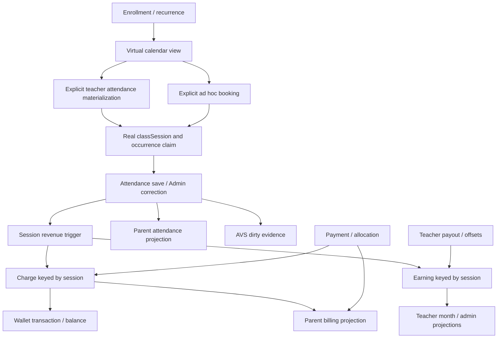

# P01.1-D1 — scheduling, attendance and financial write boundaries (26 November 2026 IST)

**Status:** Scoped source evidence verified; broader P01.1-D and P01.4 IN PROGRESS, not certified. Pinned main 701c7ec832dbe9c531964496fa09cd4a4948ddd2; prior P01.1-C root manifest complete at same revision. Draft PR #933 stacked on #932. No production reads/writes, invocations, credentials, deployments, runtime or Rules changes. Named engineering owner and independent reviewer pending. Source anchors below are relative to functions/src unless otherwise specified; no deployed behavior or race reproduction claimed.

## 1. Operational flow and authority boundaries

Arrows are source-backed dependency direction, not a claim all steps are one transaction. Explicit attendance materialization and ad hoc are distinct commands; the latter uses reservation documents, not necessarily a regular occurrence claim. Admin historical/manual and compatibility paths remain separate and need follow-up tracing.

## 2. Scheduling and attendance commands — direct source evidence

| Command / anchor | Reads / checks | Writes / atomic boundary |
|---|---|---|
| saveRollingEnrollmentSchedule — scheduling/rollingScheduleLifecycle.ts:593–747 | canonical Admin guard; enrollment; valid fee/weekly slots; terminal and recurrence-change restrictions; request key and existing state | Transaction at 618–690 updates enrollment schedule/activation, request key; subsequent enrollment metadata and sync return outside transaction. Retired day-window writer cannot generate sessions |
| setRollingEnrollmentLifecycle — same:820–960 | canonical Admin guard; existing enrollment; operational conflict and reserved child/course slot | transaction 896–956 updates enrollment, operationalEnrollmentKeys reservation set/delete, auditLogs creation. Terminal resume/pause rejected. No automatic precreation |
| ensureTeacherCalendarAttendanceSession — scheduling/teacherCalendarActions.ts:191–281 | users/{uid} teacher role/status; canonical-first assigned teacher; active enrollment, child, existing claim/session/charge/earning; date-only session query cap 250 | transaction 210–279 reuses compatible existing occurrence or creates classSessions and calendarAttendanceClaims. Conflicts/missing referenced session/orphan financial rows fail closed |
| createTeacherCalendarAdHocSession — same:335–463 | 35-minute rule; teacher/student ownership; same day sessions, teacher and child alias queries capped at 251 with fail closed above 250; virtual timetable overlaps; teacher/student day reservation docs; ledger existence | transaction 358–461 creates real session plus both calendarTeacherAdHocDays and calendarStudentAdHocDays reservations; replay returns existing session. Does not bypass regular booking conflict controls |
| saveTeacherSessionProgress — saveTeacherSessionProgress.ts:477,672–834 | current session version; session charge/earning; child occurrence claims; same-day coverage where claims missing; finance conflict conditions | transaction 726–821 updates session, stages students/{kidId}/curriculum and progress topic writes, creates missing claims and correction audit where needed. AVS dirty call occurs after transaction (825 onward) |
| adminAttendanceCorrection — same:875–1205 and 345–470 | legacy caller role resolver, target session, optional AVS fingerprint/case, ledger settlement evidence; session and charge/earning update times | one batch at 1102–1195 for attendance, audit subdoc, eligible unsettled ledger voids (each version-preconditioned), linked AVS resolution/case changes. AVS dirty marking after commit. Settled/conflicting ledger becomes review flag, not silent cash rewrite |
| onSessionComplete — onSessionComplete.ts:467–640,650–740 | manual retry permission, completion status, attendance map consistency, processing/locked/accrued markers | callable writes completion then processing lock/idempotency path. Source-controlled retirement skips decrementing legacy credits (513–522). UI must not independently duplicate completion processing. Revenue trigger handles separate ledger accrual |

**Occurrence identity:** calendarAttendanceClaimId at teacherCalendarActions.ts:134–136 intentionally ignores enrollment ID and derives child + IST date + start time. Do not substitute an enrollment-specific key: re-enrollment must not duplicate historical attendance for same child/time. Source checks 154–187 reject mismatched ownership/course and canceled sessions. Day cap and alias coverage are safeguards, not measurements of production daily volume.

**Permanent retirement:** scheduling/legacy14DayCutover.ts sets both LEGACY_14_DAY_SESSION_WRITES_RETIRED and AUTOMATIC_SESSION_CREATION_RETIRED true. dayWindowTimetableSync.ts:50–52,250–263 explicitly disables automatic session creation. Old code branches remain present; do not revive them as rollback. Current timetable authority is enrollment recurrence; persisted occurrences are explicit authorized actions. onSessionComplete credit decrement branch exists but retired flag short circuits it. Preserve these invariants through P07.

## 3. Financial commands and asynchronous projections

| Command / anchor | Source records and guards | Target / atomic boundary |
|---|---|---|
| onSessionRevenueWrite — sessionRevenue.ts:312–600 | completed + billable attendance; resolve enrollment; service date and immutable financial terms; charge/earning session-key IDs; accrued marker and repair rules | accrual transaction at 359–600 sets session revenue marker, monthly admin revenue rollup, enrollment metrics, billingCharges/{sessionId}, teacherEarnings/{sessionId}; repeated accrued event does not increment twice; missing/unsafe ledger flags review |
| revenue reversal — same:604–707 | reread session; still-billable check; accrued month; existing settlement evidence | separate transaction reverses accrued counters and marks eligible unsettled charge/earning void; settled ledgers protected via repair flag; no direct wallet credit here |
| recordPayment — revenue.ts:1047–1296 | canonical Admin; enrollment, billing charges and deterministic payment ID, idempotent replay checks | transaction at 1087 onward allocates against charge records and writes payment/related updates; keep distinct from wallet receipt route |
| adminReceiveParentPayment — wallet.ts:2531–2734 | canonical Admin; parent charge queries; dryRun branch; required write-mode key; existing payment, wallet and transaction | write-mode transaction at 2645 onward binds receipt/charge allocation and wallet top-up using derived idempotency keys. Dry-run is not production canary approval |
| onBillingChargeWalletSync — wallet.ts:2230–2520 | billing charge event, current live charge and configured eligibility, deduction/reversal cycle keys | asynchronous from accrual; appendWalletTransactionAtomic at 1193–1199 performs transaction for balance + ledger event (1133–1158). Never replace wallet transaction history with balance alone |
| recordTeacherPayout — revenue.ts:1301–1573 | canonical Admin; teacher earnings by period; deterministic payout ID | legacy transaction at 1342, updates earnings and payout doc. Still exported; actual active UI usage not exhaustively verified |
| recordTeacherPayoutV2 — recordTeacherPayoutV2.ts:81–574 | canonical Admin; earningMonthKey and actual paidAt; required idempotency key; earnings, offsets, adjustments, bounded safe ledger coverage | transaction at 144 onward; updates earnings, creates teacherPaymentOffsets at 432 and teacherPayouts at 518; preserve cash date vs service month and noncash offset distinction |
| onTeacherEarningsRollupWrite — teacherEarningsRollupTrigger.ts:173–247 | earning event; no-op predicate; incremental protocol and replay/conflict detection | asynchronous derived teacher earnings/month and adminStats/month; incremental applied/covered/replay handling; conflict falls back to coordinated authoritative recompute. Not an independent Earning authority |
| onBillingChargeReadModelWrite / onPaymentReadModelWrite — parentMonthlyBillingProjectionV2.ts:382–460,467,524 | parent/month target, internal projection, optional wallet/users, source charges | transaction at 393–433 updates parent monthly and internal billing projection; cap overflow falls back to legacy authoritative recompute. No payment allocation authority |
| onClassSessionReadModelWrite — parentMonthlyClassAttendanceProjectionV3.ts:712–813 | affected session and parent/month targets | recomputes parent monthly attendance view; no authoritative attendance write inferred |

### Financial invariants to carry forward

- helpers/sessionFinancialRates.ts:1–6,119–169: financialTermsSnapshotVersion=1, billingRateSnapshot, teacherPayRateSnapshot, financialTermsCurrency; teacher pay decision may legitimately retain school amount rather than pay teacher. Preserve snapshot and rate resolution history; do not re-price sessions using present course rate.
- helpers/attendanceFinancialCycles.ts: one real session, one charge and one earning, original IDs reused on permitted attendance restoration. Cycle 1 uses historical charge_ID/reverse_charge_ID keys; later cycles use _cycle_N. Reopen only eligible attendance-caused voids with matching identities and no settlement evidence. Do not reopen manual voids automatically.
- helpers/attendanceFinanceIdempotency.ts distinguishes replay vs missing ledger vs pre-existing/void conflict. Existing Present with no accrual can legitimately defer to revenue; do not assume Present means charged.
- Settlement evidence includes paid/settled/partial status, positive payment/settlement amounts, allocation arrays and references. Attendance remains correctable without silently modifying cash/payout history.
- Teacher payout V2 distinguishes earning service period from payment date and offsets. Do not combine cash paid and noncash entitlement adjustment in new master records.
- No cross-trigger atomicity: attendance, revenue, wallet and rollup commits are independently observable. Need eventual consistency freshness and replay evidence, not global synchronous transaction assumptions.

## 4. Source field and ownership catalogue expansion

This is a field seed from verified write payloads, not live Firestore type or nullability coverage. No personal values; identifiers/financial details restricted. Do not replace existing Wave 0 owner map or allocate P03 item IDs yet.

| Record / key | Observed source field group | Authority posture |
|---|---|---|
| enrollments/{enrollmentId} | status, schedule activation metadata, lastRequestKey; completedSessionsCount/expectedRevenueAccrued metrics | recurrence/lifecycle authority; financial counters derived |
| classSessions/{sessionId} | enrollmentId, attendance, status, source, revenueAccrued, accruedAmount/accruedMonthKey/accruedAt, attendanceFinanceCycle, financial terms snapshot | occurrence/attendance authority with historical financial snapshot; accrual flags workflow |
| calendarAttendanceClaims/{child-date-time} | sessionId, enrollmentId, childId, date, startTime, source, createdAt | occurrence uniqueness reservation, workflow state |
| calendarTeacherAdHocDays / calendarStudentAdHocDays | reservations, keyed by teacher or child and service day | conflict reservation; preserve dual-resource atomicity |
| classSessions/{sessionId}/attendanceCorrections/{correctionId} | source, sessionId, kidId, correction audit and finance review metadata | immutable historical evidence intent; verify all readers/writers before policy change |
| billingCharges/{sessionId} | sessionId, enrollmentId, kidId, parentId, teacherId, courseId, amount, currency, status, attendanceFinanceCycle, source, monthKey, serviceDate/serviceMonthKey, billingRateSnapshot, version, timestamps | charge history; settlement allocation preserved separately |
| teacherEarnings/{sessionId} | analogous session/identity references, amount/currency/status, financeCycle, source, earnedAt, monthKey, teacherPayRateSnapshot, version, timestamps | earning event history; demo earning IDs separate |
| parentWallets/{parentId} | currentBalance, openingDeficit, totalTopups, totalDeductions, totalAdjustments, status, currency, updatedBy | balance projection tied to immutable wallet events; exact rebuild/legacy opening evidence required |
| parentWallets/{parentId}/transactions/{transactionId} | type, direction, amount/signedAmount, balanceBefore/After, studentId, enrollmentId, classSessionId, billingChargeId, monthKey, method, paidAt, idempotencyKey, sourceSystem, reversalOfTransactionId and audit fields | transaction evidence; preserve deterministic ID normalization (wallet.ts:1021) |
| teacherPayouts / teacherPaymentOffsets | earningMonthKey, paidAt, idempotency and entitlement allocation evidence | payout cash event vs noncash offsets |
| parentMonthlyReadModels / internalBillingProjections / teachers/{id}/earnings/{month} / adminStats | derived bounded operational totals and projections | rebuildable views, not parallel ledgers |

Source anchors: sessionRevenue.ts:489–573; wallet.ts:1116–1158; recordTeacherPayoutV2.ts:431–547; scheduling and attendance sections above.

## 5. Authorization and direct SDK migration hazards

Pinned firestore.rules exact matches: enrollments:1091–1102 admin read/write, scoped parent/teacher/LP reads; classSessions:1113–1130 admin create/update (valid session) and delete, canonical-first teacher get/canonical list, scoped parent/kid reads; billingCharges:1256 and payments:1265 admin client write permitted, scoped parent reads; parentWallets:1274–1286 client writes denied including transactions; parentMonthlyReadModels:1346 admin write permitted, scoped parent read; teacherPayouts:1373 admin write permitted, scoped teacher read; teacherPaymentOffsets:1380 and teacherEarnings:1389 client writes denied. Founder recursive read matches at 361–465 also apply. These are source Rules permissions, not a proof of actual UI use or total access (overlapping rules and Admin SDK bypass must be considered). Direct Admin client-write permission on some financial/attendance resources is a migration dependency, not a confirmed exploit or permission to write.

Current authorization is heterogeneous: rolling lifecycle and payment/payout use ensureCanonicalAdmin; teacherCalendarActions.ts:104–129 reads legacy users role/status + canonical-first enrollment teacher; adminAttendanceCorrection uses resolveCallerRole. Preserve staged identity authority and role/ownership semantics; do not blindly switch. Live M3 ledger rechecked: verification_in_progress, finalExitGate=not_attempted, productionMutationsAuthorized=false.

Selected frontend read evidence: src/pages/teacher/components/today-sessions/AttendanceForm.tsx:189,252 reads enrollment and kid; src/lib/sessionsManagementSnapshot.ts:328–432 calls snapshot/get/refresh date endpoints, not inherently read-only canary; src/pages/admin/teacherPaymentsFinance.ts:98 builds V2 payout request. Actual callsite and direct SDK write inventory is incomplete; do not infer exclusive server writes except where explicit Rules block clients. Next trace real UI callers, compatibility endpoints, admin history/manual sessions, session reconciliation and finance repair flows, then write graph closure. Scope must also include scripts, Storage and scheduled jobs.

## 6. Verification / unresolved gates

- Reviewed actual pinned source and selected exact Rules blocks; identified transaction/batch scopes, separate asynchronous paths, legacy retirement flags and field ownership seed. No tests, emulator, production calls, new CI, or race reproduction.
- Remaining: exhaustive frontend direct writers/readers, alias/repair/maintenance paths, parent payment allocation and offset exact contracts, teacher adjustments/withholding and AVS dirty/repair implementation, all trigger target writes including indirect helpers, source versus live data/metadata and measurements.
- P01.1-D1 verified scoped evidence only; P01.1-D/P01.4 not complete; P01.3 source partial; P01.2/live P01.3 HOLD; P04 M3 HOLD. No architecture decision or cutover approved. Pending PRs remain separate.
- Rollback: close/revert docs-only PR; no data/runtime state to restore. Never re-enable retired materializers as rollback. Actual Git-based deployment impact resolver, current refs and owner approval before merge.
- Next P01.1-D2: trace frontend and admin compatibility/manual/historical/reconciliation writers in scheduling/attendance/finance, classify read vs mutation, resource auth, version/idempotency and overlapping pending PRs. Continue source field catalogue without repeating D1.
