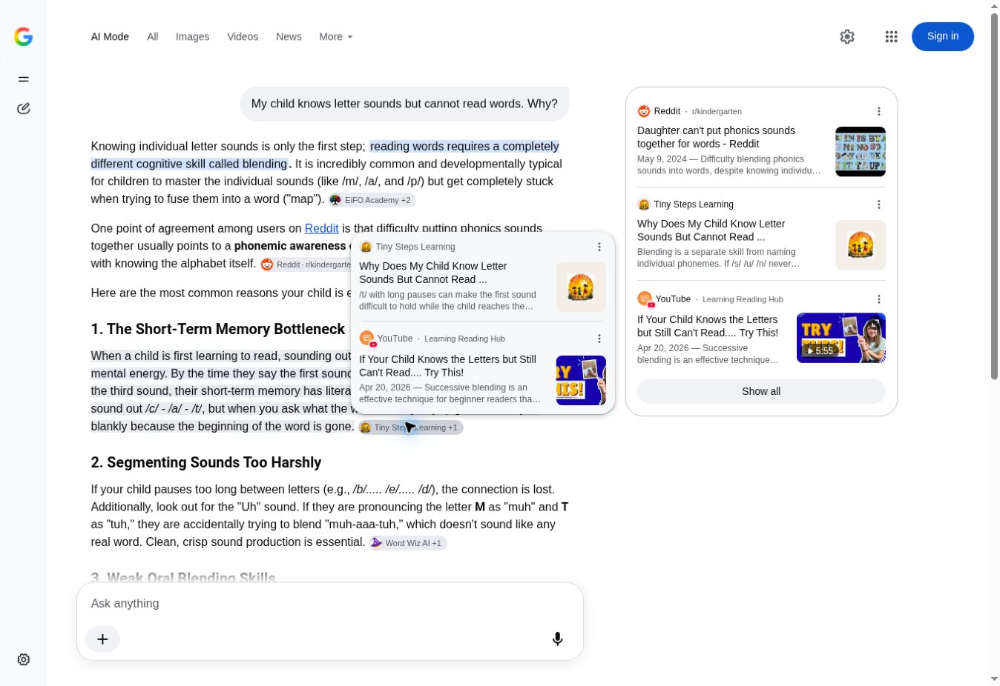

# Tiny Steps: native AI visibility and Search Console evidence audit

**Observed:** 19 October 2026, IST. **Status: completed for accessible native products, with material access and locale limitations.**
**Scope:** production-first read-only research; documentation-only delivery. Tracking: [#748](https://github.com/tinystepselearning-surya/tinysteps-react-v1/issues/748). Google index outcomes remain [#747](https://github.com/tinystepselearning-surya/tinysteps-react-v1/issues/747).

## A. Executive summary

Tiny Steps was selected in genuine Google AI Mode answers. P01 cited the intended letter-sounds article. P08 cited the existing Common Grammar Mistakes guide instead of the benchmark's parent transfer article. P05 cited a TinySteps article republished on Medium rather than the intended site article. These are three distinct source-selection observations, not three exact-owner successes.

There are **36 completed benchmark answers**: 12 ChatGPT Search, 12 Gemini and 12 Google AI Mode. **Perplexity has 12 NOT_TESTED cells** after its guest P01 returned “Sign up and repeat your request.” The remaining eleven prompts were not submitted through that blocked flow. There is no Perplexity citation denominator. An initial incomplete Gemini P08 capture was replaced with a completed fresh retest; the incomplete run is not an additional benchmark success.

No Tiny Steps citation was observed in the ChatGPT or Gemini answers. ChatGPT source-group disclosure was incomplete, so this is a visible-UI observation rather than a guarantee about every grouped source. Gemini had citation controls on P05 and P11; ten responses had no visible citations. Default Gemini Flash-Lite used automatic search/grounding where the product invoked it. Search was not forced by modifying the exact prompts.

The refreshed conventional GSC extraction reproduces 1,033 impressions/9 clicks for the letter-sounds article and 285/5 for one-word answers. It confirms a **17 October** daily row. A through-16-October rerun gives 982/9 and 284/5. The earlier report's date-cutoff narrative is inconsistent with its totals; the 51/1-impression differences are not evidence of improvement after today's edits.

The publishing architecture already provides useful explanations, examples, references and next steps. No new schema framework, AI text directory, programme route or programmatic publishing wave is justified. The smallest possible content batch is a few natural links between existing explanations and worked-example guides, after checking rendered link overlays. No production implementation occurred.

**Material limits:** English UI and exact English prompts were observed; India was requested but actual platform geography was not verified or enforced. All test accounts were signed out, with shared guest cookies. The owner GSC UI was not authenticated. Its Generative AI report and current URL Inspection verdicts could not be read. Direct Tiny Steps origin requests failed through this execution environment; this is not a verified site outage.

## B. Platform visibility comparison

Counts describe the 48 benchmark cells. “Different target” uses the required `TINY_STEPS_CITED_WRONG_URL` enum. It means a URL other than the intended parent owner; a useful supporting guide can still be educationally appropriate. It does **not** mean its canonical tag is wrong.

| Product | Completed answers | Exact owner | Different target | Third-party only* | No citation | NOT_TESTED |
| --- | --- | --- | --- | --- | --- | --- |
| ChatGPT Search | 12 | 0 | 0 | 12 | 0 | 0 |
| Gemini | 12 | 0 | 0 | 2 | 10 | 0 |
| Google AI Mode | 12 | 1 | 2 | 9 | 0 | 0 |
| Perplexity | 0 | 0 | 0 | 0 | 0 | 12 |

*ChatGPT's third-party classification is restricted to observed text, badges and available source dialogs. Some grouped sources and exact destinations were not disclosed. No percentage or universal absence claim is made. Gemini's Medium citation on P05 was not expanded to an exact URL, so it cannot be silently assigned the Medium destination seen independently in AI Mode.

**Session conditions:** cloud Chrome desktop; signed out; fresh conversation/thread for each benchmark question; shared guest browser state; no Tiny Steps name added; no follow-up widget answers supplied. Some generated ChatGPT widgets had preselected example values. Those defaults were not submitted and do not establish the child's age, language or location. ChatGPT's model identity was not disclosed. Gemini displayed Flash-Lite. Google showed the actual AI Mode interface (`udm=50`), not an ordinary results page.

**Evidence:** [48-cell evaluation](EVALUATION_48.csv), native `.json`/`.txt` snapshots and `.jpg` captures under [evidence](evidence/). Times in the matrix are capture times in IST, not invented exact dispatch timestamps. The first ChatGPT snapshot uses the original export's file modification time; its screenshot was not retained as a durable file. Every other completed cell has a saved viewport screenshot. Snapshots preserve the full accessible answer, while viewport images may show only part of it.

## C. Twelve-parent-question scorecard

Legend: **C** exact owner cited; **W** different target; **T** observed third-party sources only; **N** no visible citation; **U** unavailable. The CSV retains the full enum, prompt, timestamp, source names, evidence and limitations for every cell.

| ID | Exact parent question | Intended existing canonical owner | ChatGPT | Gemini | AI Mode | Perplexity |
| --- | --- | --- | --- | --- | --- | --- |
| P01 | My child knows letter sounds but cannot read words. Why? | https://tinystepslearning.com/blog/why-child-knows-letter-sounds-but-cannot-read-words | T | N | C | U |
| P02 | Should my child learn phonics or memorize sight words first? | https://tinystepslearning.com/blog/sight-words-or-phonics-first | T | N | T | U |
| P03 | My child reads words but cannot understand stories. What helps? | https://tinystepslearning.com/blog/why-child-reads-words-but-does-not-understand-story | T | N | T | U |
| P04 | How do I help my child become a fluent reader at home? | https://tinystepslearning.com/blog/how-to-improve-reading-fluency-in-children | T | N | T | U |
| P05 | Are phonics apps enough, or does my child need a teacher? | https://tinystepslearning.com/blog/are-phonics-apps-enough-for-kids | T | T | W | U |
| P06 | At what age should children start phonics? | https://tinystepslearning.com/blog/what-age-to-start-phonics | T | N | T | U |
| P07 | How long should learning phonics usually take? | https://tinystepslearning.com/blog/how-long-does-phonics-take | T | N | T | U |
| P08 | Why does my child know grammar rules but keep making mistakes? | https://tinystepslearning.com/blog/child-knows-grammar-but-makes-mistakes | T | N | W | U |
| P09 | My child understands English but doesn't speak in class. What should I do? | https://tinystepslearning.com/blog/child-understands-english-but-does-not-speak | T | N | T | U |
| P10 | How can I help my child give longer, meaningful answers? | https://tinystepslearning.com/blog/child-gives-one-word-answers | T | N | T | U |
| P11 | Are online phonics classes better than phonics at school? | https://tinystepslearning.com/blog/online-phonics-classes-vs-school | T | T | T | U |
| P12 | How can I identify which phonics skills my child needs help with? | https://tinystepslearning.com/blog/phonics-diagnostics | T | N | T | U |

### Verified Tiny Steps target selection

| Observation | Actual citation destination | Interpretation |
| --- | --- | --- |
| AI Mode P01 | https://tinystepslearning.com/blog/why-child-knows-letter-sounds-but-cannot-read-words | Exact intended parent owner; native citation badge and source card visible. |
| AI Mode P05 | https://medium.com/@tinystepselearning/are-phonics-apps-enough-or-does-a-child-still-need-a-teacher-ef87f4cca41f | TinySteps republication with matching teaching framework and original-site credit; externally hosted, not the intended canonical article. Medium account control and rel=canonical remain unverified. |
| AI Mode P08 | https://tinystepslearning.com/resources/grammar/common-grammar-mistakes-for-kids | Relevant published reference guide; benchmark expects the parent article about transferring known rules. No canonical change is indicated. |

P01 and P08 Google citation redirects were followed to those exact destination URLs. Destination content then encountered an upstream connection failure in this browser. This proves the link target, not successful origin loading. P05 resolved to the Medium URL, where the cloud browser was blocked; a separate web reader retrieved the article with explicit original-site credit. Evidence files record these distinctions.

## D. Google Search Console findings

### Dedicated Generative AI reporting

The inspected Windsor.ai connector exposes Search Analytics, conventional Search Appearance and Sitemaps fields. It exposes no dedicated Generative AI dimensions or measures. Visiting the requested domain-property UI redirected to the public Search Console about page with Start now/sign-in links. **Report availability for this property, selected filters, period, data freshness, page/country/device/date values and export are unverified.** This is not a zero-impressions result.

Google's official announcement names dedicated Search Generative AI reports for Search and Discover, with impressions/pages/countries/dates and Search devices. It states that these impressions also contribute to overall performance. This audit independently read that official page; it did not substitute that announcement for this property's unavailable report. Never add hypothetical AI-feature impressions to conventional totals.

### Conventional Search extraction and reconciliation

Property `sc-domain:tinystepslearning.com`; requested 1–18 October, then 1–17 October and 1–16 October for reconciliation. The connector's `include_fresh_data` option was not enabled (default false). The latest returned date is 17 October; no 18 October date row was returned. Page-grain and date-grain results have different aggregation semantics. Fresh retrieval time does not prove all source data is final. No country, device or query filter was applied. Source dates were preserved; only capture timestamps were converted to IST.

| ID | Clicks | Impressions through Oct 17 | CTR | Average position | Through Oct 16 impressions |
| --- | --- | --- | --- | --- | --- |
| P01 | 9 | 1033 | 0.87% | 6.1578 | 982 |
| P02 | 0 | 16 | 0.00% | 8.125 | 15 |
| P03 | 0 | 12 | 0.00% | 6.25 | 12 |
| P04 | 0 | 12 | 0.00% | 11.5 | 12 |
| P05 | 0 | 10 | 0.00% | 7.3 | 10 |
| P06 | 0 | 73 | 0.00% | 8.9041 | 70 |
| P07 | 0 | 33 | 0.00% | 7.2424 | 30 |
| P08 | 0 | 22 | 0.00% | 6.1818 | 21 |
| P09 | 0 | 5 | 0.00% | 5.6 | 5 |
| P10 | 5 | 285 | 1.75% | 5.4386 | 284 |
| P11 | — | No returned row | — | — | — |
| P12 | — | No returned row | — | — | — |

P01's 51 impressions on 17 October and P10's one impression reconcile the period difference exactly. No added clicks occurred for those two pages that day. The earlier aggregate totals remain valid, but their supposed through-16 date interpretation does not. Do not label unchanged through-17 totals as current uplift, or attribute them to E3 content edits merged on 19 October.

### All 85 governed knowledge guides

The source registries were imported directly and reconciled to 31 phonics, 38 grammar and 16 vocabulary paths. Exact canonical URL matching avoids adding hubs, fragments, aliases or blog-owned Speaking guides to this denominator.

| Family | Governed URLs | Returned rows | No returned row | Clicks on returned exact URLs | Impressions on returned exact URLs |
| --- | --- | --- | --- | --- | --- |
| phonics | 31 | 11 | 20 | 19 | 2451 |
| grammar | 38 | 32 | 6 | 307 | 25198 |
| vocabulary | 16 | 15 | 1 | 98 | 10040 |
| Total | 85 | 58 | 27 | 424 | 37689 |

These are page-cohort sums, not unique searchers or site-level total impressions. Missing rows remain blank, not zero. [The 85-row CSV](data/GSC_GOVERNED_85.csv) names every missing URL. Existing #747 priorities include `magic-e-phonics` and `simple-past-tense-for-kids`; both had no returned row here.

Observed opportunities deserve investigation, not immediate rewrites. Nouns had 2,669 impressions/12 clicks; its query “nouns for kids” had 343 impressions/2 clicks. Verbs had 2,406/13; “verbs for kids” had 370/4. Synonyms/antonyms had 1,814/4; “synonym definition for kids” had 92 impressions/no returned clicks. Those are candidate snippet/intent reviews. Positions, differing intent, answer satisfaction and feature mix can influence CTR; low CTR alone proves no defect.

The two strongest parent pages have extremely sparse returned query evidence: P01 has seven query rows, each with one impression; P10 has one query row, a site-restricted query. Those do not reproduce their page totals and do not establish the exact parent phrases responsible for the remaining impressions. The saved cohort query export contains 1,452 returned page/query rows across the 97 requested URLs; it remains incomplete as a demand census.

### Indexing categories

- **Technically indexable:** inherited E1/E2 production evidence for the 168-page cohort, scoped to that run and its checks. Not independently re-certified here.
- **Google-confirmed indexed in current URL Inspection:** none inspected in this run. Do not infer it from impressions or AI Mode citations.
- **Google-confirmed not indexed in current URL Inspection:** none inspected in this run. Historical Soft 404 reports are not today's verdict.
- **Unverified current indexed view:** all 12 parent owners and 85 governed guides. P11/P12 and 27 guide URLs with no returned rows are priorities for evidence gathering, not presumed failures.

No indexing requests, speculative canonical edits or mass submissions occurred. Unresolved indexed-view questions stay with #747.

## E. Cited-source and educational comparison

The CSV and raw native snapshots identify observed sources for every completed query. Unexpanded grouped citations remain explicitly unresolved. Source inclusion is observed; the reason a model selected it is unknown.

| Question | Examples actually shown in native answers | Comparison supported by evidence |
| --- | --- | --- |
| P01 | ChatGPT: IES / Indian Pediatrics badges. AI Mode: Tiny Steps, EiFO Academy, Reddit, Word Wiz AI, Wonster Words and YouTube. | Tiny Steps source already supplies clean sound production, oral/printed blending, fresh-word transfer and professional-review boundaries. No extra blending article is needed. |
| P02 | ChatGPT: NICHD. AI Mode: PRIDE Reading Program, Learn2Read, YouTube Parent Teacher Bridge, Lisa Adele, Reddit. | Tiny Steps distinguishes sight recognition, frequency and exception spellings. UFLI supports teaching decodable parts and the irregular part. Do not adopt the AI answer’s simplistic hemisphere narrative. |
| P03 | ChatGPT: EEF. AI Mode: Readability, Feller School, Understood, LearningRx, Reddit, Facebook/YouTube. | Tiny Steps distinguishes word accuracy, language knowledge, listening comprehension and response formulation. This is more appropriately bounded than assigning hyperlexia from one parent question. |
| P04 | ChatGPT: NICHD / Dyslexia Help. AI Mode: Reading Rockets, Understood, NWEA, Reading Eggs, 95 Percent Group and others. | Native guidance offers accessible modelling and rereading. Tiny Steps already includes these plus fresh-text transfer and speed-only cautions. Reading Rockets browser/reader access was blocked, so a full original-page comparison is not claimed. |
| P05 | Gemini: Wonster Words, Juneberry Learning, Reddit, Medium. AI Mode: Medium Tinysteps, Wonster Words, getsuperteacher.com, Reddit. | Retrieved Medium content uses the same teach/observe/adapt/practise framework and links to Tiny Steps. A site-versus-republication source choice is demonstrated; superior competitor pedagogy is not. Gemini’s exact Medium target is unknown. |
| P06 | ChatGPT: Reading Rockets. AI Mode: Phonics.org, MindChamps, Learn2Read, Lil Legends Books and others. | Tiny Steps source separates age examples from readiness and taught knowledge. Do not turn generic grade bands into Indian placement criteria. |
| P07 | ChatGPT: NICHD and EEF source dialog. AI Mode: Klariti Learning, Lil Legends Books, Shanahan on Literacy, Lisa Adele and others. | Tiny Steps already distinguishes skill acquisition, programme coverage and fluent reading. Unsupported duration tables in generated answers should not become guarantees. |
| P08 | ChatGPT: PubMed and ScienceDirect. AI Mode: Tiny Steps grammar guide, UsingEnglish, MPI for Psycholinguistics, Quora and others. | The cited Tiny Steps guide has error families, worked corrections and fresh-sentence checks. A contextual bridge to the parent transfer article is useful; changing either canonical is not. |
| P09 | ChatGPT: ASHA and NHS. AI Mode: Homeschool Languages, multilingual/teaching YouTube sources, Van Buren ISD and others. | ASHA explains selective mutism is not a voluntary choice and requires contextual evaluation. Tiny Steps already avoids clinical diagnosis. AI Mode’s blanket temporary-phase reassurance and Gemini’s chooses-to-stay-silent wording need caution. |
| P10 | ChatGPT: NAEYC, PMC, NCBI Bookshelf. AI Mode: SaLT by the Sea, National Fragile X Foundation, The 74 and others. | NAEYC provides concrete everyday questions, responsive wait time and a named author. Tiny Steps already has relevant modelling, prompt fading and independent elaboration. Concise worked examples are a presentation strength, not proof of ranking causality. |
| P11 | ChatGPT: NICHD, DOI, PMC, EEF. Gemini: Jolly Reading, Phonics.org. AI Mode: Little Genius Academy, Outschool, Phoenix Classes, Shanahan and others. | Tiny Steps has an impartial school-versus-online decision and advises against unnecessary tuition. Gemini/AI Mode generalisations about classroom pace and replayable live lessons should not be copied. |
| P12 | ChatGPT: Reading Rockets. AI Mode: Learning at the Primary Pond, Science of Reading Formula, Brain Friendly Reading, Reading Rockets. | Tiny Steps checklist limits samples to taught patterns and distinguishes editorial observations from formal benchmarks. AI answers’ broad inventories or truest-test language are less carefully bounded. |

### Original sources read for comparison

- [NAEYC: Asking Questions to Stretch Your Child’s Thinking](https://www.naeyc.org/resources/pubs/tyc/spring2024/message-in-a-backpack): named author Janis Strasser, practical routine-specific examples, adaptable waiting and listening. This is directly useful parent guidance. It does not explain why ChatGPT selected the source.
- [ASHA: Selective Mutism](https://www.asha.org/practice-portal/clinical-topics/selective-mutism/): professional scope, diagnostic boundaries, language/context considerations and references. Tiny Steps should link to this role of specialist guidance, not duplicate a clinical service.
- [UFLI: Irregular and High Frequency Words](https://ufli.education.ufl.edu/resources/teaching-resources/instructional-activities/irregular-and-high-frequency-words/): direct teaching examples/resources and distinction between permanent and temporary irregularity. Read as verification of P02/P04 pedagogy; it was not independently observed as a named native citation in this sample.
- [Medium TinySteps P05 article](https://medium.com/@tinystepselearning/are-phonics-apps-enough-or-does-a-child-still-need-a-teacher-ef87f4cca41f): matching framework and explicit original-site credit. Attribution supports identifying this as republished TinySteps material, but authenticated account ownership and Medium canonical metadata were not verified. The visible original-publication credit links to the site homepage, not by itself proof of article canonical metadata.

The cloud browser could not load Reading Rockets or Medium content because of site security screens. It also could not fetch Tiny Steps origin content. These restrictions are documented separately from the successful native answer UIs. Relevant guidance: [When a website blocks the task](https://help.openai.com/articles/20001280-using-cloud-browser-in-chatgpt#when-a-website-blocks-the-task).

## F. Technical and educational improvement opportunities

**No reproduced P0 issue or app-level P1 failure was found.** P1 below means important missing measurement, not a new production incident. The [action register](ACTION_REGISTER.csv) includes exact URLs, evidence, acceptance criteria, risk, owner and parent benefit.

| ID | Priority | Finding | Recommended next action |
| --- | --- | --- | --- |
| N01 | P1 | Dedicated Generative AI report and current indexed-view evidence could not be accessed. | Read authenticated GSC Generative AI Search report, record filters/date freshness and export pages/dates/countries/devices. Inspect priority exclusions through #747. |
| N02 | P1 | Perplexity guest P01 requires sign-up; no usable answer or citations. | Complete the same 12 exact prompts in a supported authenticated native session when available. Retain NOT_TESTED until real results exist. |
| N03 | P2 | AI Mode cited a Medium TinySteps republication instead of the intended site article. | Confirm control of the Medium account and inspect its canonical metadata/import settings plus the original-article attribution destination. Preserve the primary site owner. Change only a demonstrated syndication defect in a separately authorised task. |
| N04 | P2 | AI Mode selected the relevant error-family guide. Its relatedPaths do not point to the parent transfer article; the parent source has no direct contextual link to this guide. | After built/live link check, consider one natural parent-to-guide link at the correction routine and a return link where the guide discusses independent transfer. Keep both distinct intents and canonicals. |
| N05 | P2 | The comprehension article explains vocabulary/inference. An existing context-clues guide supplies worked evidence-based examples but is not linked within the article body. | After checking built/live overlays, consider one link from the vocabulary/inference discussion to the existing context-clues guide. Explicitly distinguish inferring word meaning from guessing printed words. |
| N06 | P2 | Native answers include overbroad neurological/clinical claims, false reassurance and poorly bounded home checks. | Keep Tiny Steps existing distinctions and professional-review boundaries. Include these errors in the next native quality check. Revise local content only if academic review demonstrates the same error locally. |
| N07 | P2 | 58/85 exact guide URLs returned rows. No returned row is not an index verdict. Definition queries show demand but do not establish a content defect. | Inspect indexing for the #747 overlap first, then review actual snippets/query intent for nouns, verbs and vocabulary definitions before any CTR experiment. Keep query/page totals separate. |

### Existing programmatic engine

Current source import assertions preserve 31 published phonics guides, 38 grammar guides (32 core plus six reference extensions) and 16 vocabulary guides. The answer-layer registry separates parent concerns, learning concepts and practice actions. Speaking continues to use its existing blog owners. No new Speaking child-route family is needed.

The grammar guide selected by AI Mode is already useful: Find → Name the family → Fix → Prove with a fresh example. The existing vocabulary context-clues guide models strong versus weak evidence and permits not-enough-information answers. These are appropriate destinations for narrowly placed contextual links, conditional on rendered-page checking. They should not displace the parent-question owners.

Source strings containing Blog 43/51/38 or Blog #6 are not sufficient evidence of visible leakage: `applyBlogEditorialCleanup` removes numbering in the article pipeline. Retrieved public comprehension text confirms a cleaned heading. Direct origin access was unavailable, and no new live numbering defect is asserted. Repeating the earlier three-label cleanup as a broad rewrite would not be justified.

### Focused review of all twelve source articles

[Educational source review CSV](data/EDUCATIONAL_SOURCE_REVIEW.csv) records the meaning/why, observable signs, practical activity, progress signal, professional boundary and next existing resource for each article. All twelve provide substantial intent-specific explanations and usable next steps in current source. P02's conceptual comparison does not require a clinical referral section simply to satisfy a mechanical seven-field checklist.

Verified strengths include fresh-word transfer rather than rehearsed lists, comprehension beyond decoding, fluency beyond speed, grammar in new contexts, meaningful spoken detail rather than forced length, multilingual context and impartial class recommendations. Named author Priya and academic responsibility appear in retrieved public article text. Qualifications, actual expert review records and all external-reference claim mappings were not independently substantiated. This is an auditor's source review, not a qualified academic or clinical sign-off.

Several generated native answers are less carefully bounded than the existing Tiny Steps source. The appropriate response is to preserve or improve truthful teaching guidance, not imitate those answers to chase citations. No fabricated studies, reviewer credentials, outcomes, modification dates or guarantees should be added.

## G. Smallest safe implementation recommendation

**No code, schema, canonical, robots, sitemap, machine-index or content-rewrite batch is justified by this native sample.** The previous E1/E2 architecture remains the technical baseline, subject to current access limits.

If a separately authorised editorial implementation is desired, first inspect built and current rendered HTML for N04/N05. At most, add one parent-article-to-worked-guide link for grammar transfer and one for vocabulary/comprehension, with a return-to-parent link only where it clearly helps. Verify existing dynamic handoffs before adding duplicates. Preserve all headings, authorship, dates, canonical ownership and programme routes unless a separate demonstrated defect warrants a change. Run the relevant build/SEO/link checks and inspect the resulting HTML for that later batch.

For N03, inspect actual syndication metadata before choosing an action. A Medium citation is useful brand discovery, and a supporting grammar guide is a relevant source. Neither observation authorises removing a page or changing the site’s canonical. The research PR contains documentation and captured evidence only and must remain unmerged under this brief.

## H. Limitations and next measurement baseline

1. Perplexity: one guest access attempt, no usable answer, twelve NOT_TESTED benchmark cells. Sign-in is restricted in this cloud browser. No workaround or repeated blocked submissions were attempted.
2. GSC: conventional source verified through Windsor.ai; owner UI unauthenticated. Dedicated Generative AI report, current indexed view, selected canonical, crawl timestamps and rendered Live Test evidence remain unavailable. No zero-AI or all-indexed claim.
3. Locale: English observed, actual country unverified. Results cannot be represented as a controlled India sample. Fresh chats do not eliminate cookie, language, location, time or model effects.
4. Native citations: source panels are not uniformly complete. ChatGPT grouped secondary URLs and Gemini source destinations were not all resolved. Third-party-only counts refer to the visible tested answers. Do not infer permanent exclusion from twelve observations.
5. Evidence: capture times rather than fabricated dispatch times; P01 ChatGPT retained as accessible text without durable screenshot. Viewport images are partial views, supplemented by full accessible snapshots. Guest conversations may not reopen later; local evidence is the durable record.
6. Production access: one direct origin attempt returned a 503 Envoy upstream connection failure and browser destination loads also failed. The inherited successful CI run is separate evidence. This execution limitation does not prove a site-wide outage or bot block.
7. Review depth: all twelve source articles reviewed; architecture and the 85-path registry reconciled. This is not a new full academic review of every governed guide, credential verification or an exhaustive backlink/competitor study. Referral traffic and enquiries were not available.

**Next baseline:** repeat the same twelve exact prompts in supported signed-in products with observed India/English conditions, record model/mode, current date, complete source dialogs and captures. Keep this guest sample separate from that controlled sample. Obtain the authenticated GSC Generative AI export, and inspect #747's priority pages before expanding exclusions. Compare conventional search over equal completed periods, preserve sparse query limits, and measure educational usefulness alongside exact-owner citation selection. No automatic schedule was created.

### Baseline repository review and provenance

The six requested records were reviewed: `READINESS_AND_EXECUTION_2026-10-19.md`, `E1E2_LIVE_168_URL_AUDIT_2026-10-19.md`, `E3_PARENT_EDUCATIONAL_REVIEW_AND_E4_NATIVE_EVALUATION_2026-10-19.md`, `E4_FIRST_PARTY_GSC_AND_DISCOVERY_BASELINE_2026-10-19.md`, `E4_NATIVE_12x4_SESSION_MATRIX_2026-10-19.csv` and `visibility-17-audits/COMPREHENSIVE_FINDINGS.md` (blob `14737586ff1c92c9f2b380861c2f393a3325f226`). The consolidated register describes historic audit queues and is not a substitute for later live results.

PR #750 is merged as `6a01fa0c46316bcc01f39d23ec2a2be01fd8dbe5` (read-only E1/E2 audit). #751 is merged as `43a213cc40b0a2db201df1c72014aa8e671cc2e5` (three editorial changes). #753 is merged as `d2e1903aea27fda729ad57f44979193195ca3215` (first-party baseline/matrix and rollout witness). PR metadata and diffs were read. #747 and #748 remain open in the retrieved issue state. Current source review is pinned to `21a0e124393f6bdc9046eae65c8283880c08a250`.

Inherited E1/E2 evidence: [CI 39204076223](https://github.com/tinystepselearning-surya/tinysteps-react-v1/actions/runs/39204076223) tested 168 unique pages, with no reported flags. The recorded E3 deployment witness [CI 39228607145](https://github.com/tinystepselearning-surya/tinysteps-react-v1/actions/runs/39228607145) observed the three updated pages. These are prior dated records, not newly executed checks in this audit.

Official requirements independently retrieved: [Google AI features](https://developers.google.com/search/docs/appearance/ai-features) and [Google Generative AI reporting announcement](https://developers.google.com/search/blog/2026/06/gen-ai-performance-reports). Helpful textual content, index/snippet eligibility, internal discovery and accurate structured data matter; optional AI directories and crawler permission do not guarantee source selection.

See [evidence index](EVIDENCE_INDEX.md), [data request metadata](data/REQUESTS_AND_LIMITATIONS.json), [priority GSC export](data/GSC_PRIORITY_12.csv), [governed-guide export](data/GSC_GOVERNED_85.csv) and [returned query export](data/GSC_COHORT_RETURNED_QUERIES.csv).
